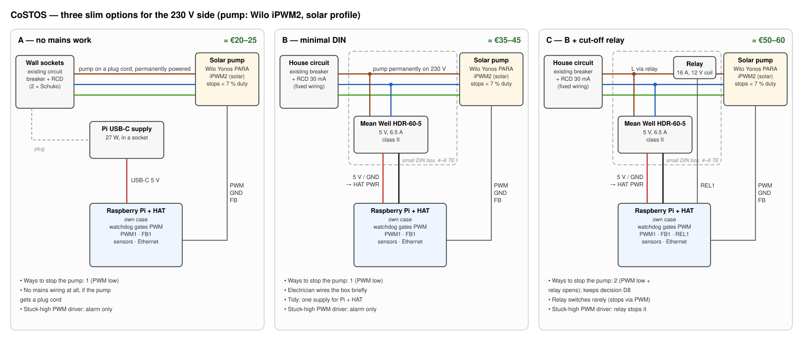

# CoSTOS architecture

Status: **draft for discussion**. Implementation has started with milestone 1 (section 10): `costos-core` (types, ΔT control) and `costos-safety` (solar pump supervisor); everything else is still a plan.

CoSTOS is an open-source controller for solar thermal systems. It runs on a
Raspberry Pi 4 or 5 (a Pi 3 B / B+ should work too), is written in
Rust, and is meant to **replace** a commercial controller. The reference
system is the one it replaces: a RESOL DeltaSol BX Plus that is read today by
[vbus2influx](https://github.com/isarrider/vbus2influx).

This document covers what CoSTOS has to do, how the hardware and software are
split up, how safety works, and how to move from the RESOL controller to
CoSTOS without risking the system.

---

## 1. Goals and non-goals

### Goals

- Take over everything the DeltaSol BX Plus does in this installation: ΔT
  pump control with speed control, store limits, collector protection
  functions and heat quantity metering.
- Be **fail-safe**. A software crash, hang, power loss or sensor fault must
  never leave a pump running or switched off in a dangerous state.
- Keep the control logic **pure and testable**: no I/O in the control code,
  so it can run against a simulator, against recorded data and in CI.
- Be **observable**: every input, decision and output is pushed to
  **VictoriaMetrics** once per second, and buffered locally while the
  database is unreachable, so no data is lost (section 6.5). The HTTP API
  and, optionally, MQTT expose the live state too.
- Make **everything configurable in the web interface**: status, sensors,
  outputs, control functions, integrations and users. No config files to
  edit by hand. Sensors, outputs and functions are wired up in config, not
  in code, and the web interface is the editor for that config (section 7).

### Non-goals (for now)

- Space-heating circuits, mixers, heat pump or boiler demand. The BX Plus
  can do these. CoSTOS starts with the solar side only.
- A display and buttons on the device (general rule). The UI is a web
  page, plus (optional) Home Assistant over MQTT; the device itself only
  has status LEDs: power, watchdog, pump and relay, all hardware-driven
  (HAT-1wire 4.8).
- Wi-Fi (general rule). CoSTOS connects over **wired Ethernet**; whatever
  platform it runs on must have an Ethernet port.
- Certification. CoSTOS is a hobby project. Mains wiring is done by a
  qualified electrician, and the hardware safety devices described in
  section 4 are not optional.

---

## 2. What the controller replaces

The DeltaSol BX Plus has 8 Pt1000/Pt500/KTY sensor inputs (plus one impulse
input for a V40 flowmeter), 4 semiconductor relays for speed control, 1
potential-free relay and 2 PWM outputs (512 Hz, about 11 V, switchable to
0–10 V).

The vbus2influx data shows which of these are used here. Before
implementation starts, that list has to be written down in
[`docs/installation.md`](installation.md) (started, still incomplete): sensor
positions (collector, store bottom, store top, return, …), which relay
drives which pump or valve, and the pump models and their PWM profiles.
This is the **acceptance spec**. CoSTOS is done when it reproduces the BX
Plus behaviour for this installation.

---

## 3. System overview

```
             ┌──────────────────── Raspberry Pi 3 / 4 / 5 ──────────────────────────┐
             │                                                                      │
 Pt1000 ───► │  sensors task ──► ┌──────────────┐    ┌──────────────┐               │
 sensors     │  (SPI / I²C)      │ control core │──► │  safety      │──► outputs ───┼──► PWM (watchdog-gated) ──► HE pump (230 V permanent)
             │                   │ (pure Rust)  │    │  supervisor  │    task       ├──► optional relay ──► cut-off relay, valve
 V40 pulses ►│  pulse counter ─► └──────────────┘    └──────────────┘               │
             │                          │                    │                     │
             │                          ▼                    ▼                     │
             │                    state + events ───► telemetry: VictoriaMetrics / MQTT / HTTP
             │                                                                      │
             │  systemd watchdog ◄── heartbeat           hardware watchdog (/dev/watchdog)
             └──────────────────────────────────────────────────────────────────────┘
                     │
                     └── outside the SBC: independent overtemperature cut-out,
                         relay outputs default to OFF without a heartbeat
```

The control loop runs at **1 Hz**. Solar thermal systems are slow, so 1 Hz
is plenty, and a fixed rate keeps timing behaviour easy to reason about.

---

## 4. Safety

Safety comes in layers. Each layer assumes the one above it can fail.

### 4.1 Hardware layer (independent of software)

| Measure | Why |
|---|---|
| **Outputs default to OFF**: relay/SSR boards that switch off when the GPIO floats, plus pull-downs; PWM outputs pulled low (= stop for solar-profile pumps) | A booting, crashed or unpowered SBC must not switch pumps on. With a permanently powered solar pump (5.6 option A) the PWM line is the only stop path, so it is gated by the external watchdog too. |
| **Output enable via an external watchdog**: a charge pump into a capacitor (the HAT's choice, D24) or a retriggerable monostable, which only enables the output stage while the SBC toggles a heartbeat GPIO | Covers a hung kernel or a GPIO stuck high, which the internal watchdog can miss. |
| **SoC hardware watchdog** (`/dev/watchdog`) | Reboots a hung system. |
| **Independent overtemperature cut-out** on the store (capillary thermostat in series with the solar pump) | Last line of defence that does not depend on CoSTOS at all. Many systems already have one. Check. |
| **Manual changeover switch** RESOL ↔ CoSTOS per output (during migration) | Lets you fall back to the RESOL controller in seconds. See section 9. |

### 4.2 Software layer

The **safety supervisor** is a separate module that sits between the
control core and the outputs. It can only **reduce** what the core asks for
(force OFF, cap speed). It can never switch something on. It enforces:

- **Unknown sensor → safe state**: a sensor without a valid value counts
  as *unknown*, never as "cold", and the outputs that depend on it go to
  their safe state.
- **Emergency store shutdown** (95 °C, configurable only lower), checked
  against the hottest store sensor.
- **Collector emergency shutdown**: at about 130 °C (configurable only
  lower) the solar pump is forced OFF. Pumping into a stagnating
  collector can flash the fluid to steam and damage the system. This is
  the main case where "pump ON" is the dangerous state, which is why the
  safe state is defined per output and not as "everything off".
- Both emergencies **latch** and release only after cooling by a
  hysteresis (10 K by default). **After a start or restart of the
  daemon both start latched**, and a cool system releases them in the
  first cycle. So a restart while the collector is still cooling down
  from stagnation (inside the hysteresis band) can't restart the pump
  early, without having to store the latch on disk.
- **Output-specific safe states** from config (normally OFF).
- **Minimum off time** and **switching rate limits**, to protect relays
  and pumps.

Not everything that protects the system can sit in the supervisor,
because it may only switch off. Who does what:

| Protection | Where | Why there |
|---|---|---|
| Open, short, CRC error, power-on value, stale, jump (5.1) | Hardware layer (`costos-hw-linux`) and daemon | Only they see the chip's fault bits and the reading times; they hand the core a fault instead of a value |
| Plausible range per sensor role (6.1 rule 18) | Core (`PlausibleRange`), applied before any function sees a reading | One place, the same for control and supervisor |
| Unknown sensor → off | Control functions **and** supervisor | Defence in depth: either one alone stops the pump |
| Store maximum (60–85 °C) | Control function (6.2) | Stops *loading*; an ordinary limit, not an emergency |
| Store and collector emergency | Supervisor | Must hold whatever the control logic does |
| Minimum **run** time | Control function | Keeping a pump *on* is not a reduction, so the supervisor can't enforce it |
| Minimum **off** time, switching rate | Supervisor | Holding a pump *off* is a reduction |
| Process hangs or crashes | Hardware watchdog on the HAT (4.1) | Software can't protect against itself |

If the supervisor itself panics, the process exits, the heartbeat stops and
the hardware layer turns everything off.

**Heartbeat for the HAT's watchdog** ([HAT-1wire 4.6](HAT-1wire.md#46-hardware-watchdog),
D24): a small task toggles GPIO 24 every 25 ms (about 20 Hz), but only
while the last control cycle (sensors read, decision made, outputs
written) succeeded less than about 1 s ago. So a hung control loop stops
the heartbeat even when the rest of the process still runs, and a crash
stops it anyway. The HAT's capacitor watchdog only stays charged by a
heartbeat between about 0.5 Hz and 1 kHz: a pin that is stuck, toggled
too slowly, or toggled in a fast loop does not count. Hardware PWM must
never drive the heartbeat, because it keeps running when the software
hangs. Linux stalls of up to about 5 s do not trip it; after the
heartbeat stops, the outputs go off within about 5–14 s, which is enough
because the watchdog only ever switches off.

### 4.3 Process layer

- systemd service with `WatchdogSec=`. The main loop calls `sd_notify` only
  after a complete control cycle has succeeded (sensors read → decision →
  outputs written).
- `panic = "abort"` in release builds, so a panic in any task ends the
  process, and systemd and the watchdog take over.
- On start, outputs stay OFF until a full set of valid sensor readings is
  available.

---

## 5. Hardware

### 5.1 Temperature measurement

Two sensor types are supported, and can be mixed freely: **Pt1000** (the
existing RESOL sensors) and **DS18x20** 1-Wire sensors. Both implement the
same `TemperatureInput` trait, so the control core doesn't know or care
which type a reading came from. A reading is always `Ok(°C)` or a typed
fault (`OpenCircuit`, `ShortCircuit`, `OutOfRange`, `Stale`, `CrcError`,
`Missing`, …), never a magic number.

| | Pt1000 | DS18x20 |
|---|---|---|
| Principle | Platinum resistor, 1000 Ω at 0 °C, +3.85 Ω/K | Digital sensor with its own ADC, 1-Wire bus |
| Range | −50 … +250 °C in practice (sensor and cable decide) | **−55 … +125 °C** |
| Use for | **Collector** (stagnation can exceed 200 °C), anything hot | Store, return, heating circuits, room, outdoor |
| Wiring | One input (2 wires) per sensor | Many sensors on one bus (3 wires), each with a unique 64-bit ID |
| Interface | LTC2983 (up to 9 sensors per chip) or MAX31865 (one per sensor), on SPI | Kernel `w1` bus via GPIO, or a DS2482 I²C bridge |
| Identification | By input number | By ROM ID, found with a bus scan |

The controller enforces the range: a function role has a maximum expected
temperature (the collector up to 250 °C, for example), and the web interface
refuses to assign a sensor whose range is too small for that role. A
DS18x20 can't be the collector sensor.

#### Pt1000

Existing Pt1000 sensors (from a commercial controller such as the RESOL)
are reused as they are.

- **Recommended: LTC2983** multi-sensor temperature measurement chip, on
  SPI (used on the HAT's PT edition). Up to 9 independent 2-wire Pt1000s
  per chip: each sensor uses two of its 20 inputs, and one shared 0.1 %
  sense resistor serves all of them, measured ratiometrically. It
  generates the excitation current, linearises Pt1000 itself, reports °C
  and a fault code per sensor (open, short, out of range), and its
  buffered inputs take series protection resistors without distorting the
  reading. The "18 RTDs in a series stack" wiring from Analog Devices'
  design note is not used: one broken cable would stop every sensor.
- **For a single Pt1000: MAX31865** RTD-to-digital converter (the
  collector input of the HAT's 1-Wire edition, or a breakout board on the
  bench). It measures ratiometrically against a reference resistor (430 Ω
  for Pt100 boards, **4.3 kΩ for Pt1000**, so check the board), has
  built-in open/short detection and ±45 V inputs, and is cheap. One chip
  select per channel.
- Considered and documented as alternatives: 8 × MAX31865 behind a
  chip-select decoder, and multi-channel ADCs (2 × ADS124S08, 2 ×
  AD7124-8), where fault detection, linearisation and input protection
  are left to the board and the software. Comparison:
  [HAT-development.md 4](HAT-development.md#4-pt-edition-choice-of-measuring-chip-d13).
- Collector sensor cables are long and outdoors, so add surge protection on
  that input (RESOL sells an SP10 for exactly this).
- Calibration: a per-channel offset in config, checked against the RESOL
  readings during shadow mode (section 9). With 2-wire sensors the cable
  resistance adds to the reading (roughly 0.25 K for 20 m of 0.75 mm²), and
  the offset compensates for that.
- Faults: the LTC2983 and the MAX31865 both detect open and short
  circuits directly. Values outside the plausible range count as faults
  too.

#### DS18x20 (1-Wire)

- **Supported chips**: the whole family — DS18S20/DS1820 (9-bit, family
  code `10`), DS18B20 (9–12-bit, `28`) and DS1822 (`22`). The family code
  in the ROM ID tells the driver which chip it is talking to.
- **Bus master**, choose one per bus:
  - **Kernel `w1-gpio`** on a GPIO pin with a 4.7 kΩ pull-up
    (`dtoverlay=w1-gpio`). Simple, no extra chip. CoSTOS reads `/sys/bus/w1/devices/<id>/temperature`.
  - **DS2482-100/-800** I²C-to-1-Wire bridge (1 or 8 buses). Active pull-up
    and proper timing in hardware, so it copes much better with long cables
    and many sensors. Recommended for anything beyond a few metres. CoSTOS
    talks to it directly over `/dev/i2c-N`.
- **Powered mode only** (VDD connected). Parasite power is not supported:
  it is unreliable at high temperatures and with several sensors converting
  at once.
- **Timing**: a 12-bit conversion takes up to 750 ms per sensor. Sensors
  are read in a separate task with **one simultaneous conversion for all
  sensors on a bus** ("Convert T" to all, wait once, then read each), so
  the whole bus refreshes about once per second regardless of the number of
  sensors. 11-bit (0.125 K, 375 ms) is the default; that is more than
  precise enough and halves the conversion time. The control loop uses the
  latest reading, and a reading older than a few seconds counts as `Stale`.
- **Faults** specific to 1-Wire, all treated as sensor faults:
  - CRC error on the scratchpad (one retry, then fault).
  - Sensor missing from the bus (cable, connector).
  - **85.0 °C power-on value**: the DS18x20 reports exactly 85 °C if it was
    reset and never converted (typically a power glitch). CoSTOS checks the
    scratchpad state and treats this reading as a fault instead of a real
    85 °C. This matters, because 85 °C is a realistic store temperature.
  - −127 °C / all bits set: bus read failure.
  - Implausible jump between two readings (faster than the water can
    change temperature): treated like a CRC error.
- **Every glitch is counted**, per sensor and kind
  (`costos_sensor_errors_total{sensor="…",kind="crc|missing|power_on|read|jump"}`
  in VictoriaMetrics, and a counter per sensor on the Hardware page). A
  retried glitch is invisible to the control loop, but a rising counter
  shows a marginal cable or connector long before the sensor fails.
- **Topology**: one line per bus (daisy chain), not a star of separate
  cables per sensor; stubs to each sensor kept short.
- Clone chips are common and sometimes behave differently (conversion
  time, power-on value). The bus scan shows the chip type, and the driver
  is tested against a few known clones.

### 5.2 Switching outputs

- **High-efficiency PWM pumps stay permanently on 230 V** and are switched
  over PWM only (5.6). Relays are optional: a cut-off relay (5.6 option C),
  a heating-profile pump, a valve or an old on/off pump need one: DIN-rail
  **solid-state relays** (zero-crossing) or mechanical relay modules with
  suitable ratings and a fuse per output, in a proper enclosure. Speed control by switching mains in bursts (the way the
  BX Plus semiconductor relays do it) only applies to old standard pumps.
  Modern high-efficiency pumps are controlled over PWM instead.
- **PWM for high-efficiency pumps**: see 5.3.
- Optional 0–10 V output via a DAC or PWM low-pass, if a pump needs it.

### 5.3 PWM pump outputs

High-efficiency circulators (Grundfos UPM3, Wilo Yonos PARA / Para iPWM and
similar) get mains power **and** a low-voltage PWM signal that sets the
speed. Most also send a PWM feedback signal back.

#### What the pump expects

| | Grundfos UPM3 | Wilo Yonos PARA / Para iPWM |
|---|---|---|
| Input | Optocoupler in the pump, driven by the controller | Same |
| High level | 4–24 V, < 10 mA | 4–15 V (Yonos PARA), up to 24 V on newer iPWM pumps; about 3.5–10 mA |
| Low level | < 1 V | ≤ 1 V |
| Frequency | 100–4000 Hz | 100–5000 Hz (1000 Hz nominal); some variants 100–1000 Hz |
| Edges | | rise/fall time ≤ T/500 (2 µs at 1 kHz) |
| Cable | | max. 3 m |
| Feedback | open collector, 75 Hz, duty encodes power or alarm | iPWM models: open collector on the black wire, 75 Hz, duty encodes status, flow/power, warnings and errors |

So the controller has to **drive** the input: actively source a few mA at
roughly 10–12 V, with clean, fast edges. A 3.3 V GPIO can do neither. The
pump's input is already isolated inside the pump, so the signal ground can
be shared with the controller.

#### Profiles

The duty cycle means opposite things depending on the profile set on the
pump:

- **Solar** (Grundfos *profile C*, Wilo *PWM2*): low duty = stop, higher
  duty = faster. **No signal or a broken cable = pump stops.**
- **Heating** (Grundfos *profile A*, Wilo *PWM1*): inverted. Low duty = full
  speed, high duty = stop. **No signal = full speed.**

Profiles are data in the config: breakpoints (stop below x %, min speed at
y %, max speed at z %, hysteresis band) with built-in presets for the common
pumps, plus inversion and frequency. Default frequency 500 Hz (inside every
range above, slow enough for clean edges over 3 m of cable). The pump
itself must be set to the matching profile; the setup wizard asks for it and
the feedback signal can confirm the pump reacts.

#### PWM frequency: settable per output

The frequency is a setting per PWM output (Settings → Hardware), not a
constant. It costs nothing in software: the Pi's hardware PWM takes any
period. The upper limit comes from the HAT's output (below): the TVS diode
at the terminal slows the edges, so the range is **100–1000 Hz**.

| | **Fixed 500 Hz** | **Settable per output** (chosen) |
|---|---|---|
| Wilo / Grundfos solar pumps | 🟢 inside every range (100–5000, 100–4000, some Wilo variants 100–1000 Hz) | 🟢 same default |
| Pump or datasheet that asks for its nominal 1 kHz | 🟡 works, but outside the maker's nominal value | 🟢 set 1000 Hz |
| Slow optocoupler in the signal path ([HARDWARE.md option 2](HARDWARE.md#option-2-optocoupler-module)) | 🔴 1–2 % duty error | 🟢 set 200 Hz, error halved |
| PWM → 0–10 V converter modules, other loads (fans, valves) | 🔴 often need 1–3 kHz | 🟡 only if the module accepts ≤ 1 kHz (the HAT output's limit, below) |
| Risk of a wrong value | 🟢 none | 🟡 limited: range checked (below) |
| Cost | — | none: one config field, already in the web UI |

Rules:

- **Default 500 Hz** (the RESOL uses 512 Hz). Allowed range **100–1000 Hz**:
  it contains the default and Wilo's nominal 1 kHz, and every listed pump
  accepts it, including the Wilo variants limited to 100–1000 Hz. Pump
  presets can narrow it further from the maker's datasheet.
- A value outside the range is **refused when the config is saved or
  loaded** (plausibility rule, 6.1), with the allowed range in the message;
  CoSTOS never runs an output at a frequency it has not checked.
- **Why 1000 Hz at most: the edge rule** (rise/fall ≤ T/500, 2 µs at
  1 kHz). The HAT's driver switches in ≈ 25 ns, but behind its series
  resistor R9 sits the TVS diode D4, and a TVS diode is also a capacitor:
  about 1 nF for the SMBJ13A at 0 V, plus ≈ 0.3 nF of cable:

  | HAT build | R9 | TVS + cable | 10–90 % edge | Rule met up to |
  |---|---|---|---|---|
  | Since D25 (one build) | 100 Ω | ≈ 1.3 nF | ≈ 0.3 µs | ≈ 6.9 kHz |
  | Former 1-Wire Lite (SMBJ6.0A) | 100 Ω | ≈ 4.15 nF | ≈ 0.9 µs | ≈ 2.2 kHz |
  | Former normal build | 470 Ω | ≈ 1.3 nF | ≈ 1.3 µs | ≈ 1.5 kHz |

  1000 Hz kept the earlier builds inside the rule with margin. Since D25
  the HAT could go up to the pumps' own limit (Grundfos 4000 Hz); the
  range stays at 1000 Hz until bring-up has measured the real edges.
  (An earlier version allowed 4 kHz, counting only the cable; the TVS
  capacitance of the 1-Wire Lite made that too fast.) Measured at bring-up ([HAT-development 6](HAT-development.md#6-bring-up-plan-rev-a)). A higher limit would need a
  TVS with less capacitance.
- The frequency only sets the period; the duty cycle (the speed) is
  unaffected, so a change takes effect at once without a pump stop. The
  watchdog gating and the "no signal = stop" behaviour do not depend on it.

#### Pump requirement (safety)

CoSTOS's standard setup keeps the pump permanently on 230 V and stops it
over PWM only (5.6). That is only safe with a pump that **stops by itself
when the signal is missing**, so the requirement is:

- **A high-efficiency pump with a PWM input in the solar profile**: Wilo
  PWM2 / iPWM2 (e.g. the reference installation's Wilo Yonos PARA
  ST 15/7-50/iPWM2), Grundfos profile C. Low duty, no signal or a broken
  cable = stop. With this profile every failure on the CoSTOS side (Pi
  off, crash, hang, HAT missing, cable cut) ends with the pump stopped.
- **Recommended: a feedback output** (Wilo iPWM, Grundfos PWM feedback),
  so CoSTOS sees whether the pump really runs, stops or has lost power.
- **Not allowed in the standard setup:** a heating-profile pump (Wilo
  PWM1, Grundfos profile A), where no signal means full speed, and an old
  on/off pump without PWM. Both need their mains switched by a relay on
  REL1 (option C); the setup wizard refuses a heating profile without a
  configured cut-off relay.

#### Output circuit (per pump)

Build instructions, parts lists and layouts for the practical options (a
TC4427 driver board at 12 V, the same board simplified to run from the
Pi's 5 V, or a ready-made optocoupler module) are in
[Hardware needed](HARDWARE.md#pwm-pump-output).

```
 3.3 V GPIO (HW PWM) ──► gate driver (e.g. MCP1402/TC4427, 12 V supply) ──► 100 Ω ──┬──► pump PWM in (brown)
                                                                                    TVS
 GND ───────────────────────────────────────────────────────────────────────────────┴──► signal GND (blue)
```

- **Hardware PWM** only, never software PWM: the timing must not depend on
  the Linux scheduler. Pi 4 and older: GPIO 18 (header pin 12), PWM0
  channel 0. Pi 5: GPIO 18 too, but the PWM is in the RP1 chip, channel 2.
  The PWM chip and channel are part of the per-board config.
- **Driver**: a small low-side MOSFET gate driver IC as level shifter. It
  accepts 3.3 V logic, outputs 0/12 V push-pull with edges far below a
  microsecond, and sources plenty of current. A plain transistor with a
  pull-up resistor also works but has slow, weak rising edges. **The HAT
  uses a discrete push-pull chain instead** (two transistors in series as
  the watchdog AND, one to the supply, one to ground; [HAT-1wire 4.1](HAT-1wire.md#41-pwm-pump-outputs),
  D22): the same job from basic parts, without the driver IC's 4.5 V
  minimum supply. The stripboard boards in HARDWARE.md use the TC4427.
- **12 V supply**: a small isolated 5 V → 12 V DC/DC module, or one 12 V
  supply for the whole controller with a buck converter for the SBC.
- **Protection**: series resistor (current limit if the cable is shorted)
  and a TVS diode at the connector against ESD and induced spikes.
- Parts cost: a few euros per channel.
- Optional galvanic isolation (digital isolator before the driver) if the
  signal cable runs far or near mains; not required, because the pump input
  is isolated already.

#### Feedback input (per pump)

```
 pump PWM out (black, open collector) ──► 1 kΩ ──┬──► GPIO (input, edge events)
                                       10 kΩ to 3.3 V, clamp diodes / TVS
```

- Pull-up to 3.3 V on the controller side, so the pump's open collector
  pulls it low. Series resistor and clamping protect the GPIO.
- Read with GPIO edge events, which the kernel timestamps; at 75 Hz that
  measures the duty cycle to well under 1 %.
- Decoded per pump type. For the Grundfos UPM3: 95 % = standby (stopped by
  the PWM signal), 90 % = alarm, blocked, 85 % = alarm, electrical error,
  75 % = warning, 0–70 % = power consumption (1 W per %).
- This is how CoSTOS detects a **stuck or failed pump** (alarm, or no power
  draw while it should run) and confirms that a commanded stop really
  stopped the pump.
- The feedback input is **optional per output** in the config (none /
  Wilo iPWM / Grundfos). With nothing connected, the board's pull-up holds
  the GPIO high, which would read as a constant 100 %; with feedback set
  to *none*, CoSTOS ignores the input.
- **Pumps without feedback** (for example the Wilo Yonos PARA PWM with
  the 2-wire cable: only PWM in and ground) need another way to check
  the pump: a plausibility check on the temperatures (the collector should
  cool down and the store flow should warm up once the pump runs), the
  flowmeter if there is one, or measuring the pump's mains current. The
  feedback input stays optional per output.

#### Mains switching and safety

- **Solar-profile pumps (default, decided, 5.6 option A): permanently on
  230 V, no mains relay.** Every stop goes over PWM. The **hardware PWM
  keeps running at its last duty cycle when the software crashes**, so the
  HAT's external watchdog gates the PWM line: no heartbeat, PWM forced low,
  pump in stand-by (HAT-1wire 4.6). The pump's feedback output shows that it
  really stopped. A mains relay or SSR (5.6 option C, HAT REL1) is an
  optional second stop path.
- **Heating-profile pumps: the relay is mandatory.** With a heating profile
  a dead signal means full speed, so only cutting the mains stops the pump;
  the relay is then part of the safe-by-default output stage (section 4.1).
- Speed and normal stops are done over PWM. Where a mains relay is fitted,
  it is the enable and the safety cut-off, switched rarely: high-efficiency pumps have a high
  inrush current and limited mains switching cycles (Wilo for example
  specifies a relay rated ≥ 8 A and at most 100 mains switchings per day for
  its Stratos PARA). CoSTOS rate-limits mains switching per output.
- With a solar profile, a broken signal cable stops the pump, which is the
  safe direction for the collector circuit. With a heating profile, it runs
  at full speed; the relay is what stops it.

#### 0–10 V pumps

Some pumps take 0–10 V instead of PWM. Optional: an I²C DAC (e.g. MCP4725)
plus an op-amp with gain 3, or the PWM output through an RC filter and
op-amp. Not planned for the first hardware version.

### 5.4 Other inputs

- **V40 flowmeter** impulse input: GPIO with interrupt and debounce, for
  heat quantity metering.
- Optional: CS10 irradiation sensor, Grundfos Direct Sensors (digital), later.

### 5.5 Kernel interfaces

The supported boards are the **Raspberry Pi 4 and Pi 5**; the **Pi 3 B /
B+** uses the same chip family as the Pi 4 and should work unchanged
(untested, [HAT-1wire.md](HAT-1wire.md#raspberry-pi-3)). The Pi 4 and Pi 5 differ more
than it seems: on the Pi 5, GPIO and PWM live in the separate RP1 chip,
with different PWM chip and channel numbers. So the Linux backend uses the
generic kernel interfaces only, not a Pi-specific library, and the same code
runs on both:

| Function | Kernel interface |
|---|---|
| GPIO | GPIO character device (`/dev/gpiochipN`, libgpiod / `gpio-cdev`) |
| SPI | `spidev` |
| I²C (DS2482) | `/dev/i2c-N` |
| 1-Wire (kernel master) | `/sys/bus/w1/` (`w1-gpio` + `w1_therm`) |
| PWM | sysfs PWM (`/sys/class/pwm`) |
| Supply under-voltage | hwmon sensor `rpi_volt` from the firmware driver `raspberrypi-hwmon`: `/sys/class/hwmon/hwmonN/in0_lcrit_alarm` (find N by its `name` file), read once per second (the driver polls the firmware every few seconds). Short dips in between are caught by the firmware's "under-voltage has occurred" bit (bit 16 of `vcgencmd get_throttled` / the mailbox call behind it), checked as well. Pi 3/4; checked on the Pi 5 during bring-up |
| PWM feedback | GPIO edge events with kernel timestamps |
| Watchdog | `/dev/watchdog` |

Pin and bus assignments live in a per-board config section, not in code.

### 5.6 230 V side

What the controller needs from the mains: 5 V for the Pi and the HAT, and
230 V for the pump. DiSoCon2 builds its own mains board (fuse, varistor,
EMI filter, HLK-PM01, TRIACs); CoSTOS keeps mains off its boards entirely
and uses only off-the-shelf, certified parts. A fully equipped DIN-rail
version (separate breaker and fuse terminal, SSR, surge protector, a
coupling relay to sense pump mains, 18 TE enclosure) came to about
€150–175, as much as a complete commercial controller (prices November
2026, single units incl. VAT, ≈ = estimate):

| Part (fully equipped version, not chosen) | Example | Price |
|---|---|---|
| SSR, zero-crossing, DC control | Finder 77.01.9.024.8050 | ≈ €49–52 |
| DIN enclosure, 1 row | IDE 12 TE (18 TE slightly more) | ≈ €23 (IP40) – €40 (IP65) |
| 5 V DIN-rail supply | Mean Well HDR-60-5 | ≈ €20–29 |
| Surge protector type 3 (optional) | CITEL MSB6-400 / DEHNrail DR M 2P 255 | ≈ €29 / €59 |
| Coupling relay, 230 V coil, to sense pump mains | Finder 38.51.8.240.0060 | ≈ €16 |
| DIN-rail holder for Pi + HAT | — | ≈ €10–15 |
| Breaker B6, 1-pole | Hager MBN106 | ≈ €6–9 |
| Wire, ferrules, glands, fuses | — | ≈ €10 |
| Fuse terminal 5×20, T 1 A | Phoenix PT 4-HESI | ≈ €4 |
| **Total** | | **≈ €150–175, ≈ €180–235 with surge protector** |

A 16 A relay with a **5 V** coil (for example Finder 40.61.7.005 on a DIN-rail
socket, ≈ €15 together) instead of the SSR would save about €35. A 12 V coil
doesn't work here: REL1 switches the HAT's 5 V supply (HAT-1wire 4.5). The
5 V coil draws about 100 mA (50 Ω), right at REL1's limit, so the SSR with
its 3–32 V DC input (under 20 mA) stays the recommended part for option C. Three slim options were compared instead:



| | A: no mains work | B: minimal DIN | C: B + cut-off relay |
|---|---|---|---|
| 5 V supply | Pi USB-C supply in a socket (most people already have one) | Mean Well HDR-60-5, USB-C lead to the Pi | as B |
| Pump | Permanently on 230 V, plug cord in a socket | Permanently on 230 V, existing circuit | L through an SSR (3–32 V DC input) or a 16 A relay with a 5 V coil, driven by REL1 |
| Enclosure | Pi case | small DIN box, 4–6 TE | as B |
| Electrician | not needed if the pump gets a plug cord | briefly | briefly |
| Ways to stop the pump | 1: PWM low (watchdog-gated) | 1 | 2: PWM low + relay |
| Cost | ≈ €0–10 with an existing supply (≈ €20–25 with a new one) | ≈ €35–45 | ≈ €50–60 |

**Decision: option A** (HAT D15), for cost and because permanent power
suits a PWM pump.

**Upsides of A** (keeping the pump permanently powered):

- **Cheapest:** with an existing Pi supply it costs nothing or only a plug
  cord for the pump, against ≈ €35–60 for B or C and ≈ €150–175 for the
  fully equipped version.
- **No mains switching wear:** high-efficiency pumps have a high inrush
  current and limited mains switching cycles (Wilo, for example, allows at
  most 100 a day for the Stratos PARA). Starting and stopping over PWM is
  how they are meant to be run, as in boilers and heat pumps.
- **Monitoring always works:** the iPWM feedback output only works while
  the pump is powered. Permanently powered, CoSTOS always sees stand-by,
  running, warnings, blocked, and "no power" (lost supply, tripped breaker),
  also while the pump should be stopped. With a relay cutting the mains,
  the pump would go silent whenever it is off. This also replaces the
  coupling relay that would otherwise sense pump mains.
- **Fewer parts, simpler wiring:** no relay contacts to fail, no
  enclosure, and no mains wiring; the house circuit's own breaker and RCD
  protect the pump and the supply.

**Downsides of A:**

- **Stand-by electricity:** Wilo specifies under 1 W for the Yonos PARA
  series, so at most about 9 kWh or €3 a year, in practice €2–3 because
  the pump runs part of the time.
- **The pump electronics are always live** and see every mains spike, not
  only while running. That is how boilers and heat pumps run their PWM
  pumps, so it is the normal case for these pumps.
- **One way to stop the pump instead of two** (the accepted risk below).

**Accepted risk:** if the HAT's PWM driver fails with its output stuck
high, the pump runs at full speed and CoSTOS can only raise an alarm
(feedback shows "running" while it should stop). The worst case is a full
store on a hot day; in the reference installation the store margin and
covering the collector during holidays make this acceptable. Anyone who
wants the second stop path adds the relay of option C on REL1, which stays
on the HAT. Heating-profile pumps always need it (5.3).

DiSoCon2 ideas kept for the options: fuse the 5 V branch separately from
the pump (B, C), a zero-crossing SSR or a rarely switched relay instead of
bare TRIACs, and mains strictly separate from low voltage.

---

## 6. Software

### 6.1 Workspace layout

```
costos/
├─ crates/
│  ├─ costos-core/       # control logic: pure, no I/O, no async, no clock (time is an input)
│  ├─ costos-safety/     # safety supervisor: pure, can only reduce outputs
│  ├─ costos-replay/     # PC tool: replays recorded BX days (tests/replay) through the core, lists differences (8.1)
│  ├─ costos-hal/        # traits: TemperatureInput, SwitchOutput, PwmOutput, PulseInput, Watchdog
│  ├─ costos-hw-linux/   # HAL implementation: gpio-cdev, spidev, i2c, sysfs PWM, w1; LTC2983, MAX31865, DS18x20, DS2482 drivers
│  ├─ costos-sim/        # thermal model of collector + store, used for tests and dry runs
│  ├─ costos-config/     # config schema, validation, migrations between schema versions, revision store
│  ├─ costos-web/        # web interface: server-rendered pages (maud), htmx handlers, SSE streams
│  └─ costosd/           # daemon: scheduler, tasks, HTTP API, MQTT, VictoriaMetrics push + buffer, systemd
├─ assets/               # vendored htmx, htmx SSE extension, uPlot, CSS, icons (embedded in the binary)
├─ tests/replay/        # recorded BX Plus days, the replay test data (8.1)
└─ docs/
```

`costos-core` and `costos-safety` contain everything that decides what the
pumps do. Because they are pure functions of `(config, inputs, time,
previous state) → (outputs, new state, events)`, they can be:

- unit- and property-tested (for example "the supervisor never switches
  anything on", "the collector emergency shutdown always wins"),
- replayed against **recorded vbus2influx data** to compare decisions with
  the real RESOL relay states,
- run against `costos-sim` in CI, including faults (sensor open circuit,
  stuck pump, overheating store).

#### Rules for `costos-core` and `costos-safety` (decided)

These two crates decide what the pumps do, so they follow stricter rules
than the rest of the code. They pay off even if CoSTOS never leaves the
Pi; a later microcontroller port (13.5) comes for free. 🟢 low, 🟡 some,
🔴 high.

| # | Rule | Without it | With it | Effort |
|---|---|---|---|---|
| 1 | **`no_std`**: only `core` and `alloc`, no `std`; tests may use `std` (`#![cfg_attr(not(test), no_std)]`) | 🔴 "no I/O, no clock" is only a convention; a hidden file access or clock read can slip in | 🟢 the compiler refuses it; same code runs on the Pi, a microcontroller or in WebAssembly | 🟡 a few different tools (`BTreeMap`, `libm`), mostly at the start |
| 2 | **Time and local time of day are inputs**, never read inside the core; the core counts in **whole seconds** (1 tick = 1 s = one control cycle) | 🔴 results depend on when the code runs; replays don't match | 🟢 fully deterministic: same inputs, same decisions; exact replay of the vbus2influx history | 🟢 the daemon passes two numbers in |
| 3 | **Diagnostics leave the core as returned events**, no `println!` / logging inside | 🟡 debug output scattered through the logic | 🟢 every decision is visible in logs, web UI and tests | 🟢 |
| 4 | **Measured values are `f32` inside a type that can only hold a finite value** | 🔴 a NaN from a bad sensor makes every comparison false: `t_store >= t_max` never becomes true, the store limit is silently off | 🟢 NaN can't exist in the core | 🟢 one small type |
| 5 | **A failed sensor arrives as "no value" (`Option`)**, and safety checks treat "no value" as stop | 🔴 a fault can look like a plausible temperature | 🟢 every function has to handle the fault case explicitly | 🟢 |
| 6 | **Counters are integers (`u64`)**: heat quantity in Wh, operating time in s, pump starts | 🔴 an `f32` total stops counting: at 1,000 kWh each 0.56 Wh step is already several % off, from ≈ 9,300 kWh (3–4 years) nothing is added at all, silently | 🟢 exact forever (`u64` Wh: never full) | 🟢 |
| 7 | **Saturating arithmetic for counters** (`saturating_add`) | 🟡 a counter at its maximum wraps to 0 in a release build | 🟢 stays at the maximum | 🟢 |
| 8 | **No milliseconds in the core**: all times and durations are whole seconds as `u64` (min run time, delays, anti-seize run, ramps, statistics) | 🔴 ms counters invite the classic bug: a `u32` in ms overflows after 49.7 days ("fails after seven weeks") | 🟢 1 s is ample for a solar thermal system; `u64` seconds last 585 billion years | 🟢 simpler than ms |
| 9 | **`overflow-checks = true`** in release builds of both crates | 🟡 integer overflow wraps silently in release builds | 🟢 a logic bug is caught instead of producing a wrong number | 🟢 one line in `Cargo.toml`, negligible speed cost |
| 10 | **`#![forbid(unsafe_code)]`** | 🟡 memory safety could be switched off locally | 🟢 no memory buffer overflows possible at all | 🟢 one line |
| 11 | **`.get(i)` instead of `[i]`** for indexing | 🟡 an out-of-range index stops the daemon (safe, the watchdog stops the pump, but control is lost) | 🟢 the missing value is handled like a sensor fault | 🟢 |
| 12 | **CI job** builds both crates for a bare-metal target (`riscv32imafc-unknown-none-elf`) | 🔴 `std` creeps back in unnoticed | 🟢 the build fails the moment it does | 🟢 one CI job |
| 13 | **Tests for the edge cases**: sensor NaN or missing, counters near their maximum, 10 years of simulated runtime, a winter with the collector at −30 °C, ΔT of −60 K, negative heat flow | 🟡 these bugs only show after years in the field | 🟢 found in CI in seconds | 🟡 written once |
| 14 | **Temperatures and ΔT are signed** (`f32`), never an unsigned type; ΔT may be negative (cold collector −20 °C, store 45 °C → ΔT −65 K) | 🔴 an unsigned value underflows below 0 °C: −1 °C becomes a huge positive number, the pump starts on a frozen collector | 🟢 −40 °C is just a number | 🟢 |
| 15 | **Sign extension in the drivers** (`costos-hw-linux`): the LTC2983 returns a 24-bit two's-complement result, the DS18B20 a signed 16-bit value; both are converted to `i32` with the sign kept | 🔴 the classic driver bug: −0.5 °C reads as about +16,000 °C (LTC2983) or +4,000 °C (DS18B20) | 🟢 tested with fixed negative raw values from the datasheets | 🟢 a unit test per driver |
| 16 | **Negative heat flow** (return warmer than flow, e.g. the daily pump kick with a cold collector) is not subtracted from the `u64` heat counter: positive heat goes into `costos_heat_wh`, negative into a separate `costos_heat_loss_wh` | 🔴 adding a negative value to an unsigned counter underflows, or the counter drops | 🟢 both counters only grow; losses stay visible | 🟢 |
| 17 | **Time differences with `saturating_sub`** (e.g. "seconds since pump start") | 🟡 `now - start` underflows if the order is ever wrong (restart, restored state) | 🟢 0 instead of a wrap or a panic | 🟢 |
| 18 | **Plausibility ranges per sensor role** (5.1), negative values included: collector −40 … +250 °C, store 0 … +110 °C; outside = fault (rule 5) | 🟡 a broken sensor could still look plausible | 🟢 in winter −25 °C on the collector is normal, −60 °C is a fault | 🟢 config with defaults |
| 19 | **Speed controller clamps its output and integrator** (0–100 %, anti-windup) | 🟡 after a long cold phase the integrator keeps growing, and the pump runs at full speed for minutes after the sun comes out | 🟢 the PI controller restarts cleanly | 🟢 |

Not under these rules: `costos-sim`, `costos-config`, `costos-hw-linux`,
`costos-web` and `costosd` stay normal Rust with `std`. Finer timing exists
only at the edges and never reaches the core: the hardware layer measures
the pump feedback duty from edge timestamps (75 Hz signal) and hands the
core a percentage, and the VictoriaMetrics protocol takes millisecond
timestamps, which the daemon makes from the cycle's second.

#### Comments (decided, all crates)

The code is meant to be reviewed by people and by AI tools, so it is
commented **a lot and in detail**. A reviewer should be able to check a
function against the spec without reconstructing why it is written the
way it is.

| What | Comment it with | Example |
|---|---|---|
| Every module | What it is for, what it decides, and the section of ARCHITECTURE (or HAT-development) it implements | "ΔT control (ARCHITECTURE 6.2) …" |
| Every public item | What it means, its unit, its valid range, what `None` / an error means | "Shortest time the pump stays off after stopping, in s" |
| Every decision branch | **Why** this branch exists and which rule it serves, not what the code does | "A fault never counts as cold: unknown → off (4.2)" |
| Every number | Where it comes from: the spec, the BX Plus manual, a datasheet, a simulation | "130 °C: collector emergency limit, 4.2" |
| Every safety-relevant line | What would go wrong without it | "Without this, a stale reading keeps the pump running" |
| Every rule from the table above | The rule number where it is applied | "rule 17: saturating, a restored state may lie in the future" |
| Every test | The situation it stands for and why it matters | "−20 °C collector, 45 °C store: rule 14" |

Comments are kept true: a change to the code updates its comments in the
same commit. A comment that disagrees with the code counts as a bug.

### 6.2 Control functions (first version)

Each function is a small state machine wired to sensors and outputs in
config:

| Function | Behaviour |
|---|---|
| **ΔT control** | Pump ON when T(collector) − T(store bottom) ≥ ΔT_on (for example 6 K), OFF when ≤ ΔT_off (for example 4 K). Hysteresis plus minimum run time. **Collector minimum temperature** (optional, default on, 10 °C as on the BX Plus): no start below it, even when ΔT is met. The control loop uses a lightly smoothed ΔT (moving average over a few samples, as DiSoCon2 does) so single noisy readings don't toggle the pump; raw values still go to VictoriaMetrics. **Flow/return switch-off** (optional, as the BX Plus "flow sensor / return sensor" option): with a solar flow and return sensor, a running pump stops only once flow − return has fallen to ΔT_off as well, so it keeps running while the loop still carries heat into the store (8.1). A fault on flow or return only drops this extra condition and raises an alarm; the control then falls back to the plain collector difference, which stops earlier, never later. |
| **Speed control** | While on, a PI controller drives the PWM duty to keep ΔT around a setpoint (for example 10 K), between min and max speed. **Start profile** per output: *kick* (default: 100 % for a short purge, then control) or *ramp* (soft start from minimum speed in steps of, say, 10 %/s, as DiSoCon2 does), for pumps or hydraulics that dislike a hard start. Optional **BX-compatible mode**: speed steps up or down by one step each time ΔT moves by the "rise value" (BX Plus default 2 K) around the setpoint, so shadow mode can compare like with like. |
| **Anti-seize run and full-speed purge** | Two parts, both configurable. **Anti-seize:** if a pump has been idle for more than 24 h, it runs for 10 s at 100 %, started at midday (12:00 local time, never at night). This replaces the BX Plus "blocking protection" (daily at 12:00 for 10 s, skipped if the pump already ran that day), which in 147 days of replay data ran only 4 times. **Full-speed purge:** with speed control a pump rarely reaches 100 %, which is what flushes air and deposits out. If a pump hasn't been at 100 % for 7 days, its next normal start begins with 60 s at 100 % (the *kick* start profile, extended). It only happens while there is solar gain anyway, so it costs no heat; a timed weekly 100 % run was rejected because in winter it would move store heat out to the cold collector. |
| **Store maximum** | Stops loading at T(store) ≥ T_max. Emergency stop at the hard limit (enforced by the supervisor as well). |
| **Collector emergency shutdown** | Enforced in the supervisor (section 4.2). |
| **Collector cooling / recooling** | Optional: lets the store take extra heat to keep the collector out of stagnation, and cools the store back down at night. |
| **Tube collector function** | Optional: short periodic pump runs so a sensor in an evacuated tube collector sees the real temperature. |
| **Frost protection** | Optional. Only needed without glycol. |
| **Heat quantity** | From V40 pulses (or a configured fixed flow) × ΔT(flow, return) × fluid properties (glycol percentage in config). Persisted. |
| **Statistics** | Per pump: operating hours, starts, last run time and **electrical energy**: measured from the pump's PWM feedback where it reports power (Grundfos: 1 W per %), otherwise estimated from rated power × duty. From that, a **solar yield ratio** (heat delivered ÷ pump electricity) per day and month. Collector time above a threshold (for example 80 °C) per day and month, a stagnation indicator. Persisted with the heat quantity counters. |
| **Standby mode** | A global *automatic / standby* switch in the web interface (DiSoCon2 "Centralina in Automatico"): standby stops all control functions and keeps the outputs off, for filling, flushing and maintenance. The safety supervisor and logging keep running; it shows prominently on every page and is logged as an event. |
| **Multi-store priority** | Later, if the installation uses it (BX Plus supports 2–3 stores). |
| **Back-up heating suppression** | Optional, later. Publishes "solar is charging" and a forecast of the store top temperature, so an external heat source can hold back its hot-water run while solar will do the job. The BX Plus switches a relay for this; CoSTOS offers it through the HTTP API and, when enabled, MQTT. In the reference installation, Home Assistant would use it to delay the heat pump's hot-water heating. |

#### Function checks and alarms

Software plausibility checks, modelled on the BX Plus "function control"
installer menu, with one addition. They cost no hardware. Each one raises
an alarm on the web page, as a metric (`costos_alarm{kind}`) and, when
enabled, over MQTT. Thresholds and delays are configurable, and each check
can be switched off.

| Check | Detects | Typical cause | Action |
|---|---|---|---|
| **ΔT too high** | Pump running, ΔT stays far above the setpoint for a long time, and the store bottom doesn't warm | Air in the loop, seized pump, closed valve, scaled heat exchanger | Alarm |
| **No circulation** (CoSTOS addition) | After a pump start the collector doesn't cool within a set time (no flow sensor needed) | Dead or unpowered pump, air lock, broken PWM signal | Alarm; the pump is stopped after repeated failures so it doesn't run dry. If a solar flow sensor is configured, a second criterion as in DiSoCon2: after a grace time (the time the loop volume takes to pass, there 9 min for a 270 m loop) the flow line must be warmer than the store bottom, checked over several consecutive cycles before it counts |
| **Night circulation** | At night, with the pump off, the collector warms while the store bottom cools | Faulty non-return valve (gravity circulation) | Alarm |
| **Flow/return swapped** | When the pump starts, the flow and return sensors respond the wrong way round | Sensors swapped at installation | Alarm (only if flow and return sensors are configured) |
| **Store maximum reached** | Store at T_max | Full store in summer | Notice (on by default, as on the BX Plus) |
| **Sensor fault** | Open, short, out of range, sudden jumps (5.1), and **stale** (no new reading within a timeout, for example a hung converter or 1-Wire bus) | Cable, connector, sensor | Alarm; the affected functions go to their safe state |
| **PWM output check** (CoSTOS addition, needs the HAT's output readback) | Continuously: the line is high while 0 % is commanded, or its measured duty (edge timestamps, like the feedback input) differs from the command. At every start: **watchdog self-test**, PWM set high and the heartbeat stopped, the line must drop to 0 V within about 15 s; the watchdog readback (GPIO 20) gives the real timeout, which must lie between about 3 and 20 s | Stuck driver, AND gate or transistor; a watchdog layer that no longer cuts the output; a watchdog part that has drifted or failed (timeout outside its range); broken PWM path | Alarm. A failed self-test keeps the pump output off and the alarm active until the fault is fixed; with a permanently powered solar-profile pump that means the solar loop is not used, which is the safe side. The pump runs for at most about 15 s during the self-test |
| **Supply under-voltage** (CoSTOS addition) | The Pi's own under-voltage flag is set (5 V rail below ≈ 4.63 V), now or since the last check | Weak or wrong supply (phone charger), long or thin USB cable, failing supply | Alarm. The HAT's pump signal is doubled from this 5 V and keeps a 2 V margin even at the flag ([HAT-1wire 11.1](HAT-1wire.md#111-rule-it-may-fail-but-it-may-not-break-anything)), but the Pi itself becomes unreliable; a pump that stops is also reported by the pump feedback |

A **fault output** (switching REL2 to drive a lamp or buzzer on any alarm)
is possible later, as on the BX Plus "fault relay". The web page and
VictoriaMetrics alerting cover this for now.

#### BX Plus functions not taken over

From the BX Plus manual (firmware 2.07 or later), checked against the
reference installation:

| BX Plus function | Why not (for now) |
|---|---|
| Bypass, CS bypass, irradiance switch | Need a bypass valve or an irradiance sensor (CS10), which the installation doesn't have |
| External heat exchanger, drainback, twin pump, overheat dissipation | Different hydraulics; overheat dissipation needs an extra output and a cooler |
| Multi-store charging logic, zone charging, parallel relay | Single store; see multi-store priority above |
| Holiday function (store recooling through the collector) | Evacuated tubes lose almost no heat at night; the collector is covered during holidays instead ([installation.md](installation.md#overtemperature-protection)) |
| Pressure and flow monitoring with Grundfos Direct Sensors | No sensors, and the HAT has no analogue input; the "no circulation" check covers the flow side |
| Mixer, heating circuits, solid-fuel boiler, return boost, return admixing, screed drying | Heating side, a non-goal for now (section 1) |
| DHW heating, thermal disinfection, circulation pump | Done by the heat pump |
| Function block (thermostats, timers and logic gates on spare outputs) | Useful for other installations, nothing to use it for yet; a candidate once there are spare outputs |
| Heat meter "CO₂ / fuel saved" display | A dashboard item, not a control function |

#### DiSoCon2 firmware behaviours not taken over

From its ESPHome configuration (`Software/hardware/interval.yaml` and friends):

| DiSoCon2 behaviour | Why not |
|---|---|
| **Collector above T_max → pump to 100 %** to cool it | The opposite of the BX Plus and CoSTOS collector emergency shutdown. Pumping glycol through a collector at stagnation temperature (208 °C here) puts steam into the loop and stresses the pump, the expansion vessel and the fluid. CoSTOS stops the pump above the emergency limit and restarts only once the collector has cooled (4.2); collector cooling (above) acts earlier, while the temperature is still safe |
| **Collector sensor fault between 12:00 and 16:00 → precautionary pump run** (up to 5 min) | Running blind can just as well move heat the wrong way or start the pump into steam. With a failed collector sensor CoSTOS goes to its safe state (pump off) and raises an alarm; evacuated tube collectors are designed to stagnate |
| Fixed speed steps (30 / 50 / 75 / 100 %) with hysteresis | Covered by the PI controller and the BX-compatible mode |
| Heat output from a fixed 5 l/min with water properties | CoSTOS uses a configured or measured flow and the real fluid properties (glycol) |
| Two-tank switching with a 3-way valve | Multi-store, later (see multi-store priority) |
| LCD menu, buttons, temperature trend arrows, Wi-Fi | No local display (general rule), wired Ethernet only; trend arrows are a web-page detail |

### 6.3 Runtime

- `tokio`, but with one **deterministic control task** at 1 Hz. Sensor
  reading, telemetry and the HTTP/MQTT servers are separate tasks, so a slow
  network can never delay a control cycle. The control task takes the latest
  sensor snapshot, and a snapshot older than a configured limit counts as a
  sensor fault.
- **Configuration** is owned by the daemon and edited only through the web
  interface or its API (section 7). It is stored as a versioned document in
  `/var/lib/costos/` (readable for backups, not meant for hand editing),
  fully validated before it is applied, and applied **live** at a control
  cycle boundary, without a restart. An invalid or missing config at start-up
  means outputs stay OFF and the web interface opens the setup wizard.
- **Persistent state** (heat quantity counters, operating hours): small file
  written atomically, at most every few minutes, to spare the SD card or eMMC.
- **Manual mode**: per output OFF / AUTO / ON (with timeout), through the API.
  The safety supervisor still applies in manual mode.

### 6.4 Interfaces

| Interface | Purpose |
|---|---|
| **Web interface + HTTP API** (axum) | Status, configuration, manual mode, history, events. See section 7. |
| **VictoriaMetrics** | All values pushed every second, with a local buffer for outages. See section 6.5. |
| **MQTT** with Home Assistant discovery (**optional, off by default**) | Sensors, outputs and alarms appear in HA automatically once enabled. Writes (manual mode) are a separate option, also off by default. The reference installation doesn't use it. |
| **E-mail notifications** (**optional, off by default**) | A mail when something fails, and when it is fixed again. See section 6.7. |
| **Logs** | `tracing` to journald. Every state change and every safety intervention is logged as a structured event. |

Not planned: emulating VBus to be read by other RESOL tools.

### 6.5 VictoriaMetrics push and buffering

VictoriaMetrics is the only time-series target. No InfluxDB support.

- **Every control cycle (1 Hz)** produces one sample set: all temperatures,
  output states and speeds, pump feedback, ΔT, heat output, heat quantity
  counters, active functions, sensor fault and safety intervention flags.
  Each sample carries the timestamp of the control cycle, not the time it
  was sent.
- **Protocol**: VictoriaMetrics' Prometheus import endpoint
  (`/api/v1/import/prometheus`), text format with explicit millisecond
  timestamps, optional basic auth or bearer token. One request per second in
  normal operation.
- **Metric names follow the vbus2influx scheme with the prefix `costos`.**
  vbus2influx writes Influx line protocol with measurement `vbus2influx`
  and fields like `temperature_01`, without tags, which VictoriaMetrics
  stores as series named `vbus2influx_temperature_01` with no labels.
  CoSTOS writes the same field names, without labels, under its own
  prefix: `costos_temperature_01`.
  - Every sensor gets a **VBus channel number** in the web interface, so
    the collector sensor that was `S1` on the RESOL becomes
    `costos_temperature_01`. Same for `relay_01` … `relay_05` (speed in %),
    `PWM_0_10V_A`/`_B`, `flow_rate_*`, `irradiation_10`, `pressure_*`.
    Units stay the same (°C, %).
  - Values the RESOL never had (ΔT, heat output, active function, fault and
    safety flags, buffer state) get new names under the same prefix, for
    example `costos_delta_t`, `costos_sensor_fault_01`.
  - **Pump feedback** (iPWM / Grundfos PWM feedback, 5.3) is logged per
    pump output, numbered like the relays, whenever a feedback input is
    configured:
    - `costos_pump_feedback_01`: the raw feedback duty in %, averaged over
      the second (the input is sampled continuously at 75 Hz). Raw, so
      that values Wilo describes only as "flow or power information" are
      kept and can be interpreted later.
    - `costos_pump_status_01`: the decoded state as a number: 0 stand-by,
      1 running, 2 warning, 3 temporary error, 4 permanent failure, 5 no
      power, 6 feedback interface damaged.
    - `costos_pump_power_01`: electrical power in W, only for pumps whose
      feedback encodes power (Grundfos: 1 W per %); feeds the statistics
      (6.2).
    - A mismatch between commanded and reported state (stop commanded but
      running, run commanded but stand-by or no power) also raises an
      alarm (`costos_alarm{kind}`, 6.2).
  - **PWM output readback** (6.2, "PWM output check"):
    - `costos_pump_output_duty_01`: the duty measured at the terminal, %.
    - `costos_watchdog_selftest`: 1 if the last start-up self-test passed,
      0 if it failed.
    - `costos_watchdog_timeout_seconds`: the watchdog timeout measured at
      the last start through the readback on GPIO 20; a slow drift shows
      ageing parts long before they fail.
  - **Supply voltage** (6.2, "supply under-voltage"):
    - `costos_supply_undervoltage`: 1 while the Pi reports under-voltage,
      else 0.
    - `costos_supply_undervoltage_events_total`: how often it was seen
      since start, so short dips between two readings are not lost.
  - A sensor with a fault is **not written** for that second (a gap in the
    chart), instead of writing a fake value.
  - The prefix is fixed at `costos`, also after CoSTOS has replaced the
    RESOL controller. That way vbus2influx and CoSTOS never write to the
    same series, shadow mode needs no special setup, and the RESOL history
    stays under `vbus2influx_*`. Existing dashboards only need the prefix
    in their queries changed. To show old and new data in one chart, query
    both, for example `costos_temperature_01 or vbus2influx_temperature_01`.
- **Buffering**: a sender task reads from a queue, so a slow or unreachable
  database never affects the control loop.
  - Samples go into an in-memory queue first. If a push fails, the queue
    keeps growing, and its content is written to disk in compressed (zstd)
    segments of about one minute in `/var/lib/costos/buffer/`. This keeps SD
    card or eMMC writes low and survives a restart or power loss (at most the
    last minute is lost).
  - Size limit is configurable (for example 500 MB). At 1 Hz with about 30
    values that is weeks of outage. When full, the oldest segments are
    dropped and an event is logged.
  - When VictoriaMetrics is back, the current samples are sent first, so live
    dashboards recover immediately, then the backlog is sent oldest first in
    batches, rate-limited so it doesn't overload the database or the network.
    VictoriaMetrics accepts backfilled samples, so the gap fills in.
  - A segment is only deleted after VictoriaMetrics has confirmed it (HTTP
    2xx). A crash during sending means a few samples are sent twice, which
    VictoriaMetrics deduplicates (same series and timestamp).
- **Clock**: timestamps need correct time. A Raspberry Pi has no RTC and
  boots with a wrong clock until NTP syncs. Until the system clock is
  synchronised, samples are buffered with monotonic timestamps and converted
  once the clock is synced. Control itself doesn't depend on wall-clock time.
- **Status** in the web interface: connected / buffering, buffer size and
  age of the oldest buffered sample, last error. Long outages and a full
  buffer create an event (and an MQTT alarm).

### 6.6 Deployment

- A **native systemd service** is the primary target, not Docker. The
  watchdog integration, start ordering and direct device access are simpler
  that way, and a container runtime is one more thing that can fail.
- Cross-compiled static binaries (aarch64, armv7) built by GitHub Actions,
  plus a `.deb` package or tarball with a systemd unit.
- A Docker image can come later for the simulator and for dry runs.


### 6.7 E-mail notifications

Optional, off by default, set up under Settings → Integrations.

- **Server:** any SMTP server (own mail server, provider account), with
  STARTTLS or implicit TLS, user name and password or app password; one or
  more recipients. A "send test mail" button checks the settings. Sent
  with the `lettre` crate.
- **What triggers a mail** (each can be switched off):
  - every alarm from the function checks (6.2): sensor fault, no
    circulation, ΔT too high, night circulation, pump feedback error or
    mismatch, PWM output check or watchdog self-test failed, supply
    under-voltage, store maximum reached;
  - safety interventions: collector emergency shutdown, store hard limit,
    watchdog trip seen after a restart;
  - VictoriaMetrics unreachable for longer than a set time, buffer full;
  - CoSTOS started after an unclean stop or a power cut;
  - **cleared:** a second mail when the alarm is gone.
- **No mail floods:** one mail per alarm kind until it clears, a minimum
  gap between mails (for example 15 min), and alarms that arrive close
  together are combined into one mail. A flapping sensor gives one mail,
  not hundreds.
- **Content:** what happened, since when, the current values (temperatures,
  pump state and feedback), and a link to the web interface.
- **Never in the way of control:** mails go through a queue and a separate
  task, like the VictoriaMetrics push. A slow or unreachable mail server
  changes nothing in the control loop; unsent mails are retried for a
  while, then dropped with a log entry.
- **Limit:** a controller that is dead, unpowered or offline can't send a
  mail about it. For that case the documentation recommends a "no data"
  alert in VictoriaMetrics or Grafana (series `costos_*` stops updating),
  which runs on another machine.

---

## 7. Web interface

The web interface is the only user interface. It shows the live state of the
system and is where **everything** is configured: from first setup (which
sensor is on which input) to control parameters and integrations. Nobody
should ever need to edit a file or open a shell to run CoSTOS.

### 7.1 Pages

| Page | Content |
|---|---|
| **Overview** | System diagram (collector, pipes, store, pumps) with live temperatures; the store is drawn to scale from its configured shape (dimensions, coils, connections, sensor positions; example: [reference store](img/store-reference.svg)), pump state and speed, ΔT, current heat output. Active alarms and safety interventions on top. Updates live. |
| **History** | Charts of temperatures, pump speed and heat quantity, queried from VictoriaMetrics (its Prometheus query API), so any time range is available. If VictoriaMetrics is unreachable, the last 24 h are shown from memory. |
| **Manual mode** | Per output OFF / AUTO / ON / speed %, with a mandatory timeout after which it returns to AUTO. Clearly shows that the safety limits still apply. |
| **Events** | Log of state changes, sensor faults, safety interventions and config changes (who, when, what). |
| **Settings → Hardware** | Board, Pt1000 inputs and 1-Wire buses with a **bus scan** (lists every DS18x20 found with ROM ID, chip type and live reading; new or missing sensors are highlighted), per sensor: name, VBus channel number, calibration offset, live reading; outputs (relay/SSR/PWM, PWM profile and frequency, **test button**), flowmeter. |
| **Settings → System** | Hydraulic layout (which sensor is collector/store bottom/store top, which output is the solar pump), the store's shape (dimensions, coils, connections, sensor heights) for the overview drawing, and the control functions with their parameters (ΔT on/off, setpoint, store max, optional functions). Each parameter has a short explanation, unit, allowed range and default. |
| **Settings → Integrations** | VictoriaMetrics (URL, auth, buffer size), MQTT + Home Assistant discovery, e-mail notifications (SMTP server, recipients, which events), each with a "test" button. |
| **Settings → Users & access** | Users, passwords, API tokens. |
| **Settings → Backup** | Download/upload the whole config, list of config revisions with diff and one-click rollback. |
| **About / Diagnostics** | Version, uptime, watchdog state, board temperature, update check. |

### 7.2 Setup wizard

On first start (or after a factory reset) there is no valid config, so all
outputs stay OFF and the interface opens a wizard:

1. Create the admin user.
2. Choose the board (Pi 3 / Pi 4 / Pi 5) and the sensor/output hardware.
3. **Assign sensors**: every Pt1000 input and every DS18x20 found by the
   bus scan shows its live temperature, so you can identify each sensor by
   its reading (or by warming it in your hand: the one that rises is
   highlighted) instead of guessing ROM IDs. Each sensor gets a name, a
   role and its VBus channel number.
4. **Assign and test outputs**: switch each output on for a few seconds and
   check that the right pump or valve runs. PWM pumps: test a few speeds.
5. Choose a system layout (single store first; templates for more later)
   and review the default parameters.
6. Summary, then activate. Only now does automatic control start.

### 7.3 How config changes are applied

Config changes can switch pumps, so they are applied carefully:

- **Validation** happens in `costos-config`, the same code the daemon uses.
  The API returns errors per field, and the interface shows them next to the
  field. Cross-field rules are validated too (ΔT_off < ΔT_on, every function
  has its sensors assigned, no output used twice).
- **Hard safety limits are not configurable.** Collector emergency shutdown
  and the absolute store limit can be set lower, never above the compiled-in
  maximum.
- **Draft → review → apply.** Edits are collected in a draft. Before applying,
  the interface shows a diff against the active config. Applying is atomic and
  takes effect at the next control cycle.
- **Hardware changes** (sensor/output assignment, PWM profile) put the
  affected outputs into OFF while they are applied, and are flagged in the
  review step.
- **Revisions**: every applied config is kept as a numbered revision with
  author, time and an optional comment. Any revision can be restored.
- **Concurrent edits**: each change carries the revision it was based on. If
  someone else applied a change in the meantime, the interface asks to
  reload instead of silently overwriting it.

### 7.4 Technology

The interface is **server-rendered HTML with htmx**. There is no separate
frontend app and no JavaScript build: `cargo build` produces the complete
program, web interface included.

- **Rendering**: pages and page fragments are rendered in Rust with
  [maud](https://maud.lambda.xyz/) (HTML as a Rust macro, checked at compile
  time, so a broken template is a compile error, not a runtime error). They
  live in `costos-web` and are served by axum.
- **htmx** turns forms and buttons into partial page updates: a changed
  field is validated by the server as you type, and only the affected part of
  the page is replaced. Every page also works as a plain HTML form without
  JavaScript, just less smoothly.
- **Live updates**: Server-Sent Events, via the htmx SSE extension. The
  overview receives updated HTML fragments (temperatures, pump states, the
  system diagram) once per control cycle. The setup wizard streams live
  sensor readings the same way.
- **System diagram**: an SVG rendered by the server. Values and states are
  elements in the SVG that the SSE stream replaces.
- **Charts**: [uPlot](https://github.com/leeoniya/uPlot), a small and fast
  time-series library, and the only real piece of JavaScript. The history
  page gives it data from VictoriaMetrics, fetched through the daemon.
- **Forms built from the config definitions**: parameter names, units,
  ranges, defaults and help texts are defined once in Rust (`costos-config`).
  `costos-web` builds the settings forms from these definitions and shows
  the validation errors that `costos-config` returns, next to the field.
  Interface and controller can't disagree about valid values, because it's
  the same code. A new parameter appears in the interface without
  hand-written form code.
- **Assets** (htmx, its SSE extension, uPlot, CSS, icons) are **vendored**
  into `assets/` with pinned versions and checksums, and embedded in the
  binary. No CDN, so the interface works with no internet connection, and
  there are no npm dependencies to keep updated.
- **CSS**: one small hand-written stylesheet with a mobile-first layout,
  since the interface is often used on a phone next to the store. No CSS
  framework that needs a build step.
- **JSON API**: the same daemon also offers a JSON API (documented as
  OpenAPI) for Home Assistant, scripts and future apps. The web pages don't
  depend on it; they talk HTML to the server. Both use the same validation
  and access rules.

### 7.5 Access and security

The interface can switch pumps, so changes need login:

- **Without login**: the status pages (overview, history, events) are
  visible to everyone who can reach the device, **read-only**. Nothing can be
  changed, not even manual mode. Settings pages are not shown (they contain
  credentials such as the VictoriaMetrics, MQTT and mail passwords).
- **With login**: everything else (manual mode, all settings, users,
  backup). One role (admin) is enough; several admin users are possible, so
  the event log shows who changed what.
- Passwords stored as Argon2 hashes, session cookies (`HttpOnly`,
  `SameSite=Strict`), CSRF protection on all writes, rate-limited login.
- API tokens per integration, revocable. Read-only API endpoints, like the
  status pages, need no token.
- HTTP by default in the local network, with optional built-in TLS (own
  certificate or self-signed). Not meant to be exposed to the internet
  directly; use a VPN or reverse proxy for remote access.
- A **local recovery** path (for example a reset command on the device)
  for a lost admin password.

---

## 8. Testing strategy

1. **Unit and property tests** on `costos-core` and `costos-safety`.
2. **Replay tests**: feed recorded VBus data (temperatures plus RESOL relay
   states) through the core, and report where CoSTOS would have decided
   differently. This is the main tool for checking the behaviour against the
   reference controller.
3. **Simulation tests** with `costos-sim`: sunny day, cloudy day, store
   overheating, stagnation, sensor faults, stuck pump.
4. **Hardware-in-the-loop on the bench**: SBC plus sensor boards with
   resistors (or a decade box) in place of the Pt1000 sensors, LEDs or lamps
   in place of the pumps. Test the watchdog by killing the process and
   unplugging the SBC.

### 8.1 Replay data and what it shows about the BX Plus

**Source.** vbus2influx has written the BX Plus values to VictoriaMetrics
since 1 July 2026. The full export (1 July – 22 November 2026, 147 days) was
analysed once; six days are kept in the repository as test data.

**Series mapping.** vbus2influx field numbers, S-numbers as in
[installation.md](installation.md):

| VictoriaMetrics series | Sensor | Used for |
|---|---|---|
| `vbus2influx_temperature_01` | S1 collector | ΔT on and off |
| `vbus2influx_temperature_02` | S2 store bottom | ΔT on and off |
| `vbus2influx_temperature_03` | S3 store top | Display, store maximum |
| `vbus2influx_temperature_04` | S4 solar flow (at the store) | Second off condition (below) |
| `vbus2influx_temperature_05` | S5 solar return (at the store) | Second off condition (below) |
| `vbus2influx_relay_01` | R1 solar pump | The decision to compare against |

**Files.** `tests/replay/<date>.csv`, one local day (Europe/Berlin) each.
Comment lines start with `#` and say why the day was picked. Columns:
`unix_s,s1,s2,s3,s4,s5,relay`, temperatures in °C with one decimal, relay in
percent. A row is written whenever a value changes, and at least once every
60 s. The raw samples are sometimes up to about 90 s apart (a few skipped
telegrams), so only rows more than **120 s** apart count as a **recording
gap**; none of the kept days has one.

| Day | Why it is kept |
|---|---|
| 2026-07-09 | Sunny, one 9.5 h run; shows the second off condition (pump on for 36 min after S1 − S2 < 2 K) |
| 2026-07-13 | Hottest day: collector 91.3 °C, store top 83.0 °C |
| 2026-08-03 | Morning cycling: short runs that end at S1 − S2 = 2 K |
| 2026-08-17 | Most starts in one day (7) |
| 2026-09-16 | Irregular sampling: four raw sample intervals of 60–75 s. On this day the BX settings were changed (blocking protection off, minimum pump speed 30 %); while its menu is in use the BX writes to the VBus irregularly or not at all |
| 2026-11-06 | No pump run: collector never above 12.5 °C |
| 2026-11-14 | Cold night (collector −2.1 °C), then 4.6 h of winter sun with 2 starts |

**What the data shows.**

| Finding | Detail | Consequence for CoSTOS |
|---|---|---|
| 🟢 Samples about every 5 s | The core runs a 1 s cycle | The replay tool holds each row until the next one, so the core sees 5 identical cycles |
| 🟡 The relay is only **0 % or 100 %** | R1 only switches the pump's mains on and off. The speed comes from the BX's PWM A output (`PWM_0_10V_A`, PWM2 profile, minimum 30 % since 2026-09-16), which was not in the export | On/off decisions can be compared by replay now. Speed control can be compared once the PWM A series is exported too (10.2); until then the PI controller is checked by unit and simulation tests |
| 🟢 Switch-on at **S1 − S2 ≥ 5 K** | 227 starts, median 4.9 K at the last sample before the start, p10 4.8 K | ΔT_on = 5 K here (the core's example default is 6 K) |
| 🟡 Switch-off needs **both** S1 − S2 ≤ 2 K **and** S4 − S5 ≤ 2 K | Long runs end at S4 − S5 = 2.1 K (p10 2.1, p90 2.4) while S1 − S2 is often far below zero (−18 K on 2026-07-09); short morning runs end at S1 − S2 = 2.1 K while S4 − S5 is negative (the store's cold coil contents pass S5 first) | A plain S1 − S2 rule stops the pump too early on a sunny evening, while S4 − S5 shows the loop still delivers about 10 K. A simulation of "on at S1 − S2 ≥ 4.9 K, off when S1 − S2 ≤ 2.1 K and S4 − S5 ≤ 2.1 K" matches the relay in **99.95 %** of the samples, and 789 h of pump time against 788 h. This matches the BX Plus option **flow and return sensor** (manual 8.5, Solar / Expert: *Vorlaufsensor*, *Rücklaufsensor*): with both enabled, the controller uses them for the switch-off condition. Confirmed on the controller: flow sensor S4 and return sensor S5 are enabled, ΔTon 5 K and ΔToff 2 K |
| 🟡 25 mismatches longer than 1 min | Mostly the BX stopping at S1 − S2 = 2 K while S4 − S5 was still 2.4–4.9 K, and a few starts the sample rate missed | The rule above is close, not exact; replay reports these as differences to look at, not as failures |
| 🟢 Eleven 10–15 s runs at about 14:57, the last on 09-09 | On days with no earlier run; none after 2026-09-16, when the blocking protection was switched off | The BX Plus blocking protection (anti-seize run, manual default 12:00, 10 s). The BX clock is about 3 h off, which explains the time. Replay compares in Unix time and ignores the BX clock; CoSTOS takes its time from NTP and uses its own anti-seize logic (6.2), so replay lists runs shorter than 30 s separately instead of as differences |
| 🟡 **No stagnation** in the record | Collector maximum 91.3 °C, store top maximum 83.0 °C | Emergency shutdown and store maximum can't be checked by replay; they stay with unit and simulation tests |
| 🟢 17 days without a pump run | Autumn and November; there is no recording gap over 120 s in the whole export | Cold-collector and sensor-range behaviour gets real data. Gap handling is tested with made-up data |

**What counts as "decided differently".** The replay tool steps the core
with the recorded S1 and S2 (and S4/S5 once the second off condition
exists), compares `pump_on` with `relay > 0` and lists every stretch where
they differ, with its start, length and the temperatures at its start.
Differences shorter than 6 s (about one sample interval) are not listed:
the recording can't place a switch event more precisely than that. BX relay
runs shorter than 30 s are its anti-seize run; they are listed separately
and not compared. A recording gap ends the comparison and restarts it after the gap with a fresh state,
because CoSTOS would have seen stale sensors there (section 5.1) and the
recording doesn't show what the BX did.

**The replay tool** is the crate `costos-replay`:

```
cargo run -p costos-replay -- tests/replay/*.csv
cargo run -p costos-replay -- --no-flow-return tests/replay/2026-07-09.csv
```

Results with the BX settings (ΔT_on 5 K, ΔT_off 2 K, collector minimum
10 °C, no minimum run time, flow/return switch-off on S4/S5), November 2026:

| Day | Agreement | Pump on BX / CoSTOS | Starts BX / CoSTOS | Differences of 6 s or more |
|---|---|---|---|---|
| 2026-07-09 | 99.99 % | 9.5 h / 9.5 h | 1 / 1 | none |
| 2026-07-13 | 99.99 % | 7.6 h / 7.6 h | 1 / 1 | none |
| 2026-08-03 | 99.98 % | 8.0 h / 8.0 h | 2 / 2 | none |
| 2026-08-17 | 99.49 % | 1.7 h / 1.8 h | 6 / 5 | 🟡 406 s: the BX stopped at S1 − S2 = 1.9 K although S4 − S5 was still 4.9 K; CoSTOS ran on |
| 2026-09-16 | 99.99 % | 1.8 h / 1.8 h | 1 / 1 | none |
| 2026-11-06 | 100 % | 0 / 0 | 0 / 0 | none |
| 2026-11-14 | 99.97 % | 4.6 h / 4.6 h | 2 / 1 | 🟢 14 s: the BX paused briefly, CoSTOS didn't |
| **Total** | **99.92 %** | **33.2 h / 33.3 h** | **13 / 11** | |

Without the flow/return switch-off, 2026-07-09 drops to 96.9 % and CoSTOS
stops about 40 minutes before the BX. The 08-17 case is the only open
detail: the BX sometimes stops on the collector difference alone while the
loop is still more than 2.4 K warm. Over all 147 days that happened 14
times, in two groups:

| Group | Cases | Pattern | Hypothesis (not yet tested) |
|---|---|---|---|
| Short runs | 7, all 4–9 min long, mostly late morning | Stopped as soon as S1 − S2 reached 2 K, S4 − S5 at 2.6–4.4 K | The BX uses flow/return only after the pump has run for some minutes (while the loop fills, S4 − S5 isn't meaningful yet) |
| Fixed time of day | 4, at 14:57–14:58 (10-11, 10-13, 11-04, 11-16) | Long runs ended exactly at the time the blocking protection used to run, that is 12:00 on the BX clock | A daily event at 12:00 BX time re-evaluates the pump on S1 − S2 alone |

The steepness of the collector's fall (a "the sun is going" guess) doesn't
separate these stops from the others: on 08-17 it was −0.38 K/min over 5
min, the median of all stops. Either way the difference costs at most a
few minutes of pumping. The replay tests in `costos-replay` keep
every day at 99 % or more, so a change to the ΔT control that breaks this
has to explain why.

---

## 9. Migration from the DeltaSol BX Plus

| Phase | What runs | Exit criteria |
|---|---|---|
| **0. Bench** | CoSTOS on the bench with simulated or resistor sensors | All tests green, watchdog and output-default-OFF verified |
| **1. Shadow mode** | RESOL controls the system. CoSTOS takes the **RESOL's sensor values over VBus** (the same data vbus2influx reads) and computes decisions **without outputs connected**. Its own sensors (HAT, DS18B20 in the free sleeves) are added once the hardware exists. | Weeks of data across sunny/cloudy/hot days. Temperature readings match RESOL within tolerance. Decisions match, or every difference is understood. |
| **2. Switchable** | Changeover switch on the pump's PWM line: RESOL or CoSTOS. On CoSTOS days the RESOL pump relay is set to manual ON, so the pump is permanently powered as in the final setup (5.6 option A) and CoSTOS starts and stops it over PWM; RESOL is one switch flip (and the relay back to Auto) away. | Runs through hot periods (store max, collector shutdown actually triggered) without intervention |
| **3. Replacement** | CoSTOS only. RESOL kept as a spare. | — |

Shadow mode starts with the RESOL values over VBus (decided): it tests the
control logic and the software right away, without hardware. CoSTOS doesn't
open the VBus UART itself (only one program can): it polls the latest
values once per second from vbus2influx's JSON endpoint
(`http://localhost:11110/`) through a `vbus2influx` sensor source, so
vbus2influx keeps running unchanged. A Pt1000 can't
be connected to two measuring devices at once without affecting both
readings, so CoSTOS's own measurement comes in as extra sensors (the store
has two free ½" sleeves) once the HAT exists.

**If the BX Plus fails before CoSTOS is ready:** with the Wilo PWM2 profile
a missing PWM signal means *stop*, so the pump stands still and the
heat-pipe collector goes into stagnation. That costs solar yield but
doesn't damage anything short term. The fastest way back to a running
system is the bench setup without the HAT: a Pi, two MAX31865 breakout
boards on the existing collector (S1) and store bottom (S2) Pt1000 cables
(cheap and available off the shelf; the LTC2983 only comes on the HAT or
on expensive evaluation boards),
a ready-made PC817 optocoupler module for the pump's PWM (option 2 in
[HARDWARE.md](HARDWARE.md), no soldering) and the pump on
permanent mains. That needs milestones 1 and 3 only, which is why they
come first.

---

## 10. Milestones

1. `costos-core` + `costos-safety` with ΔT control, speed control, store max
   and collector emergency shutdown. Tests and a replay tool for vbus2influx
   data. *Done so far:* basic types, ΔT control with the flow/return
   switch-off, anti-seize run and full-speed purge, safety supervisor,
   replay tool with seven recorded days. *Open:* speed control, store
   maximum.
2. `costos-sim` and simulation tests in CI.
3. HAL + Linux backend: GPIO outputs, PWM, watchdog, then the measuring
   drivers in this order: the Pt1000 front end of the PT edition (the
   reference installation keeps its Pt1000 sensors; which chip is open
   again, HAT D26), 1-Wire, MAX31865 (1-Wire edition only). Bench setup.
4. `costosd` + `costos-config`: scheduler, systemd, config store with
   revisions, JSON API, VictoriaMetrics push with buffering.
5. Web interface: overview, setup wizard, all settings pages, users/login,
   manual mode.
6. Shadow mode on the real system.
7. Heat quantity, optional functions (cooling, tube collector, frost).
8. Switch over.
9. Optional: e-mail notifications (6.7, off by default). Useful already
   during shadow mode, so it can move earlier.
10. Optional: MQTT + Home Assistant discovery (off by default).

### 10.1 Expected size

An estimate made before any code exists (November 2026), from the scope
in this document and experience with similar Rust projects; take it as
±30 %. Lines of Rust without blank lines;
vendored htmx and uPlot, CI configuration and `Cargo.toml` files are not
counted. 🟢 small, 🟡 medium, 🔴 large.

| Crate / part | What's in it | Code (lines) | Tests (lines) |
|---|---|---|---|
| `costos-web` | All pages (7.1): overview with server-rendered SVG system and store drawing, history (uPlot), manual mode, events, settings, the setup wizard, backup with diff, diagnostics; forms built from the config definitions; login (Argon2, sessions, CSRF, rate limit, tokens); SSE; JSON API with OpenAPI | 🔴 7,000–10,000 | 1,000–2,000 |
| `costos-core` | The control functions and function checks (6.2), plausibility and smoothing, the rule types of 6.1 (finite `f32`, `Option`, `u64` counters) | 🟡 3,500–5,000 | 🔴 3,000–5,000 (property tests, 10-year runs, the edge cases of 6.1 rule 13) |
| `costos-hw-linux` | gpio-cdev, spidev, sysfs PWM, w1/DS18x20, DS2482, MAX31865, LTC2983, edge-timestamp duty for pump feedback and output readback, the 20 Hz heartbeat and the watchdog self-test, hwmon under-voltage | 🟡 3,000–4,500 | 800–1,200 |
| `costos-config` | Schema with names, units, ranges and help texts, cross-field validation, version migrations, revision store with diff and rollback | 🟡 2,500–4,000 | 1,000–2,000 |
| `costosd` | Scheduler and tasks, VictoriaMetrics push with disk buffer (6.5), persistence, systemd, logging, recovery command, MQTT with Home Assistant discovery, e-mail (6.7) | 🟡 3,000–4,500 | 800–1,200 |
| `costos-sim` | Thermal model of collector, pipes and store; weather days; fault injection | 🟢 1,000–2,000 | 300–600 |
| `costos-safety` | Supervisor (4.2): emergency shutdown, absolute limits, stale data; can only reduce outputs | 🟢 600–1,000 | 800–1,200 |
| `costos-hal` | Traits for inputs, outputs, PWM, pulses, watchdog | 🟢 300–500 | — |
| Replay tool | vbus2influx history through the core, list of differing decisions | 🟢 500–1,000 | 200–400 |
| CSS and JS glue | One stylesheet, the uPlot wiring | 🟢 700–1,200 | — |
| **Total** | | **≈ 22,000–33,000** | **≈ 8,000–14,000** |

So roughly **30,000–47,000 lines including tests**. By milestone, code
without tests, as a running total:

| Milestone | Adds | Running total |
|---|---|---|
| 1. Core + safety + replay tool | ≈ 5,000 | ≈ 5,000 |
| 2. Simulation | ≈ 1,500 | ≈ 6,500 |
| 3. HAL + Linux drivers, bench | ≈ 4,000 | ≈ 10,500 |
| 4. Daemon + config + VictoriaMetrics | ≈ 6,000 | ≈ 16,500 |
| 5. Web interface | ≈ 8,500 | ≈ 25,000 |
| 6–8. Shadow mode, optional functions, switch-over | ≈ 2,000 (mostly in the core) | ≈ 27,000 |
| 9–10. E-mail, MQTT | ≈ 1,500 | ≈ 28,500 |

What drives the size:

- **The web interface is about a third of the code.** That is the price
  of "everything is configured in the browser, nobody edits a file"
  (section 7). A read-only overview with a config file would bring
  milestones 1–4 to about 15,000 lines, but goes against that principle.
- **Core and safety are small but carry the most tests**, on purpose:
  they decide what the pumps do.

Update this section with the real numbers once code exists (for example
from `tokei crates/`).

---

### 10.2 Open work

Everything that is known to be still to do, so nothing gets lost between
sessions. 🔴 blocks other work, 🟡 needed, 🟢 nice to have.

| # | Topic | What is open | Depends on | Effort | Rating |
|---|---|---|---|---|---|
| H1 | Pt1000 front end from basic parts (HAT D13 reopened, D26) | Circuit (for example 8 dividers with 0.1 % reference resistors, a 74HC4051 multiplexer and one ADS1115, measured ratiometrically), input protection, simulation, parts list from JLCPCB basic parts, new comparison table in HAT-development 4 | — | 1–2 sessions | 🔴 no PT board is ordered before it |
| H2 | The 1-Wire edition's single Pt1000 input | Replace the MAX31865 with one divider channel from H1? | H1 | small | 🟡 |
| H3 | Real prices for both editions | From the new parts lists | H1 | small | 🟡 |
| H4 | Re-review of the HAT pull request #2 | Waiting for the fixes | — | 1 session | 🟡 |
| S1 | Speed control (PI) | Milestone 1 | — | 1 session | 🟡 |
| S2 | Store maximum | Milestone 1 | — | small | 🟡 |
| S3 | The 14 early BX stops (8.1) | Test both hypotheses in the replay: flow/return only after some minutes of running; a daily re-check at 12:00 BX time | — | small | 🟢 |
| S4 | Offset calibration per sensor | One offset per channel, set against the recorded BX readings; needed for 2-wire cables, especially with H1 | H1 | small | 🟡 |
| S5 | Start profiles and the purge | Which start profiles a pump can have, and how the full-speed purge follows them (6.2) | decision | tiny | 🟢 |
| S6 | Export the BX PWM A series | One more VictoriaMetrics export with `PWM_0_10V_A` (if vbus2influx records it), so the replay can compare speed control too | — | tiny | 🟡 |
| D1 | `AGENTS.md` / `GEMINI.md` | Short files that point AI tools to CONTRIBUTING.md | decision | tiny | 🟢 |

## 11. Open questions

- Settled: the BX Plus switch-off rule is its flow and return sensor option
  (Solar / Expert, S4 and S5 enabled, ΔTon 5 K, ΔToff 2 K), see 8.1.
- **Installation details**: the remaining open points in
  [installation.md](installation.md#open-points).
- Settled: custom HAT ([HAT.md](HAT.md)); 1-Wire via kernel `w1-gpio` on
  two buses (HAT D4); a PT edition of the HAT with 8 Pt1000 inputs on an
  LTC2983 plus one 1-Wire bus, for installations that keep their sensors
  (HAT D12, D13). The reference installation plans the PT edition and
  keeps its eight Pt1000 sensors; the 1-Wire edition with DS18B20 stays
  documented as the alternative.
- Settled: the platform stays the Raspberry Pi (HAT D14). An ESP32-P4
  port on the Waveshare ESP32-P4-WIFI6-DEV-KIT, which has the Pi form
  factor, was checked and is documented as a possible later option
  ([HAT-development 7](HAT-development.md#7-considered-waveshare-esp32-p4-wifi6-dev-kit)).

## 12. Related projects

### DiSoCon2 (carletz/DiSoCon)

An open-hardware ESP32-S3 differential solar controller with ESPHome
firmware: a 4-layer control board (ESP32-S3, W5500 Ethernet, ATmega32U4 +
ADS1115 for 4 Pt1000 inputs, RS-485) and a 2-layer 230 V power board
(HLK-PM01 supply, two triacs for pumps, two relays for 3-way valves),
LCD and buttons, in a 3D-printed DIN-rail case. About €40 in parts per
controller.

From its repository (EasyEDA files for JLCPCB): a **control board**,
86 × 100 mm, 4 layers, and a **power board**, 100 × 100 mm, 2 layers.
Bare PCBs come to roughly €3–5 per controller when ordering 5 sets, plus
shipping (estimate from JLCPCB's usual pricing; the repo states no prices).
The parts lists' "JLCPCB Price" column is unrealistically low; estimated
from LCSC: control board ≈ $24 (ESP32-S3 module, W5500 + RJ45,
ATmega32U4, ADS1115, MCP6004, RS-485, terminals, USB-C, buttons), power
board ≈ $14 (HLK-PM01, 2 × BTA41 + MOC3021, 2 relays, filter, varistor,
fuses), so ≈ €40 plus display and case. It has no PWM output for a
high-efficiency pump.

It is licensed **CC BY-NC-SA 4.0**, so nothing from it is copied into
CoSTOS (MIT). What we take from it as ideas:

- **Wired Ethernet with a W5500 and an RJ45 jack on the board** works
  for a controller in a boiler room. Any microcontroller version of
  CoSTOS should have wired Ethernet, not only Wi-Fi. The most likely
  candidate is the ESP32-P4, which has a built-in Ethernet MAC. For now
  CoSTOS stays on the Pi (HAT D14, pin check in [HAT-development 7](HAT-development.md#7-considered-waveshare-esp32-p4-wifi6-dev-kit)).
- **Standalone first:** it keeps controlling with no network at all and
  has a local display and buttons. CoSTOS's control loop is local too; its
  local indication is the HAT's hardware-driven status LEDs (HAT-1wire 4.8). A
  display is ruled out by the general rules (section 1).
- **Low voltage and mains on separate boards,** joined by a ribbon cable.
  CoSTOS keeps mains off its board entirely (the Pi's own USB-C supply,
  the pump on its existing circuit, 5.6); if
  an all-in-one option is ever wanted, a separate power board is the
  pattern to follow (EMI filter, varistor, fuses, zero-cross detection).
- **A cheap Pt1000 front-end:** a 0.1 % divider, an op-amp buffer and an
  ADS1115 per 4 sensors is accurate enough for solar control. It has no
  built-in fault detection or protection, which is why CoSTOS prefers the
  LTC2983 / MAX31865.
- **Valve outputs for tank switching:** two relays for 3-way valves
  (multi-store systems). CoSTOS's REL2 position could serve the same
  purpose later.
- **Protection on every external line:** TVS diodes on sensor inputs,
  ESD arrays, polyfuses on sensor supplies, as on the CoSTOS HAT.
- **Firmware behaviours** (from its ESPHome configuration), reviewed in
  6.2: taken over are ΔT smoothing, a soft-start ramp as a start profile,
  the grace-time flow check, a stale-reading watchdog for the sensor
  converter, a global automatic/standby switch, and pump energy and
  runtime statistics. Deliberately not taken over: running the pump at
  100 % when the collector overheats, and precautionary pump runs with a
  failed collector sensor.

---

## 13. Platform comparison (Pi or microcontroller)

Compared in November 2026 before any code was written. **Decision: stay
on the Raspberry Pi** (HAT D14): more people already own one, and Linux
gives more flexibility. The ESP32-P4 is documented as a possible later
port (pin check in [HAT-development 7](HAT-development.md#7-considered-waveshare-esp32-p4-wifi6-dev-kit)). Prices are single quantity; those marked
"from memory" were not looked up.

### 13.1 Cost per controller, including the computer

The Pi rows include an SD card (≈ €10). The HAT figures in this section
use the earlier single prices from EU distributors; with LCSC prices the
HAT parts cost ≈ €15 (1-Wire edition) and ≈ €52 (PT edition), see
[HAT-1wire 8.1](HAT-1wire.md#81-parts-list-with-prices-rev-a-as-fitted-per-board).
The comparison between the platforms still holds, since every row
carries the same HAT parts.

| Base | Compute part | 1-Wire edition | PT edition | 5 V supply |
|---|---|---|---|---|
| Pi 5 + HAT | Pi 5 2 GB ≈ €80 ($77.50) | ≈ €125 | ≈ €160 | 5 A |
| Pi 4 + HAT | Pi 4 2 GB ≈ €70 ($67.50) | ≈ €115 | ≈ €150 | 3 A |
| Pi Zero 2 W + HAT | ≈ €15–18 | ≈ €63 | ≈ €97 | ≈ 1.5 A |
| ESP32-S3 on the board | module ≈ $4.70 + regulator, USB-C, microSD ≈ €8 | ≈ €40–45 | ≈ €75–80 | < 1 A |
| RP2350 (Pico 2 W) on the board | module ≈ €7–8 (from memory) + regulator, microSD ≈ €10 | ≈ €42–47 | ≈ €77–82 | < 1 A |

### 13.2 Board cost only (without the computer)

| Base | What the board adds | 1-Wire edition | PT edition |
|---|---|---|---|
| Any Pi: HAT | stacking header and spacers (≈ €3) | ≈ €35 (≈ €30 since D18) | ≈ €69 (≈ €65 since D18) |
| ESP32-S3 on the board | instead of the header: module (≈ €4.50), 3.3 V regulator (≈ €1), USB-C (≈ €0.50), microSD slot (≈ €0.50) | ≈ €39 | ≈ €73 |
| RP2350 (Pico 2 W) on the board | instead of the header: module (≈ €7.50, from memory), regulator (≈ €1), microSD slot (≈ €0.50) | ≈ €41 | ≈ €75 |

Not included: storage (SD or microSD, €5–10 either way) and, for the
microcontroller boards, wired Ethernet (W5500 + jack, ≈ €5). On the board
alone a microcontroller version costs only €4–6 more than the HAT; the
real saving is the Pi itself.

### 13.3 What each platform can do

| What CoSTOS has to do | Pi (Linux) | ESP32-S3 | RP2350 (Pico 2 W) |
|---|---|---|---|
| Control loop, outputs, PWM, feedback | via kernel drivers | 🟢 direct hardware, real-time | 🟢 direct hardware (PIO) |
| Pt1000 (LTC2983 / MAX31865), 1-Wire | 🟢 kernel drivers | 🟢 own drivers, 1-Wire via RMT | 🟢 own drivers, 1-Wire via PIO |
| Watchdog, boot time | external watchdog needed; boots in about 30 s | 🟢 built in; under 1 s | 🟢 built in; under 1 s |
| Web interface | 🟢 no limits | 🟡 works; 512 KB RAM + 8 MB PSRAM | 🔴 tight: 520 KB RAM |
| History charts in the web UI | 🟢 from local data | 🟡 last 24 h in RAM, longer from VictoriaMetrics | 🔴 VictoriaMetrics only |
| 1-second push with buffering | 🟢 on disk | 🟡 RAM for hours, microSD for days | 🟡 microSD |
| Network | 🟢 Ethernet (Pi 4/5) | 🟡 Wi-Fi; wired needs a W5500 | 🟡 Wi-Fi; wired needs a W5500 |
| Updates | 🟢 packages | 🟢 over the network, 2 firmware slots | 🟡 possible, less mature in Rust |
| Rust support | 🟢 standard Rust | 🟢 mature (esp-rs, std via ESP-IDF) | 🟡 good, no std (Embassy) |
| Independent of other software | 🔴 shares the Pi with other services | 🟢 dedicated device | 🟢 dedicated device |

With the general rules (wired Ethernet only, no local display; section 1)
the field narrows: the Pi Zero 2 W is out (Wi-Fi only), the RP2350 is out
(radio unused, needs a W5500, RAM too tight), the ESP32-S3 would leave its
Wi-Fi unused and still need a W5500. The **ESP32-P4** fits best among the
microcontrollers: Ethernet MAC built in, no radio, 32 MB PSRAM.

### 13.4 ESP32-P4 against the Pi

Assuming a ready-made P4 Ethernet board under the same HAT.

| | Pi 4 / Pi 5 + HAT | ESP32-P4 + HAT |
|---|---|---|
| Compute | 🔴 Pi 5 2 GB ≈ €80, Pi 4 2 GB ≈ €70 | 🟢 P4 board ≈ €12–25 |
| Storage | SD card ≈ €10 | microSD for the buffer ≈ €5 |
| 5 V supply | 🔴 Pi 5: 5 A · Pi 4: 3 A | 🟢 < 1 A |
| **Total per controller** | **≈ €130–145 (1-Wire) / €165–180 (PT)** | **≈ €60 (1-Wire) / €95 (PT)** |
| Power use | 🟡 3–5 W | 🟢 under 1 W (≈ €8/year less) |
| After a power cut | 🔴 boots in about 30 s | 🟢 running in about 1 s |
| Storage wear | 🔴 SD card can wear out or get corrupted | 🟢 firmware in flash |
| Watchdog | 🟡 external watchdog + systemd | 🟢 built in, plus the HAT's external watchdog |
| Independence | 🔴 shares the Pi with other services | 🟢 dedicated device |
| Rust platform | 🟢 standard Rust, every library | 🟡 ESP-IDF or bare metal, younger on the P4 |
| Drivers | 🟢 kernel drivers ready | 🟡 written ourselves (1-Wire, LTC2983/MAX31865, PWM, feedback capture) |
| Web interface, buffer | 🟢 no limits, disk | 🟢 htmx and uPlot are small; PSRAM holds days, microSD beyond |
| Updates, debugging | 🟢 apt, SSH, standard tools | 🟡 firmware upload with 2 slots; USB debugger, network logs |
| Development speed | 🟢 fastest | 🟡 slower, especially the first drivers |
| Other people building one | 🟡 must buy and set up a Pi | 🟢 flash the firmware |

Summary: the P4 is the better product (less than half the price, ready
in a second, no SD card, dedicated); the Pi is the faster and more
flexible development platform, and many people already own one. That
flexibility decided it (D14).

### 13.5 ESP32-P4 boards considered

| Board | Price | Notes |
|---|---|---|
| Waveshare ESP32-P4-ETH | $12.99 ($16.99 with PoE) | 32 MB PSRAM, 32 MB flash, RJ45, microSD, 40-pin header compatible with some Pico HATs; would need its own carrier board |
| Olimex ESP32-P4-DevKit | €16.00 | open hardware (OSHW certified), Ethernet with PoE option, all GPIOs exposed, 72 × 30 mm; needs a carrier board |
| Waveshare ESP32-P4-NANO | €22.60 incl. VAT (Eckstein) | 32 MB PSRAM, 16 MB flash, RJ45, ESP32-C6 (Wi-Fi, unused), 28 GPIOs; header not Pi-shaped, needs a carrier board |
| **Waveshare ESP32-P4-WIFI6-DEV-KIT** | €24.90 incl. VAT (Eckstein) | **Pi form factor** (85 × 56.5 mm) with a Pi-style 40-pin header, so the CoSTOS HAT could plug on directly; 32 MB PSRAM, 16 MB flash, RJ45, ESP32-C6 (unused), PoE header. Pin map checked against the HAT in HAT-development 7: three signals would have to move |

If the port is ever done, the WIFI6-DEV-KIT under the same HAT is the
simplest route. That door is kept open by the rules for `costos-core`
and `costos-safety` in 6.1 (`no_std`, decided), so they run unchanged on a
microcontroller:

- **What it means:** these two crates only compute. They get temperatures,
  settings and the time as plain values and return output commands. They
  use only Rust's `core` and `alloc` libraries, not `std`, so no files,
  threads, network, system clock or printing. Everything that touches
  Linux stays in `costos-hw-linux` and `costosd`. This is section 6.1's
  "pure, no I/O" rule, enforced by the compiler instead of by discipline.
- **Advantages:** a later ESP32-P4 port rewrites only the hardware and
  daemon parts, not the control logic and its tests; the compiler refuses
  a file access or clock read slipped into the control code; the logic
  stays small and easy to test and replay on the PC.
- **Drawbacks:** a few conveniences need replacements (`HashMap` →
  `BTreeMap` or a fixed-size map, `f32::exp` and friends from the `libm`
  crate, no `println!` debugging inside the core, so debug output goes
  through returned events), and contributors must keep to the rule.
  Tests and the simulator still run on the PC with `std`.
