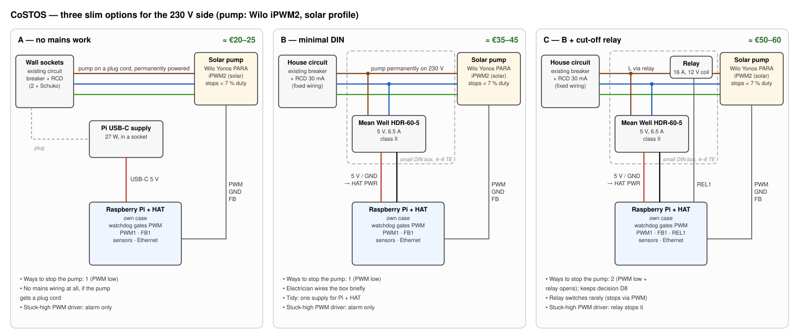
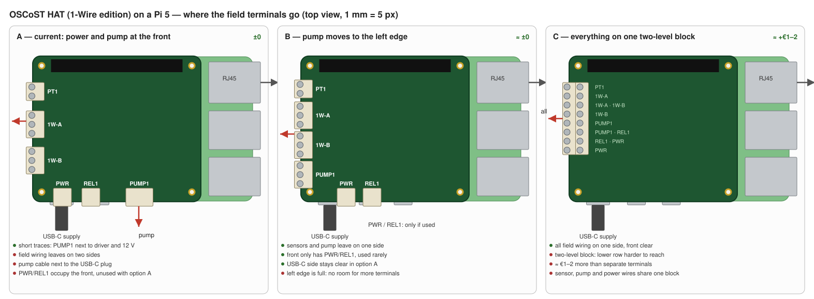

# OSCoST design decisions

The history of every design decision: the question, what was decided, the
alternatives that were compared and why. The specification documents
([HAT.md](HAT.md), [ARCHITECTURE.md](ARCHITECTURE.md)) describe what is
built and link here for the *why*. New decisions get the next number;
a changed decision gets a new entry, and the old one is marked as replaced
instead of being deleted.

Section numbers inside an entry refer to the document the decision
belongs to (HAT.md for D-entries, ARCHITECTURE.md for A-entries), unless
they name another document. Prices are from November 2026.

## Index

| # | Decision | Status |
|---|---|---|
| [D1](#d1--12-v-or-5-v-pump-driver-supply) | 12 V or 5 V pump driver supply | decided |
| [D2](#d2--one-or-two-pump-and-relay-outputs) | One or two pump and relay outputs | decided |
| [D3](#d3--how-many-pt1000-inputs) | How many Pt1000 inputs | decided |
| [D4](#d4--ds2482-or-plain-w1-gpio) | DS2482 or plain w1-gpio | decided |
| [D5](#d5--power-the-pi-from-the-hat) | Power the Pi from the HAT | replaced by [D18](#d18--does-the-hat-need-its-own-power-input) |
| [D6](#d6--hat-id-eeprom) | HAT ID EEPROM | decided |
| [D7](#d7--hand-assembly-or-factory-assembly) | Hand assembly or factory assembly | decided |
| [D8](#d8--external-watchdog-and-pwm-gating) | External watchdog and PWM gating | decided |
| [D9](#d9--keep-the-max31865-or-measure-the-pt1000-more-cheaply) | Keep the MAX31865 or measure the Pt1000 more cheaply | decided |
| [D10](#d10--pluggable-or-fixed-screw-terminals) | Pluggable or fixed screw terminals | decided |
| [D11](#d11--vbus-receiver-on-the-hat) | VBus receiver on the HAT | decided |
| [D12](#d12--a-pt1000-only-hat) | A Pt1000-only HAT | decided |
| [D13](#d13--measuring-chip-for-the-pt-edition) | Measuring chip for the PT edition | decided |
| [D14](#d14--raspberry-pi-or-esp32-p4) | Raspberry Pi or ESP32-P4 | decided |
| [D15](#d15--how-do-the-pi-the-hat-and-the-pump-get-their-power) | How do the Pi, the HAT and the pump get their power | decided |
| [D16](#d16--spacer-height) | Spacer height | decided |
| [D17](#d17--where-do-the-field-terminals-go) | Where do the field terminals go | decided |
| [D18](#d18--does-the-hat-need-its-own-power-input) | Does the HAT need its own power input | decided |
| [D19](#d19--a-separate-low-cost-board) | A separate low-cost board | decided |
| [D20](#d20--which-parts-to-pick-for-the-bom) | Which parts to pick for the BOM | decided |
| [A1](#a1--language-rust) | Language: Rust | decided |
| [A2](#a2--time-series-database-victoriametrics-only) | Time-series database: VictoriaMetrics only | decided |
| [A3](#a3--mqtt-and-home-assistant-optional-off-by-default) | MQTT and Home Assistant: optional, off by default | decided |
| [A4](#a4--e-mail-notifications-optional-off-by-default) | E-mail notifications: optional, off by default | decided |
| [A5](#a5--general-rules-wired-ethernet-only-no-local-display) | General rules: wired Ethernet only, no local display | decided |
| [A6](#a6--rules-for-the-control-core-no_std-number-types-overflow) | Rules for the control core (`no_std`, number types, overflow) | decided |
| [A7](#a7--bx-plus-functions-not-taken-over) | BX Plus functions not taken over | decided |
| [A8](#a8--disocon2-behaviours-not-taken-over) | DiSoCon2 behaviours not taken over | decided |
| [A9](#a9--control-loop-at-1-hz-whole-seconds) | Control loop at 1 Hz, whole seconds | decided |

## Hardware (HAT)

### D1 · 12 V or 5 V pump driver supply

**Status:** decided  
**Question:** 12 V (DC/DC) or 5 V driver supply?  
**Decision:** **12 V**: the HAT is meant to run for years; the margin is worth one DC/DC module  
**Where:** [HAT 4.1](HAT.md#41-pwm-pump-outputs)

### D2 · One or two pump and relay outputs

**Status:** decided  
**Question:** One or two PWM outputs and relay outputs?  
**Decision:** **Two positions each, one fitted**: PUMP1 and REL1 for the solar pump; PUMP2 and REL2 stay unfitted until a second pump is added  
**Where:** [HAT 4.1](HAT.md#41-pwm-pump-outputs)

### D3 · How many Pt1000 inputs

**Status:** decided  
**Question:** How many Pt1000 inputs?  
**Decision:** **Two on the board, one fitted**: PT1 for the collector; PT2 (MAX31865 #2, its parts and terminal) stays unfitted until needed  
**Where:** [HAT 4.3](HAT.md#43-pt1000-inputs)

### D4 · DS2482 or plain w1-gpio

**Status:** decided  
**Question:** DS2482 or plain `w1-gpio`?  
**Decision:** **`w1-gpio` on two buses** (GPIO 4 and 17), sensors in powered mode, DS2482 footprint as unfitted fallback. Keeps I²C out of normal use  
**Where:** [HAT 4.4](HAT.md#44-1-wire-bus)

### D5 · Power the Pi from the HAT

**Status:** replaced by [D18](#d18--does-the-hat-need-its-own-power-input)  
**Question:** Power the Pi from the HAT?  
**Decision:** ~~Yes~~, replaced by D18: **no**, the Pi uses its own USB-C supply  
**Where:** [HAT 4.7](HAT.md#47-power-from-the-pi-d18)

### D6 · HAT ID EEPROM

**Status:** decided  
**Question:** Fit the HAT ID EEPROM?  
**Decision:** **Footprint only**; fit later if automatic configuration is wanted  
**Where:** [HAT 2](HAT.md#2-target-boards-and-form-factor)

### D7 · Hand assembly or factory assembly

**Status:** decided  
**Question:** Hand assembly or factory assembly?  
**Decision:** **Factory-assembled, delivered fully soldered**; AISLER or JLCPCB decided on quotes once the BOM exists (8.2)  
**Where:** [HAT 8](HAT.md#8-manufacturing)

### D8 · External watchdog and PWM gating

**Status:** decided  
**Question:** Keep the external watchdog and PWM gating?  
**Decision:** **Yes**: about €3 in parts for a second, independent way to stop the pump, e.g. when the SSR fails short-circuited  
**Where:** [HAT 4.6](HAT.md#46-hardware-watchdog)

### D9 · Keep the MAX31865 or measure the Pt1000 more cheaply

**Status:** decided  
**Question:** Keep the MAX31865 or measure the Pt1000 more cheaply?  
**Decision:** **Keep the MAX31865**: timing a capacitor charge with a GPIO is too inaccurate under Linux, and a small SPI ADC saves only about €6 but loses the ±45 V input protection on the roof cable and the sensor fault detection  
**Where:** [HAT 4.3](HAT.md#43-pt1000-inputs)

### D10 · Pluggable or fixed screw terminals

**Status:** decided  
**Question:** Pluggable or fixed screw terminals?  
**Decision:** **Fixed**: about €4 per board cheaper; the HAT rarely comes off, and then the wires are unscrewed  
**Where:** [HAT 7](HAT.md#7-field-connectors)

### D11 · VBus receiver on the HAT

**Status:** decided  
**Question:** VBus receiver on the HAT?  
**Decision:** **No**: VBus is only needed while the BX Plus is still connected (shadow mode, switchable phase). The existing loose adapter plugs onto pins 1, 6 and 10 on top of the stacking header until then; after the switch-over it goes away and the UART is free  
**Where:** [ARCHITECTURE 9](ARCHITECTURE.md#9-migration-from-the-deltasol-bx-plus)

### D12 · A Pt1000-only HAT

**Status:** decided  
**Question:** Offer a Pt1000-only HAT?  
**Decision:** **Yes, as a second edition** of the same board (section 11): same outline and shared KiCad sheets for power, pump, relay and watchdog; only the sensor sheet differs. Measuring chip: see D13  
**Where:** [HAT 11](HAT.md#11-pt-edition-8--pt1000)

### D13 · Measuring chip for the PT edition

**Status:** decided  
**Question:** Measuring chip for the PT edition?  
**Decision:** **One LTC2983**: 8 independent 2-wire Pt1000 inputs (18 of its 20 inputs), excitation, fault detection and linearisation built in, result in °C, buffered inputs for simple protection. Costs a little more than 2 × ADS124S08 but needs far less analog design and software, and it frees GPIO4 for a 1-Wire bus. Comparison in 11.6  
**Where:** [HAT 11.6](HAT.md#116-choice-of-measuring-chip)

#### Comparison

Chips that measure several Pt1000s, compared for 8 two-wire sensors; the
last column is the 1-Wire edition with new DS18B20 probes, for comparison
with keeping the existing Pt1000 sensors. **Decided: LTC2983 (D13).** The
other options stay documented as alternatives.

Prices are single quantity at the time of writing; totals are estimates
until a real BOM exists, and LCSC stock changes daily. The totals were
made with the power input, since dropped (D18): subtract about €4 from
every column for parts, about €5 per board at 5 boards and about €15 for
the smallest order of 2 (8.2). 🟢 good,
🟡 medium, 🔴 weak.

| | **8 × MAX31865** | **2 × ADS124S08** | **2 × AD7124-8** | **1 × LTC2986** | **1 × LTC2983** (chosen) | **1-Wire edition:** 1 × MAX31865 + 7 × DS18B20 |
|---|---|---|---|---|---|---|
| ***Channels*** | | | | | | |
| Independent 2-wire Pt1000s per chip | 1 | 5 (force + sense pin each) | 7 (16 analog pins) | 🔴 4 (10 inputs, 2 per sensor + sense resistor) | 🟢 9 (20 inputs) | collector: 1; DS18B20: one chip per probe |
| Spare channels with 8 sensors | 🔴 0 | 🟡 2 | 🟢 6 | 🔴 none: 8 only as a series stack | 🟡 1 more sensor | 🟢 PT2 footprint; the buses take more probes |
| 1-Wire bus on the same board | 🔴 no: GPIO4/17 drive the chip-select decoder | 🟢 possible | 🟢 possible | 🟢 possible | 🟢 **yes, 1W-A** | 🟢 2 buses |
| ***Cost*** | | | | | | |
| Chips, LCSC | 🟡 8 × $4.27 = $34 | 🟢 2 × $6.46 = $13 | 🟢 2 × $10.47 = $21 | 🔴 $53 | 🟡 $39 | 🟢 $4.27 |
| Chips, DigiKey / Farnell EU | 🔴 8 × €8.76 = €70 | 🟢 2 × €9.94 = €20 | 🟢 ≈ €20–25 | 🟡 €34–42 | 🟡 ≈ €37–42 | 🟢 €8.76 |
| Extra parts on the board | 8 reference resistors 0.1 %, 16 ESD, decoder ≈ €8 | 2 reference resistors, 16 R + clamps + ESD ≈ €3 | like ADS ≈ €3 | 1 sense resistor, protection R ≈ €2 | 1 sense resistor, 16 protection R + ESD, 1-Wire parts ≈ €3 | pull-ups, ESD, polyfuse ≈ €1 |
| Sensor section, assembled | 🟡 ≈ €40 | 🟢 ≈ €15 | 🟢 ≈ €22 | 🔴 ≈ €50 | 🟡 ≈ €39 | 🟢 ≈ €6 |
| Rest of the board, assembled | ≈ €28 | ≈ €28 | ≈ €28 | ≈ €28 | ≈ €28 | ≈ €27 |
| New sensors and cable | 🟢 none | 🟢 none | 🟢 none | 🟢 none | 🟢 none | 🔴 7 DS18B20 probes + 2 cables ≈ €60–80 |
| **Total, assembled (5 boards, JLCPCB, incl. VAT and shipping)** | 🟡 **≈ €68** | 🟢 **≈ €43** | 🟢 **≈ €50** | 🔴 **≈ €78** | 🟡 **≈ €67** | 🟡 **≈ €33 + €60–80 = €93–113** |
| **Price for one: smallest assembled order (2 boards, JLCPCB)** | 🟡 **≈ €175** | 🟢 **≈ €125** | 🟢 **≈ €139** | 🔴 **≈ €195** | 🟡 **≈ €173** | 🟡 **≈ €105 + €60–80 = €165–185** |
| **Total, single-quantity parts (DigiKey, excl. VAT)** | 🔴 **≈ €103** | 🟢 **≈ €48** | 🟢 **≈ €50** | 🟡 **≈ €61–69** | 🟡 **≈ €69** | 🟡 **≈ €35 + €60–80 = €95–115** |
| Stock for assembly | 🟡 varies | 🟢 good (≈ 1,700 at LCSC) | 🔴 thin, one variant out | 🔴 thin | 🟡 thin at LCSC; buy at DigiKey and consign | 🟡 MAX varies; probes bought separately (fakes are common) |
| ***Function*** | | | | | | |
| Input protection | 🟢 ±45 V built in | 🟡 external parts, needs care | 🟡 external parts, needs care | 🟢 external, easy (buffered inputs) | 🟢 external, easy (buffered inputs) | 🟢 MAX ±45 V; 1-Wire ESD + polyfuse |
| Open / short detection | 🟢 fault register | 🟡 burnout current + software | 🟢 burnout + diagnostics built in | 🟢 built in, per sensor type | 🟢 built in, per sensor type | 🟡 CRC, missing probe; a short takes down its whole bus |
| Output | ratio, converted to °C in software | raw ADC codes, software does all | raw ADC codes, software does all | 🟢 °C directly, linearised | 🟢 °C directly, linearised | 🟢 DS18B20 gives °C directly |
| Range, accuracy | 🟢 Pt1000 beyond 200 °C, class B ±0.6 K at 60 °C | 🟢 same sensors | 🟢 same sensors | 🟢 same sensors | 🟢 same sensors | 🟡 ±0.5 K, max 125 °C (S4 can exceed it: fit PT2) |
| Resolution | 15-bit, ≈ 0.03 K | 24-bit | 24-bit | 24-bit, 0.1 °C accuracy | 24-bit, 0.1 °C accuracy | DS18B20 12-bit, 0.0625 K |
| Package, space | 🔴 8 × SSOP-20, tight | 🟢 2 × TQFP-32 5×5 | 🟢 2 × QFN-32 5×5 (no hand soldering) | 🟢 1 × LQFP-48 7×7 | 🟢 1 × LQFP-48 7×7 | 🟢 roomy |
| ***Effort and risk*** | | | | | | |
| Circuit design | 🟢 low: PT1 circuit × 8 | 🔴 high: analog force/sense layout | 🔴 high: like ADS | 🟢 low–medium: datasheet circuits | 🟢 low–medium: datasheet circuits | 🟢 done: schematic drawn |
| Software | 🟢 simple, driver shared with the 1-Wire edition | 🔴 most: input and current switching, settling, linearising | 🟡 medium: the sequencer helps | 🟢 simple: write channel setup, read °C | 🟢 simple: write channel setup, read °C | 🟢 simple: kernel 1-Wire + MAX driver |
| Work at the installation | 🟢 move the existing wires | 🟢 move the existing wires | 🟢 move the existing wires | 🟢 move the existing wires | 🟢 move the existing wires | 🔴 fit 7 probes, run 2 cables, set calibration offsets |
| Charts vs. history | 🟢 seamless | 🟢 seamless | 🟢 seamless | 🟢 seamless | 🟢 seamless | 🟡 small step, fixed with offsets |
| ***Verdict*** | | | | | | |
| Best for | fallback with a proven circuit, no 1-Wire | cheapest; cost-down option | spare analog inputs (other sensors) | only up to 4 independent sensors | 🟢 **PT edition: chosen** | 🟢 new installations, or when sensors get replaced anyway |

Variant not shown as a column: the 1-Wire edition with PT2 fitted, so S4
stays Pt1000 (2 Pt1000 + 6 DS18B20): about €5 more assembled, one probe
less. The LTC2984 is the LTC2983 with an EEPROM for the channel setup; it
costs more (≈ $71 at LCSC) and OSCoST doesn't need it.

**Also considered: a DiSoCon2-style divider front-end** (each Pt1000 in a
divider with a 0.1 % resistor, op-amp buffer, ADS1115; see
[ARCHITECTURE 12](ARCHITECTURE.md#12-related-projects)). For 8 sensors:
2 × ADS1115 ≈ €5–7, 8 precision resistors ≈ €1–2, 2 quad op-amps
≈ €1–3, reference ≈ €1, protection ≈ €2, so ≈ €10–15 instead of ≈ €42
for the LTC2983 section: **about €30 less per PT board** (≈ €40–45
instead of ≈ €69). On the 1-Wire edition it would save only about €5 on
the single Pt1000 (D9). Not taken, because it gives up:

- open/short **fault detection** (a broken sensor just reads extreme),
- **input protection** for the roof cable,
- **drift-free accuracy**: the ADS1115 measures against its internal
  reference, so supply and reference drift go into the reading unless a
  spare channel measures the excitation and the code works ratiometrically,
- **simple software**: divider maths, calibration and Callendar–Van Dusen
  in our code instead of °C over SPI.

Solar control would cope with ±0.5–1 K, but for a controller meant to run
10+ years the €30 is worth it.

### D14 · Raspberry Pi or ESP32-P4

**Status:** decided  
**Question:** Raspberry Pi or ESP32-P4 (Waveshare ESP32-P4-WIFI6-DEV-KIT, same form factor)?  
**Decision:** **Raspberry Pi**: more people already own one, and Linux gives more flexibility. The P4 board is a possible later port; the pin check and the platform comparison are below. On the P4, SCLK, REL1 and PWM2 would hit the RTC crystal and the audio amplifier  
**Where:** [HAT 2.1](HAT.md#21-esp32-p4-instead-of-the-pi)

#### Pin check: Waveshare ESP32-P4-WIFI6-DEV-KIT

The Waveshare ESP32-P4-WIFI6-DEV-KIT has the Pi form factor and a
40-pin header, so a microcontroller version could in principle use the
same HAT. The pin maps were checked against each other (header
silkscreen and the board schematic, November 2026):

- 5 V, 3.3 V and GND are on the same pins as on the Pi.
- The board's 3.3 V buck (MP1658, 3 A) has plenty of headroom; the HAT
  needs under 50 mA.
- The USB inputs appear to be ORed through a P-MOSFET and a Schottky
  diode. Same rule as on the Pi: one supply at a time.
- I²C (pins 3/5, GPIO7/8) is shared with the on-board audio codec. It
  only matters if the DS2482 is ever fitted.

Three HAT signals land on pins the P4 board uses itself:

| HAT signal | Pi header pin | P4 GPIO there | Used on the P4 board for | Free P4 pin instead |
|---|---|---|---|---|
| SCLK | 23 | GPIO0 | 32.768 kHz crystal (via R29, 0 Ω) | 37 (GPIO47) |
| REL1 | 22 | GPIO1 | 32.768 kHz crystal (via R33, 0 Ω) | 31 (GPIO26) |
| PWM2 (unfitted) | 35 | GPIO53 | audio amplifier enable (via R73, 0 Ω) | 33 (GPIO48) |

There are two ways to fit the HAT to the P4:

- **Move the three signals.** The HAT then no longer works on a Pi,
  because the Pi's SPI clock is fixed to pin 23.
- **Remove R29/R33 on every P4 board.** This costs the board's RTC
  crystal, and PWM2 still has to move.

**Decision D14: OSCoST stays on the Raspberry Pi.** More people already
own one, and Linux gives more flexibility for the web interface,
VictoriaMetrics buffering, updates and add-ons. The P4 stays a possible
later port. If it is ever done, the "move the three signals" variant
above is the starting point. The full cost and capability comparison of the Pi
against the ESP32-S3, RP2350 and ESP32-P4, and the P4 boards considered,
are in [ARCHITECTURE 13](#platform-comparison-pi-or-microcontroller).

---

#### Platform comparison (Pi or microcontroller)

Compared in November 2026 before any code was written. **Decision: stay
on the Raspberry Pi** (HAT D14): more people already own one, and Linux
gives more flexibility. The ESP32-P4 is documented as a possible later
port (pin check in HAT 2.1). Prices are single quantity; those marked
"from memory" were not looked up.

##### Cost per controller, including the computer

The Pi rows include an SD card (≈ €10).

| Base | Compute part | 1-Wire edition | PT edition | 5 V supply |
|---|---|---|---|---|
| Pi 5 + HAT | Pi 5 2 GB ≈ €80 ($77.50) | ≈ €125 | ≈ €160 | 5 A |
| Pi 4 + HAT | Pi 4 2 GB ≈ €70 ($67.50) | ≈ €115 | ≈ €150 | 3 A |
| Pi Zero 2 W + HAT | ≈ €15–18 | ≈ €63 | ≈ €97 | ≈ 1.5 A |
| ESP32-S3 on the board | module ≈ $4.70 + regulator, USB-C, microSD ≈ €8 | ≈ €40–45 | ≈ €75–80 | < 1 A |
| RP2350 (Pico 2 W) on the board | module ≈ €7–8 (from memory) + regulator, microSD ≈ €10 | ≈ €42–47 | ≈ €77–82 | < 1 A |

##### Board cost only (without the computer)

| Base | What the board adds | 1-Wire edition | PT edition |
|---|---|---|---|
| Any Pi: HAT | stacking header and spacers (≈ €3) | ≈ €35 (≈ €30 since D18) | ≈ €69 (≈ €65 since D18) |
| ESP32-S3 on the board | instead of the header: module (≈ €4.50), 3.3 V regulator (≈ €1), USB-C (≈ €0.50), microSD slot (≈ €0.50) | ≈ €39 | ≈ €73 |
| RP2350 (Pico 2 W) on the board | instead of the header: module (≈ €7.50, from memory), regulator (≈ €1), microSD slot (≈ €0.50) | ≈ €41 | ≈ €75 |

Not included: storage (SD or microSD, €5–10 either way) and, for the
microcontroller boards, wired Ethernet (W5500 + jack, ≈ €5). On the board
alone a microcontroller version costs only €4–6 more than the HAT; the
real saving is the Pi itself.

##### What each platform can do

| What OSCoST has to do | Pi (Linux) | ESP32-S3 | RP2350 (Pico 2 W) |
|---|---|---|---|
| Control loop, outputs, PWM, feedback | via kernel drivers | 🟢 direct hardware, real-time | 🟢 direct hardware (PIO) |
| Pt1000 (LTC2983 / MAX31865), 1-Wire | 🟢 kernel drivers | 🟢 own drivers, 1-Wire via RMT | 🟢 own drivers, 1-Wire via PIO |
| Watchdog, boot time | external watchdog needed; boots in about 30 s | 🟢 built in; under 1 s | 🟢 built in; under 1 s |
| Web interface | 🟢 no limits | 🟡 works; 512 KB RAM + 8 MB PSRAM | 🔴 tight: 520 KB RAM |
| History charts in the web UI | 🟢 from local data | 🟡 last 24 h in RAM, longer from VictoriaMetrics | 🔴 VictoriaMetrics only |
| 1-second push with buffering | 🟢 on disk | 🟡 RAM for hours, microSD for days | 🟡 microSD |
| Network | 🟢 Ethernet (Pi 4/5) | 🟡 Wi-Fi; wired needs a W5500 | 🟡 Wi-Fi; wired needs a W5500 |
| Updates | 🟢 packages | 🟢 over the network, 2 firmware slots | 🟡 possible, less mature in Rust |
| Rust support | 🟢 standard Rust | 🟢 mature (esp-rs, std via ESP-IDF) | 🟡 good, no std (Embassy) |
| Independent of other software | 🔴 shares the Pi with other services | 🟢 dedicated device | 🟢 dedicated device |

With the general rules (wired Ethernet only, no local display; section 1)
the field narrows: the Pi Zero 2 W is out (Wi-Fi only), the RP2350 is out
(radio unused, needs a W5500, RAM too tight), the ESP32-S3 would leave its
Wi-Fi unused and still need a W5500. The **ESP32-P4** fits best among the
microcontrollers: Ethernet MAC built in, no radio, 32 MB PSRAM.

##### ESP32-P4 against the Pi

Assuming a ready-made P4 Ethernet board under the same HAT.

| | Pi 4 / Pi 5 + HAT | ESP32-P4 + HAT |
|---|---|---|
| Compute | 🔴 Pi 5 2 GB ≈ €80, Pi 4 2 GB ≈ €70 | 🟢 P4 board ≈ €12–25 |
| Storage | SD card ≈ €10 | microSD for the buffer ≈ €5 |
| 5 V supply | 🔴 Pi 5: 5 A · Pi 4: 3 A | 🟢 < 1 A |
| **Total per controller** | **≈ €130–145 (1-Wire) / €165–180 (PT)** | **≈ €60 (1-Wire) / €95 (PT)** |
| Power use | 🟡 3–5 W | 🟢 under 1 W (≈ €8/year less) |
| After a power cut | 🔴 boots in about 30 s | 🟢 running in about 1 s |
| Storage wear | 🔴 SD card can wear out or get corrupted | 🟢 firmware in flash |
| Watchdog | 🟡 external watchdog + systemd | 🟢 built in, plus the HAT's external watchdog |
| Independence | 🔴 shares the Pi with other services | 🟢 dedicated device |
| Rust platform | 🟢 standard Rust, every library | 🟡 ESP-IDF or bare metal, younger on the P4 |
| Drivers | 🟢 kernel drivers ready | 🟡 written ourselves (1-Wire, LTC2983/MAX31865, PWM, feedback capture) |
| Web interface, buffer | 🟢 no limits, disk | 🟢 htmx and uPlot are small; PSRAM holds days, microSD beyond |
| Updates, debugging | 🟢 apt, SSH, standard tools | 🟡 firmware upload with 2 slots; USB debugger, network logs |
| Development speed | 🟢 fastest | 🟡 slower, especially the first drivers |
| Other people building one | 🟡 must buy and set up a Pi | 🟢 flash the firmware |

Summary: the P4 is the better product (less than half the price, ready
in a second, no SD card, dedicated); the Pi is the faster and more
flexible development platform, and many people already own one. That
flexibility decided it (D14).

##### ESP32-P4 boards considered

| Board | Price | Notes |
|---|---|---|
| Waveshare ESP32-P4-ETH | $12.99 ($16.99 with PoE) | 32 MB PSRAM, 32 MB flash, RJ45, microSD, 40-pin header compatible with some Pico HATs; would need its own carrier board |
| Olimex ESP32-P4-DevKit | €16.00 | open hardware (OSHW certified), Ethernet with PoE option, all GPIOs exposed, 72 × 30 mm; needs a carrier board |
| Waveshare ESP32-P4-NANO | €22.60 incl. VAT (Eckstein) | 32 MB PSRAM, 16 MB flash, RJ45, ESP32-C6 (Wi-Fi, unused), 28 GPIOs; header not Pi-shaped, needs a carrier board |
| **Waveshare ESP32-P4-WIFI6-DEV-KIT** | €24.90 incl. VAT (Eckstein) | **Pi form factor** (85 × 56.5 mm) with a Pi-style 40-pin header, so the OSCoST HAT could plug on directly; 32 MB PSRAM, 16 MB flash, RJ45, ESP32-C6 (unused), PoE header. Pin map checked against the HAT in HAT 2.1: three signals would have to move |

If the port is ever done, the WIFI6-DEV-KIT under the same HAT is the
simplest route. That door is kept open by the rules for `oscost-core`
and `oscost-safety` in 6.1 (`no_std`, decided), so they run unchanged on a
microcontroller:

- **What it means:** these two crates only compute. They get temperatures,
  settings and the time as plain values and return output commands. They
  use only Rust's `core` and `alloc` libraries, not `std`, so no files,
  threads, network, system clock or printing. Everything that touches
  Linux stays in `oscost-hw-linux` and `oscostd`. This is section 6.1's
  "pure, no I/O" rule, enforced by the compiler instead of by discipline.
- **Advantages:** a later ESP32-P4 port rewrites only the hardware and
  daemon parts, not the control logic and its tests; the compiler refuses
  a file access or clock read slipped into the control code; the logic
  stays small and easy to test and replay on the PC.
- **Drawbacks:** a few conveniences need replacements (`HashMap` →
  `BTreeMap` or a fixed-size map, `f32::exp` and friends from the `libm`
  crate, no `println!` debugging inside the core, so debug output goes
  through returned events), and contributors must keep to the rule.
  Tests and the simulator still run on the PC with `std`.

### D15 · How do the Pi, the HAT and the pump get their power

**Status:** decided  
**Question:** How do the Pi, the HAT and the pump get their power?  
**Decision:** **Option A** ([ARCHITECTURE 5.6](ARCHITECTURE.md#56-230-v-side)): the Pi's own USB-C supply in a socket (most people already have one), the pump permanently on 230 V and stopped over PWM only. Cheapest, no mains wiring, no switching wear, and the pump feedback works at all times. Accepted: one stop path instead of two. REL1 stays on the board for an optional cut-off relay (option C), which heating-profile pumps always need  
**Where:** [ARCHITECTURE 5.6](ARCHITECTURE.md#56-230-v-side)

What the controller needs from the mains: 5 V for the Pi and the HAT, and
230 V for the pump. DiSoCon2 builds its own mains board (fuse, varistor,
EMI filter, HLK-PM01, TRIACs); OSCoST keeps mains off its boards entirely
and uses only off-the-shelf, certified parts. A fully equipped DIN-rail
version (separate breaker and fuse terminal, SSR, surge protector, a
coupling relay to sense pump mains, 18 TE enclosure) came to about
€150–175, as much as a complete commercial controller (prices November
2026, single units incl. VAT, ≈ = estimate):

| Part (fully equipped version, not chosen) | Example | Price |
|---|---|---|
| SSR, zero-crossing, DC control | Finder 77.01.9.024.8050 | ≈ €49–52 |
| DIN enclosure, 1 row | IDE 12 TE (18 TE slightly more) | ≈ €23 (IP40) – €40 (IP65) |
| 5 V DIN-rail supply | Mean Well HDR-60-5 | ≈ €20–29 |
| Surge protector type 3 (optional) | CITEL MSB6-400 / DEHNrail DR M 2P 255 | ≈ €29 / €59 |
| Coupling relay, 230 V coil, to sense pump mains | Finder 38.51.8.240.0060 | ≈ €16 |
| DIN-rail holder for Pi + HAT | — | ≈ €10–15 |
| Breaker B6, 1-pole | Hager MBN106 | ≈ €6–9 |
| Wire, ferrules, glands, fuses | — | ≈ €10 |
| Fuse terminal 5×20, T 1 A | Phoenix PT 4-HESI | ≈ €4 |
| **Total** | | **≈ €150–175, ≈ €180–235 with surge protector** |

A 16 A interface relay with a 12 V coil (Finder 38.61) instead of the SSR
would save about €35. Three slim options were compared instead:

| | A: no mains work | B: minimal DIN | C: B + cut-off relay |
|---|---|---|---|
| 5 V supply | Pi USB-C supply in a socket (most people already have one) | Mean Well HDR-60-5, USB-C lead to the Pi | as B |
| Pump | Permanently on 230 V, plug cord in a socket | Permanently on 230 V, existing circuit | L through a 16 A relay, 12 V coil, driven by REL1 |
| Enclosure | Pi case | small DIN box, 4–6 TE | as B |
| Electrician | not needed if the pump gets a plug cord | briefly | briefly |
| Ways to stop the pump | 1: PWM low (watchdog-gated) | 1 | 2: PWM low + relay |
| Cost | ≈ €0–10 with an existing supply (≈ €20–25 with a new one) | ≈ €35–45 | ≈ €50–60 |

**Decision: option A** (HAT D15), for cost and because permanent power
suits a PWM pump.

**Upsides of A** (keeping the pump permanently powered):

- **Cheapest:** with an existing Pi supply it costs nothing or only a plug
  cord for the pump, against ≈ €35–60 for B or C and ≈ €150–175 for the
  fully equipped version.
- **No mains switching wear:** high-efficiency pumps have a high inrush
  current and limited mains switching cycles (Wilo, for example, allows at
  most 100 a day for the Stratos PARA). Starting and stopping over PWM is
  how they are meant to be run, as in boilers and heat pumps.
- **Monitoring always works:** the iPWM feedback output only works while
  the pump is powered. Permanently powered, OSCoST always sees stand-by,
  running, warnings, blocked, and "no power" (lost supply, tripped breaker),
  also while the pump should be stopped. With a relay cutting the mains,
  the pump would go silent whenever it is off. This also replaces the
  coupling relay that would otherwise sense pump mains.
- **Fewer parts, simpler wiring:** no relay contacts to fail, no
  enclosure, and no mains wiring; the house circuit's own breaker and RCD
  protect the pump and the supply.

**Downsides of A:**

- **Stand-by electricity:** Wilo specifies under 1 W for the Yonos PARA
  series, so at most about 9 kWh or €3 a year, in practice €2–3 because
  the pump runs part of the time.
- **The pump electronics are always live** and see every mains spike, not
  only while running. That is how boilers and heat pumps run their PWM
  pumps, so it is the normal case for these pumps.
- **One way to stop the pump instead of two** (the accepted risk below).

### D16 · Spacer height

**Status:** decided  
**Question:** Spacer height: per board, or one for all?  
**Decision:** **One tall height for all** (≈ 16–17 mm with a stacking header): fits the Pi 5 with active cooler or a passive heatsink, and a Pi 4; one BOM. Check that a passive heatsink stays below about 14 mm  
**Where:** [HAT 2](HAT.md#2-target-boards-and-form-factor)

### D17 · Where do the field terminals go

**Status:** decided  
**Question:** Where do the field terminals go?  
**Decision:** **Option B** (section 7): sensors and PUMP1 on the left edge, the rarely used PWR/REL1 (PWR later dropped, D18) and the unfitted positions at the front. All normally used wiring leaves on one side and the USB-C plug (D15) has the front edge to itself. Costs nothing; the left edge is then full. PT edition: S1–S8 and PUMP1 left, 1W-A at the front  
**Where:** [HAT 7](HAT.md#7-field-connectors)

**Where the field terminals go (decided: B, D17).** With the Pi powered
over USB-C (D15) the USB-C cable leaves at the front edge. Moving PUMP1 to
the left edge puts all wiring that is normally used on one side and
leaves the front to the USB-C plug and to REL1, which option A doesn't
use. (The drawing still shows the PWR terminal, dropped later by D18.) The three arrangements compared (1-Wire edition):

### D18 · Does the HAT need its own power input

**Status:** decided  
**Question:** Does the HAT need its own power input?  
**Decision:** **No**: with option A (D15) the Pi runs from its own USB-C supply, so the PWR terminal, fuse, TVS and ideal diode were never used. Removed: about €4 and nine parts; the HAT's 5 V now sits behind the Pi's own input protection. DIN-rail builds feed the Pi through a USB-C lead (4.7). Replaces D5  
**Where:** [HAT 4.7](HAT.md#47-power-from-the-pi-d18)

- **Earlier design** (rev A drafts before D18): a PWR terminal with fuse,
  TVS and an LM74700 ideal diode powered the Pi through the header. It was
  dropped because option A never uses it; it saved about €4 and nine parts.

### D19 · A separate low-cost board

**Status:** decided  
**Question:** A separate low-cost board?  
**Decision:** **No: a Lite build of the 1-Wire edition** (section 12): same board, without the 12 V DC/DC and the relay output; the pump driver runs on 5 V through R26 (0 Ω). Both 1-Wire buses and the PWR LED stay. Saves ≈ €4.60, as much as a dedicated Lite board would with the same parts, without a second layout, and can be upgraded. Solar-profile pumps only  
**Where:** [HAT 12](HAT.md#12-lite-build-decided-d19)

**Why no dedicated Lite board:** the comparison that decided D19, both
Lite variants against the normal build (single-quantity parts; 🟢 good,
🟡 medium, 🔴 weak):

| | **Normal HAT** (1-Wire edition) | **HAT Lite** (own board) | **Lite as build option** | **Saved: Lite (own board)** | **Saved: Lite build option** |
|---|---|---|---|---|---|
| ***What's left out*** | | | | | |
| 12 V converter + its load resistor | 🟢 12 V pump signal, large margin | 🟡 5 V, small margin (≈ 4.7 V against 4 V) | 🟡 5 V via a 0 Ω link; converter can be fitted later | **€3.05** | **€3.05** |
| Relay output REL1 (switch chip, MOSFET, diode, terminal, R1 LED) | 🟢 cut-off relay (option C), heating-profile pumps, on/off loads | 🔴 none: solar-profile pumps only | 🟡 not fitted, spot stays | **€1.55** | **€1.55** |
| Second 1-Wire bus (terminal, ESD, pull-up) | 🟢 2 buses | 🟡 1 bus | 🟡 1 fitted, 1W-B can be fitted later | **€0.65** | **€0.65** |
| PWR LED | 🟢 | 🟡 none (WD shows power too) | 🟡 not fitted | **€0.15** | **€0.15** |
| 0 Ω link for 5 V | — | — | one extra part | — | **−€0.01** |
| ***Kept on all three*** | | | | | |
| MAX31865 for the collector, watchdog + PWM gating, all field-line protection, PUMP1 with feedback, WD and PUMP1 LEDs, tall header, full outline | 🟢 | 🟢 | 🟢 | — | — |
| PT2, PUMP2, REL2, DS2482 spots for later | 🟢 | 🔴 none | 🟢 | — | — |
| ***Totals*** | | | | | |
| Parts, single quantity | ≈ €30 | ≈ €24.60 | ≈ €24.60 | **≈ €5.40** | **≈ €5.39** |
| **Price for one** (smallest assembled order: 2 boards, 8.2) | ≈ €90 | ≈ €71 | ≈ €71 | **≈ €19** | **≈ €19** |
| Assembled, per board in a batch of 5 | ≈ €27 | ≈ €19.50 | ≈ €19.50 | **≈ €7.50** | **≈ €7.50** |
| Extra design work | — | 🔴 second board, layout, parts list, tests, docs | 🟢 one extra part and a second parts list | — | — |
| Upgrade later to the full HAT | — | 🔴 buy a new board | 🟢 solder the missing parts on | — | — |

Both savings columns come out the same: the saving comes only from parts
that are not fitted, empty footprints cost nothing, and a dedicated board
would have the same outline. The dedicated board would only add a second
design to maintain and remove the upgrade path. After this comparison the
second 1-Wire bus and the PWR LED were put back into the Lite build (12.2),
so it now saves about €4.60.

### D20 · Which parts to pick for the BOM

**Status:** decided  
**Question:** Which parts to pick for the BOM?  
**Decision:** **JLCPCB basic or preferred extended parts for everything ordinary** (8.3), so only the special chips pay a loading fee: about six fees per order instead of fifteen or more, ≈ €25–30 less for a small order. Checked against the current lists before ordering  
**Where:** [HAT 8.3](HAT.md#83-assembly-services-compared)

## Architecture and software

### A1 · Language: Rust

**Status:** decided  
**Decision:** The whole controller is written in Rust: memory safety without a garbage collector, good embedded support, one language for daemon, web interface and control logic.  
**Where:** [ARCHITECTURE 6](ARCHITECTURE.md#6-software)

### A2 · Time-series database: VictoriaMetrics only

**Status:** decided  
**Decision:** All values go to VictoriaMetrics every second, with a local disk buffer for outages; no InfluxDB support. Metric names follow the vbus2influx scheme with the prefix `oscost`, so shadow mode and the RESOL history never collide.  
**Where:** [ARCHITECTURE 6.5](ARCHITECTURE.md#65-victoriametrics-push-and-buffering)

### A3 · MQTT and Home Assistant: optional, off by default

**Status:** decided  
**Decision:** The reference installation does not use MQTT; it is the last milestone and stays switched off unless enabled.  
**Where:** [ARCHITECTURE 6.4](ARCHITECTURE.md#64-interfaces)

### A4 · E-mail notifications: optional, off by default

**Status:** decided  
**Decision:** A mail when something fails and when it is fixed, without mail floods, never blocking the control loop. A dead controller can't mail: a "no data" alert in VictoriaMetrics or Grafana covers that.  
**Where:** [ARCHITECTURE 6.7](ARCHITECTURE.md#67-e-mail-notifications)

### A5 · General rules: wired Ethernet only, no local display

**Status:** decided  
**Decision:** No Wi-Fi and no screen or buttons on the device; the user interface is the web page. The device only has hardware-driven status LEDs (HAT D-entries and 4.8). These rules ruled out the Pi Zero 2 W and the RP2350 (D14).  
**Where:** [ARCHITECTURE 1](ARCHITECTURE.md#non-goals-for-now)

### A6 · Rules for the control core (`no_std`, number types, overflow)

**Status:** decided  
**Decision:** `oscost-core` and `oscost-safety` are `no_std`, take time and time of day as inputs, count in whole seconds, use finite `f32` temperatures with faults as "no value", integer `u64` counters with saturating arithmetic, overflow checks, no `unsafe`, signed values everywhere negative temperatures can occur, and a CI build for a bare-metal target. Worth it even without a microcontroller port: the compiler guarantees the safety-relevant code has no hidden I/O or clock access, and replays of the vbus2influx history are exact. Dropping `no_std` later is easy; adding it later is not. The full rule table with the risks is in ARCHITECTURE 6.1.  
**Where:** [ARCHITECTURE 6.1](ARCHITECTURE.md#rules-for-oscost-core-and-oscost-safety-decided)

### A7 · BX Plus functions not taken over

**Status:** decided  
**Decision:** From the BX Plus manual, checked against the reference installation.  
**Where:** [ARCHITECTURE 6.2](ARCHITECTURE.md#62-control-functions-first-version)

From the BX Plus manual (firmware 2.07 or later), checked against the
reference installation:

| BX Plus function | Why not (for now) |
|---|---|
| Bypass, CS bypass, irradiance switch | Need a bypass valve or an irradiance sensor (CS10), which the installation doesn't have |
| External heat exchanger, drainback, twin pump, overheat dissipation | Different hydraulics; overheat dissipation needs an extra output and a cooler |
| Multi-store charging logic, zone charging, parallel relay | Single store; see multi-store priority above |
| Holiday function (store recooling through the collector) | Evacuated tubes lose almost no heat at night; the collector is covered during holidays instead ([installation.md](installation.md#overtemperature-protection)) |
| Pressure and flow monitoring with Grundfos Direct Sensors | No sensors, and the HAT has no analogue input; the "no circulation" check covers the flow side |
| Mixer, heating circuits, solid-fuel boiler, return boost, return admixing, screed drying | Heating side, a non-goal for now (section 1) |
| DHW heating, thermal disinfection, circulation pump | Done by the heat pump |
| Function block (thermostats, timers and logic gates on spare outputs) | Useful for other installations, nothing to use it for yet; a candidate once there are spare outputs |
| Heat meter "CO₂ / fuel saved" display | A dashboard item, not a control function |

### A8 · DiSoCon2 behaviours not taken over

**Status:** decided  
**Decision:** From DiSoCon2's ESPHome configuration.  
**Where:** [ARCHITECTURE 6.2](ARCHITECTURE.md#62-control-functions-first-version)

From its ESPHome configuration (`Software/hardware/interval.yaml` and friends):

| DiSoCon2 behaviour | Why not |
|---|---|
| **Collector above T_max → pump to 100 %** to cool it | The opposite of the BX Plus and OSCoST collector emergency shutdown. Pumping glycol through a collector at stagnation temperature (208 °C here) puts steam into the loop and stresses the pump, the expansion vessel and the fluid. OSCoST stops the pump above the emergency limit and restarts only once the collector has cooled (4.2); collector cooling (above) acts earlier, while the temperature is still safe |
| **Collector sensor fault between 12:00 and 16:00 → precautionary pump run** (up to 5 min) | Running blind can just as well move heat the wrong way or start the pump into steam. With a failed collector sensor OSCoST goes to its safe state (pump off) and raises an alarm; evacuated tube collectors are designed to stagnate |
| Fixed speed steps (30 / 50 / 75 / 100 %) with hysteresis | Covered by the PI controller and the BX-compatible mode |
| Heat output from a fixed 5 l/min with water properties | OSCoST uses a configured or measured flow and the real fluid properties (glycol) |
| Two-tank switching with a 3-way valve | Multi-store, later (see multi-store priority) |
| LCD menu, buttons, temperature trend arrows, Wi-Fi | No local display (general rule), wired Ethernet only; trend arrows are a web-page detail |

### A9 · Control loop at 1 Hz, whole seconds

**Status:** decided  
**Decision:** Solar thermal systems change slowly; one control cycle per second is ample. Finer timing exists only at the edges (pump feedback capture, VictoriaMetrics timestamps) and never reaches the core.  
**Where:** [ARCHITECTURE 3](ARCHITECTURE.md#3-system-overview)
