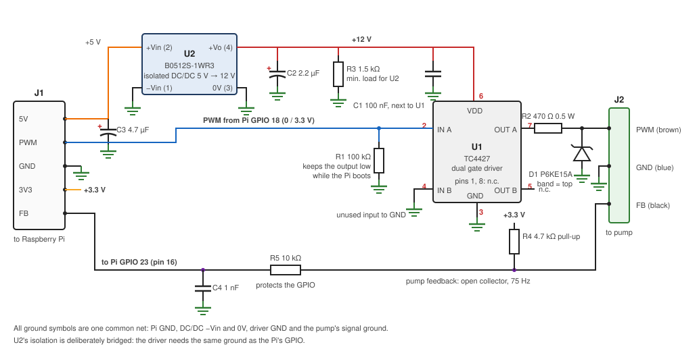
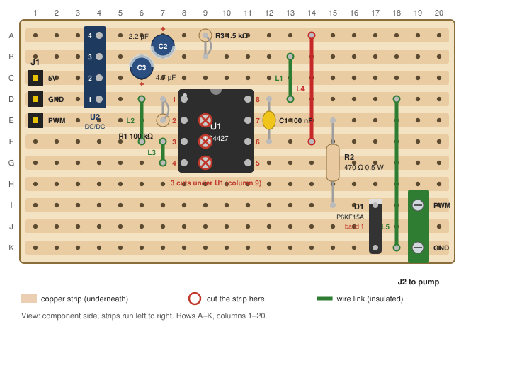
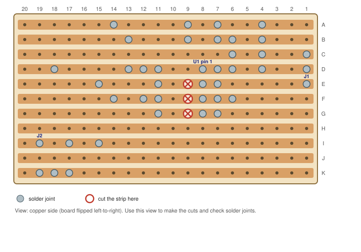
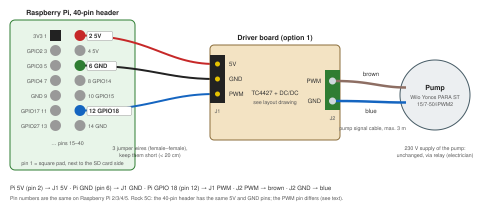
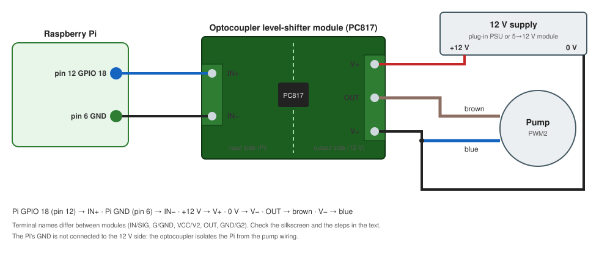

# Hardware needed

This page lists the electronics OSCoST needs between the single-board
computer and the system, and how to build them. It grows as the hardware is
designed. Right now it covers:

- [PWM pump output](#pwm-pump-output): driving a high-efficiency pump's
  speed input from the Raspberry Pi.

> **Safety.** Everything on this page is low voltage (5 V and 12 V). The
> pump's 230 V supply stays where it is: on a relay that switches off when
> OSCoST stops responding (see
> [Safety](ARCHITECTURE.md#4-safety)). Leave mains wiring to a qualified
> electrician.

Hole positions on stripboard are given as **row letter + column number**,
as seen from the component side: `D8` is row D, column 8.

---

## PWM pump output

The pump (here a Wilo Yonos PARA ST 15/7.0-PWM2) gets its speed as a PWM
signal on a 2-wire cable: **brown = PWM**, **blue = signal ground**. Its
input expects a high level of 4–15 V and up to 7.5 mA, at 100–5000 Hz. A
Raspberry Pi pin gives 3.3 V and very little current, so something has to
sit in between. See
[PWM pump outputs](ARCHITECTURE.md#53-pwm-pump-outputs) for the background.

Two ways to do it:

| | Option 1: driver board | Option 2: optocoupler module |
|---|---|---|
| What | TC4427 gate driver on stripboard | Ready-made PC817 level-shifter module |
| Soldering | Yes, about an hour | None (screw terminals) |
| Signal quality | Clean 12 V, edges < 1 µs | Slow edges (tens of µs), small duty-cycle error |
| Isolation Pi ↔ pump wiring | No (shared ground, protected by series resistor and TVS diode) | Yes |
| 12 V | Made on the board from the Pi's 5 V | Separate 12 V supply needed |
| Parts cost | about €5 | about €3–7 plus the 12 V supply |
| Recommended | **yes** | if you don't want to solder |

---

### Option 1: driver board

A TC4427 MOSFET driver turns the Pi's 3.3 V PWM into a clean 0/12 V signal.
A small DC/DC module makes the 12 V from the Pi's 5 V, so the board needs
only three wires to the Pi and two to the pump.



What each part does:

- **U1 TC4427**: two non-inverting drivers; only channel A is used. Accepts
  3.3 V logic, outputs 0 V or 12 V with very fast edges.
- **U2 B0512S-1WR3**: turns 5 V into 12 V (1 W, 84 mA max). Its
  input/output isolation is deliberately bridged, because the driver needs
  the same ground as the Pi.
- **R1 100 kΩ**: pulls the driver input low while the Pi boots and the pin
  is not yet configured. Low = 0 % = **pump stopped** (PWM2 profile).
- **R2 470 Ω**: limits the current if the pump cable is shorted. At the
  pump's few mA it drops only a few volts, so the pump still sees well over
  its 4 V minimum.
- **R3 1.5 kΩ**: the DC/DC module needs at least 10 % load (about 8 mA) to
  keep a stable output voltage; R3 provides it.
- **D1 P6KE15A**: TVS diode, clamps spikes and static discharge coming in
  over the pump cable.
- **C1, C2, C3**: decoupling for the driver and the DC/DC module.

#### Parts list

| Ref | Part | Notes |
|---|---|---|
| U1 | **TC4427** in DIP-8 (TC4427CPA, TC4427ACPA or TC4427EPA) | Must be TC4427 (non-inverting). TC4426 is inverting, TC4428 mixed. |
| — | DIP-8 IC socket | Recommended, so U1 can be inserted last and replaced |
| U2 | **Mornsun B0512S-1WR3** (or B0512S-1W) | SIP-4, 5 V in, 12 V out. Pin order 1 −Vin, 2 +Vin, 3 0V, 4 +Vo |
| C1 | 100 nF ceramic, ≥ 25 V, 5.08 mm pitch | |
| C2 | 2.2 µF electrolytic, ≥ 25 V | Value recommended by the DC/DC datasheet; don't go much higher |
| C3 | 4.7 µF electrolytic, ≥ 16 V | |
| R1 | 100 kΩ, 0.25 W | |
| R2 | 470 Ω, **0.5 W** or 0.6 W metal film | |
| R3 | 1.5 kΩ, 0.25 W | |
| D1 | **P6KE15A** TVS diode, unidirectional | Not the bidirectional P6KE15CA |
| J1 | 3-pin male pin header, 2.54 mm | For jumper wires to the Pi |
| J2 | 2-pin PCB screw terminal, 5.08 mm | For the pump cable |
| — | Stripboard, 2.54 mm, at least 20 × 11 holes | Strips must run along the 20-hole side |
| — | Solid insulated wire, about 0.5 mm | For the wire links |
| — | 3 jumper wires female–female, 10–20 cm | Pi to J1 |

Tools: soldering iron, solder, side cutters, a strip cutter (or a 3.5–4 mm
drill bit turned by hand), a multimeter.

#### Layout

Component side. The copper strips run left to right underneath.



Copper side, flipped left to right as you see it when you turn the board
over. Use this one for the cuts and to check your solder joints.



The drawings are generated by
[`tools/hw/pwm_driver_layout.py`](../tools/hw/pwm_driver_layout.py), which
also checks every connection on the board against the circuit diagram.

#### Building it, step by step

Solder the flattest parts first; that way the board lies flat while you
work.

1. **Cut the board** to 20 columns × 11 rows, with the strips running
   along the 20 columns. Write `A1` on the corner that will be top left
   (component side) so you don't lose orientation.
2. **Cut the three strips under U1**: holes **E9, F9 and G9**. From the
   copper side (second drawing) they are in the middle, just right of
   centre. Twist the strip cutter or drill bit until the copper ring is
   gone completely. Check with the multimeter (continuity mode): E8–E11,
   F8–F11 and G8–G11 must **not** beep.
3. **Wire links** (insulated wire; strip only the ends):
   - **L3**: G7 → F7 (short)
   - **L2**: F6 → D6
   - **L1**: B13 → D13
   - **L4**: F14 → A14 (red in the drawing: +12 V)
   - **L5**: K18 → D18 (long)

   The links only connect at their two ends. Where they cross other strips
   they must not touch the copper, which is why they're insulated.
4. **Resistors**:
   - **R2** 470 Ω lying flat from **E15 to I15**.
   - **R1** 100 kΩ standing upright between **D7 and E7**.
   - **R3** 1.5 kΩ standing upright between **A9 and B9**.
5. **IC socket for U1**: pins 1–4 in **D8, E8, F8, G8**, pins 8–5 in
   **D11, E11, F11, G11**. The notch points up (towards row A–C), pin 1 is
   at **D8**. Don't insert the chip yet.
6. **C1** 100 nF between **D12 and F12** (no polarity).
7. **Electrolytic capacitors**, mind the polarity (the stripe on the can
   marks **minus**):
   - **C3** 4.7 µF: **+ in C6**, − in B6.
   - **C2** 2.2 µF: **+ in A7**, − in B7.
8. **D1** P6KE15A standing upright: **band (cathode) in I17**, other end in
   K17.
9. **U2** DC/DC module, standing: **pin 1 in D4**, pin 2 in C4, pin 3 in
   B4, pin 4 in A4. Pin 1 is marked on the module (dot, notch or the
   printed "1"). Check before soldering: this part is the easiest to put
   in the wrong way round.
10. **J1** pin header: **C1 = 5V, D1 = GND, E1 = PWM**. Label them on the
    board with a marker.
11. **J2** screw terminal with the openings facing outwards (right):
    **I19 = PWM (brown)**, **K19 = GND (blue)**.

#### Checks before power

Look at the copper side under a bright light for solder bridges between
neighbouring strips, especially around U1 and U2. Then, still without U1
in its socket, measure with the multimeter:

| Measure between | Expect | If not |
|---|---|---|
| J1 5V – J1 GND | no short (resistance rises as C3 charges) | bridge on rows B–D near U2 |
| A row (+12 V) – D row (GND) | about 1.5 kΩ (R3) | bridge on rows A–B |
| E8 – E11 (socket pin 2 – pin 7) | open | cut E9 incomplete |
| F8 – F11 (socket pin 3 – pin 6) | open | cut F9 incomplete. **Important**: this one shorts 12 V to GND |
| J2 PWM – socket pin 7 (E11) | 470 Ω | R2 |
| J2 GND – J1 GND | 0 Ω | L5 |
| Socket pin 4 (G8) – J1 GND | 0 Ω | L3 / L2 |

#### First power-up

1. Shut down the Pi and unplug it. Connect the three jumper wires: **Pi
   pin 2 (5V) → J1 5V**, **Pi pin 6 (GND) → J1 GND**, **Pi pin 12 (GPIO 18)
   → J1 PWM**. On a **Rock 5C** the PWM wire goes to **pin 13** instead
   (see [Testing the output](#testing-the-output)).

   

2. Power up the Pi. Measure the A row against the D row: **about 12 V**
   (11–13.5 V is fine; the DC/DC output is unregulated). The DC/DC module
   should stay cold.
3. Shut down and unplug the Pi again, then insert **U1 into its socket,
   notch up, pin 1 at D8**.

#### Testing the output

The PWM pin and how to switch it on depend on the board. 5V (pin 2) and
GND (pin 6) are the same on all of them.

| Board | PWM pin on the header | PWM hardware | sysfs channel |
|---|---|---|---|
| Raspberry Pi 4 and older | **pin 12** (GPIO 18) | PWM0 in the main chip | `0` |
| Raspberry Pi 5 | **pin 12** (GPIO 18) | PWM0 in the RP1 I/O chip, channel 2 | `2` |
| Radxa Rock 5C | **pin 13** (GPIO4_B2) | PWM14 (`PWM14_M1`) | `0` |

**Rock 5C: use pin 13, not pin 12.** Pin 12 has no PWM function on the
Rock 5C. Of the header pins that do (3, 5, 11, 13, 15, 23, 24, 27, 28),
pins 3/5 are I²C, 23/24 are SPI (needed for the MAX31865 temperature
boards) and 27/28 are the HAT ID-EEPROM pins in the Raspberry Pi layout, so
**pin 13** is the natural choice. It is on the left (odd) row, directly below pin 11. Move J1's PWM
jumper wire there; 5V and GND stay on pins 2 and 6.

**1. Switch the PWM output on** (once, then reboot):

- **Raspberry Pi 4 and older**: add this line to `/boot/firmware/config.txt`
  (`/boot/config.txt` on older systems):

  ```
  dtoverlay=pwm,pin=18,func=2
  ```

- **Raspberry Pi 5**: add this line to `/boot/firmware/config.txt`:

  ```
  dtoverlay=pwm
  ```

  On the Pi 5 the PWM hardware sits in the RP1 chip, and GPIO 18 is
  channel **2** of its PWM0 block, not channel 0 as on older Pis. Guides
  for older Pis often use `pwm-2chan`; that has been reported not to work
  on the Pi 5, so stick to `pwm`. After the
  reboot, `pinctrl get 18` should show `a3 … PWM0_CHAN2`.

- **Rock 5C**: run `sudo rsetup`, go to *Overlays → Manage overlays*,
  enable the **PWM14-M1** entry, save and reboot.

**2. Find the PWM chip.** Each board numbers them differently, and the
Pi 5 already has one for its fan. Run `ls /sys/class/pwm/` before and after
step 1: the `pwmchipN` that appeared is yours. (If you didn't check before:
`ls -l /sys/class/pwm/` shows which hardware each one belongs to.)

**3. Set the PWM by hand** (500 Hz = 2 000 000 ns period). Fill in your
chip and the channel from the table:

```sh
CHIP=/sys/class/pwm/pwmchip0   # from step 2
CH=0                            # Pi 4 and Rock 5C: 0, Pi 5: 2

echo $CH     | sudo tee $CHIP/export
echo 2000000 | sudo tee $CHIP/pwm$CH/period       # 500 Hz
echo 0       | sudo tee $CHIP/pwm$CH/duty_cycle   # 0 %
echo 1       | sudo tee $CHIP/pwm$CH/enable
```

To change the duty cycle later: `echo 1000000 | sudo tee
$CHIP/pwm$CH/duty_cycle` (50 %).

With the multimeter on DC volts between J2 PWM and J2 GND (the meter
averages the PWM):

| `duty_cycle` | Duty | Expect at J2 |
|---|---|---|
| `0` | 0 % | 0 V |
| `1000000` | 50 % | about 6 V |
| `2000000` | 100 % | about 12 V |

#### Connecting the pump

1. Set the duty cycle back to `0`.
2. Unplug the pump's signal cable from the RESOL controller and connect it
   to J2: **brown → PWM, blue → GND**.
3. The pump still gets its 230 V from the RESOL relay. For the test, set
   that relay to manual **ON** in the RESOL menu. Remember to set it back
   to **Auto** afterwards.
4. Step through the PWM2 characteristic:
   - `0` (0 %): pump stays in standby.
   - `400000` (20 %): pump starts and runs slowly.
   - `1000000` (50 %), then `2000000` (100 %): pump gets faster.
   - back to `0`: pump stops.
5. Finally plug the signal cable back into the RESOL controller and set its
   relay back to Auto, until OSCoST takes over.

---

### Option 2: optocoupler module

A ready-made module with a PC817 optocoupler: the Pi switches the LED
inside the optocoupler, and the output side switches 12 V from its own
supply. No soldering, and the Pi is electrically isolated from the pump
cable. The trade-off is slow edges (see [Limits](#limits)).

#### What to buy

| Part | Notes |
|---|---|
| **PC817 isolated level-shifter module** that converts **3.3 V up to 12 V** | For example the Boardoza PC817C (2 channels, 3.3–12 V on both sides). Many cheap modules only go the other way (12 V down to 3.3 V) or need 12–24 V at the input. Read the description. |
| **12 V supply** | A small 12 V plug-in power supply, or a 5 V → 12 V DC/DC module. Only a few mA are needed. |
| Wires | 2 jumper wires to the Pi, short wires for the 12 V supply |

#### Wiring



| From | To |
|---|---|
| Pi pin 12 (GPIO 18); Rock 5C: pin 13 | module **IN+** (also called IN, SIG) |
| Pi pin 6 (GND) | module **IN−** (also called G, GND on the input side) |
| 12 V supply + | module **V+** (also called VCC, V2) |
| 12 V supply 0 V | module **V−** (also called GND, G2 on the output side) |
| module **OUT** | pump **brown** |
| module **V−** | pump **blue** |

The Pi's GND must **not** be connected to the 12 V side; otherwise the
isolation is gone.

#### Step by step

1. **Identify the terminals.** Every module labels them a bit differently;
   the table above lists the usual names. Input side = where the Pi
   connects, output side = where the 12 V supply connects.
2. **Check that 3.3 V is enough to switch it.** Connect only the output
   side to the 12 V supply. Connect IN− to Pi GND and touch IN+ to **Pi pin 1
   (3.3 V)**: the module's indicator LED should light, and OUT should
   change. If nothing happens, the module's input resistor is sized for a
   higher voltage, and the module is not suitable.
3. **Check whether it inverts.** Measure OUT against V− with IN+ **open**
   and with IN+ on **3.3 V**:
   - 0 V when open, about 12 V on 3.3 V: **non-inverting**. Good.
   - About 12 V when open, 0 V on 3.3 V: **inverting**. OSCoST can invert
     its output in the settings, but with an inverting module the pump
     gets **100 %** whenever the Pi is off or booting. With the PWM2
     profile that means full speed instead of stop, so the pump's 230 V
     relay is then the only thing that stops it. Prefer a non-inverting
     module.
4. **Wire everything** as in the drawing, with the Pi shut down.
5. **Test** exactly as for option 1: enable PWM on GPIO 18
   ([Testing the output](#testing-the-output)), measure OUT against V−
   (0 % → 0 V, 50 % → about 6 V, 100 % → about 12 V), then
   [connect the pump](#connecting-the-pump).

#### Limits

- **Slow edges.** The PC817 needs tens of microseconds to switch, while
  Wilo specifies edges of a few microseconds. Each edge shifts the
  effective duty cycle a little. At 500 Hz (2 ms period) that is roughly
  1–2 %, which is acceptable for speed control. Use a lower PWM frequency
  for this option, for example **200 Hz** (period `5000000`), which halves
  the error and is still well inside the pump's 100–5000 Hz range.
- **No margin data.** Modules differ in input resistor, pull-up and
  optocoupler grade. Steps 2 and 3 above are the minimum check; if the
  pump behaves erratically at low duty cycles, use option 1.
