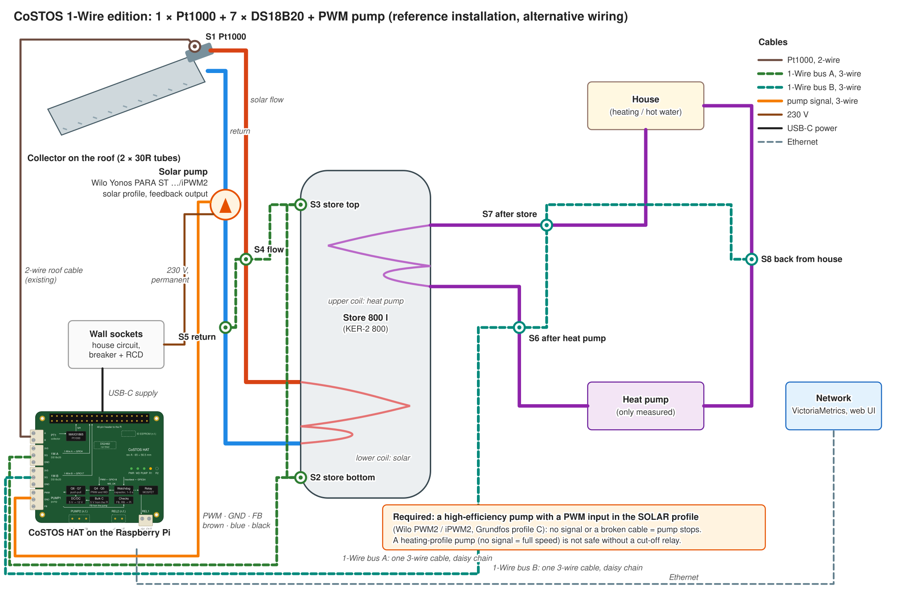
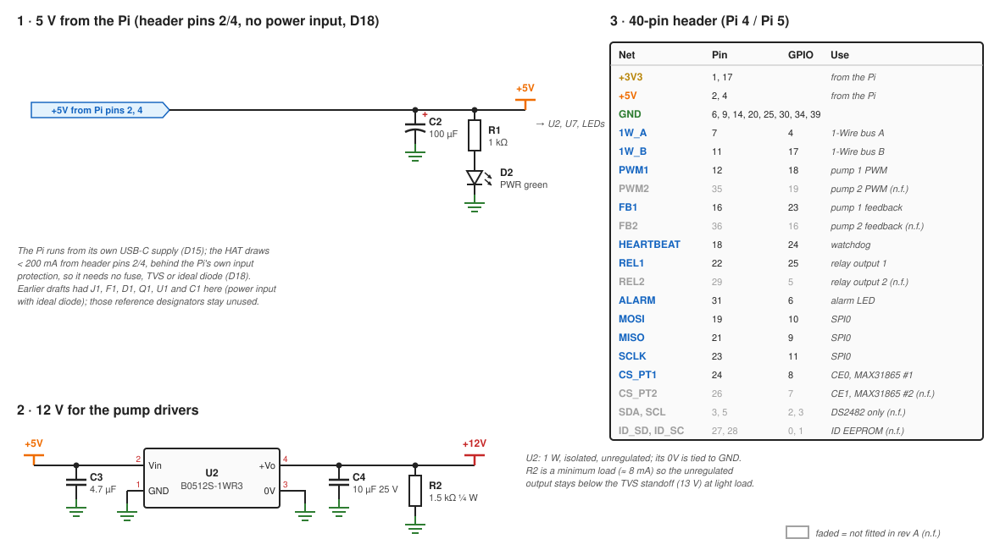
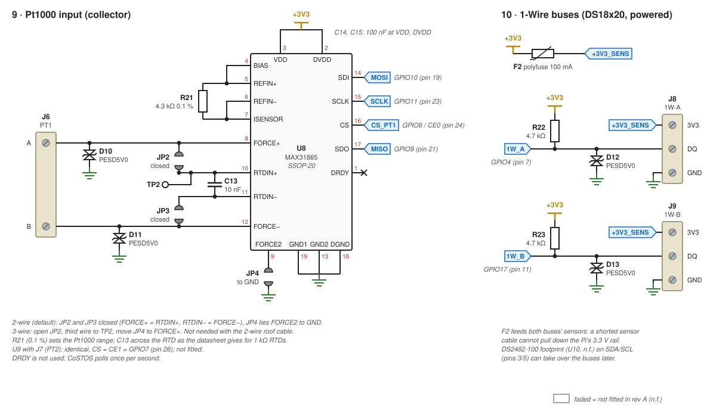
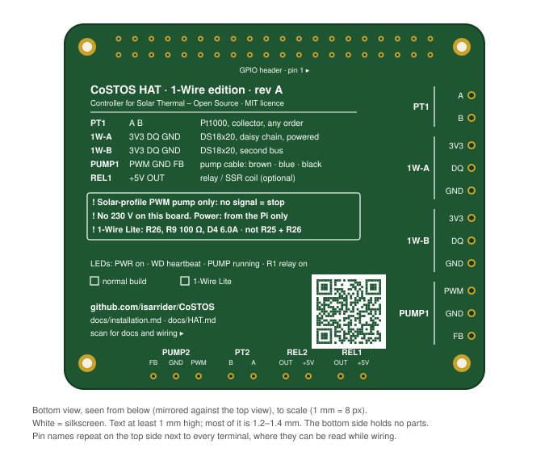
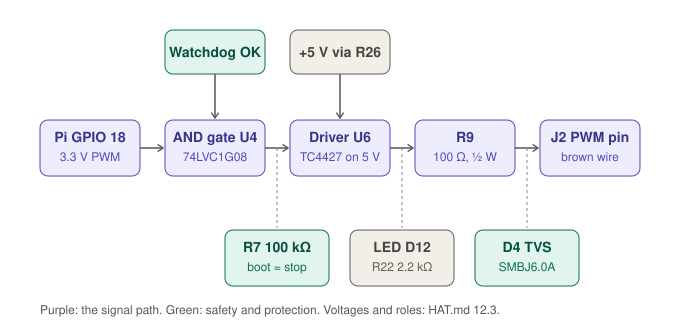

# CoSTOS HAT: 1-Wire edition (and 1-Wire Lite)

Status: **design for rev A, not yet built or tested**. This page describes
the 1-Wire edition as it will be built: 1 Pt1000 input (collector) plus
two 1-Wire buses for DS18x20 sensors, and the cheaper 1-Wire Lite
([section 11](#11-1-wire-lite)). Which HAT to choose:
[HAT.md](HAT.md). The PT edition, which shares everything except the
sensor inputs: [HAT-PT.md](HAT-PT.md). Why it is built this way, the
dropped alternatives and the prototype tests:
[HAT-development.md](HAT-development.md); "Dn" (for example D22) refers to
a decision there. Once rev A has passed its tests, this line will say
"released".

The HAT combines the circuits from [Hardware needed](HARDWARE.md) on one
board that plugs onto the 40-pin header. No stripboard version is built
for the reference installation, so HAT rev A is the first hardware on the
real system: the [bring-up plan](HAT-development.md#6-bring-up-plan-rev-a) tests every block on its own,
and the pump only gets connected once its output and the watchdog have
been checked on the bench.

## 1. Scope

**On the HAT** (low voltage only, 3.3 V / 5 V / 12 V):

- PWM pump outputs with feedback inputs
- Pt1000 temperature inputs
- 1-Wire bus for DS18x20 sensors
- Control outputs for external relays / SSRs
- **No power input** (D18): the Pi is powered by its own USB-C supply and
  the HAT takes its few hundred mA from header pins 2/4, like any HAT
- Hardware watchdog that switches all relay outputs off when the software
  stops
- Protection on every connection that leaves the board, status LEDs

**Not on the HAT, deliberately:**

- **Anything with 230 V.** The pump's mains supply and an optional relay
  or SSR stay off the board (ARCHITECTURE 5.6). The HAT only sends a relay
  a low-voltage control signal.

## 2. Target boards and form factor

| | |
|---|---|
| Boards | Raspberry Pi 4, Raspberry Pi 5; Raspberry Pi 3 B / B+ should work (untested, see below) |
| Size | Raspberry Pi HAT: 65 × 56.5 mm, 4 × M2.5 mounting holes matching the Pi |
| Header | 40-pin female stacking header with tall spacers (≈ 16–17 mm) for every board (D16): clears the Pi 5 active cooler and most passive heatsinks, and works on a Pi 4 too |
| Connectors | Field connections on the left and bottom edges, fixed 3.5 mm screw terminals (see 7) |
| Component height | Low enough for a standard enclosure; the DC/DC module is the tallest part |
| ID EEPROM | Footprint for the Raspberry Pi HAT ID EEPROM on pins 27/28, not fitted in rev A (D6) |

### Mockup

Top view to scale. The placement shows that everything fits; the real
layout is done in KiCad.


On a Pi 5, top and side view: the HAT covers the left 65 mm, Ethernet and
USB stay free, sensors leave to the left and the pump cable to the front.
Heights are approximate and get fixed in KiCad.


A complete installation with the 1-Wire edition: 1 Pt1000 on the
collector, 7 DS18B20 on two daisy-chained buses and the PWM pump (sensor
names from the [reference installation](installation.md#sensors-and-outputs-in-use)).
The pump must have a PWM input in the solar profile
([Pump requirement](ARCHITECTURE.md#pump-requirement-safety)).



### Raspberry Pi 3

The Pi 3 B and B+ have the same 40-pin header, HAT size and mounting holes,
and the same PWM, SPI and 1-Wire blocks as the Pi 4, so the HAT and the
software should work unchanged. **Untested**: it gets checked in bring-up
([bring-up](HAT-development.md#6-bring-up-plan-rev-a)) if a Pi 3 is at hand. For someone with a spare Pi 3 it is the cheapest
way in: with the 1-Wire Lite, the HAT is then the only purchase.

| | Pi 3 B / B+ | Pi 4 / Pi 5 |
|---|---|---|
| 40-pin header, HAT size, mounting holes | 🟢 same | 🟢 |
| PWM (GPIO 18/19), SPI, 1-Wire, GPIO edge events | 🟢 same as the Pi 4, same overlays (6) | 🟢 |
| CPU and RAM for CoSTOS (1 Hz loop, web UI, local buffer) | 🟢 1 GB is plenty | 🟢 |
| Power | 🟡 **micro-USB**, 5.1 V 2.5 A supply, not USB-C | 🟢 USB-C |
| Ethernet | 🟡 100 Mbit (B), ≈ 300 Mbit (B+): plenty for the metrics | 🟢 Gigabit |
| Tall spacers (D16) | 🟢 fit, with more air than needed | 🟢 |
| Software | 🟢 the same 64-bit build (aarch64) | 🟢 |

Not the Pi 3 A+: it has no Ethernet, and CoSTOS uses no Wi-Fi. Older
boards (Pi 2, Pi 1 B+) have the header but too little CPU and RAM, and are
not considered.

## 3. Block diagram

```
                40-pin header
 ┌──────────────────┼──────────────────────────────────────────────────────┐
 │                  │                                                      │
 │  5 V from the Pi (pins 2/4) ─► bulk capacitor, power LED ─► HAT         │
 │  5 V ──► DC/DC 5→12 V ──► 12 V ─┐                                       │
 │                                 ▼                                       │
 │  PWM1 ─► switches Q4·Q5 (AND WD_OK) ─► Q6 / Q7 ─► R ─► TVS ──► Pump 1   │ PWM / GND / FB
 │  PWM2 ─► same chain, not fitted ─► R ─► TVS ─────────────────► Pump 2   │ PWM / GND / FB
 │          ▲                                                              │
 │  FB1, FB2 ◄── R/C filter ◄── pull-up 3.3 V ◄─────────────────── Pumps   │
 │          │                                                              │
 │  HEARTBEAT ─► capacitor watchdog (charge pump) ────► WD_OK ─┐           │
 │                                                            ▼           │
 │  REL1..2 ─────────────────────────────► low-side MOSFETs ◄─ relay supply ├──► external SSR / relay
 │                                                                         │
 │  SPI ─► MAX31865 (Pt1000) ◄─────────────────────────────────── sensors  │
 │  GPIO 4, 17 ─► pull-ups ─► 1-Wire bus A, B ◄────────────────── DS18x20  │
 │                                                                         │
 │  LEDs: power, watchdog OK, pump 1, relay 1, relay 2                     │
 └─────────────────────────────────────────────────────────────────────────┘
```

### Circuit diagrams (rev A)

Drawn from this specification as a reference for the KiCad project; the
KiCad schematic will be the reference for the board itself. Faded parts
are footprints that are not fitted in rev A. Regenerate with
`python3 tools/hw/hat_schematic.py docs/img`.






Part choices the drawings add to the text below (all to be confirmed
when the BOM is made): relay supply switch AO3401A P-MOSFET turned on by an AO3400A from `WD_OK` (D23); capacitor watchdog from 1N4148W
diodes, capacitors and AO3400A (D24); pump driver from MMBT3904/MMBT3906
transistors and an AO3400A as watchdog switch (D22, D24); relay
MOSFETs AO3400A with 1N4148W flyback diodes; ESD diodes PESD5V0 on the
sensor inputs; 100 mA polyfuse for the 1-Wire sensor supply; a 1.5 kΩ
minimum load on the 12 V output, which keeps the unregulated DC/DC below
the 13 V TVS standoff at light load.

## 4. Functions

### 4.1 PWM pump outputs

- **Two output positions. Rev A fits only PUMP1** (solar pump). PUMP2
  (its transistors, resistors, TVS, feedback parts and terminal) stays
  unfitted, as a spare for a later store-loading or heating pump (D2).
- **The driver is a transistor chain (H3, D22)**, from basic parts only:

  ```
              +V_DRV (12 V normal / 5 V 1-Wire Lite)
                │
              ┌─┴── R36 2.2 kΩ
              ├──┤ Q6 MMBT3906 PNP "to the supply" ──► R9 ──┬───────► J2 PWM
     PWM_OFF  │                                            ├── D4 TVS
              │                                            ├──┤ Q7 MMBT3904 "pull-down"
             R35 2.7 kΩ                                    │     base from PWM_OFF via R37 10 kΩ
              │                                            ├── R38 10 kΩ to GND
 PWM1 ─R33 10 kΩ─► Q4 MMBT3904  "PWM switch"               └── R31/R32 readback → GPIO 6
 WD_OK ──────────► Q5 AO3400A   "watchdog switch"
              │
             GND
  ```

  **Two switches in a row, one switch to the supply, one to ground.** Q4
  (the PWM) and Q5 (the watchdog) in series are the watchdog AND: only
  when both are on is node PWM_OFF pulled low, Q6 switches the output to
  +V_DRV and Q7 is off. If either is off, R36 pulls PWM_OFF high, Q6 turns
  off and Q7 pulls the terminal actively to 0 V = stop. R7 (100 kΩ) holds
  PWM1 low while the Pi boots. Q7 sits behind R9, so the brief moment when
  Q6 and Q7 overlap while switching is limited by R9 like a shorted cable.
  Why this chain, what it replaced and how it is tested:
  [HAT-development.md 2](HAT-development.md#2-pump-driver-chain-alternatives-d22)
  (on the rev A prototype the original AND gate + TC4427 chain sits next
  to it as a jumper-selected fallback).
- P6KE15A-class TVS at the terminal (SMD equivalent with the same
  breakdown voltage, SMBJ13A; not lower, since the unregulated 12 V can
  reach 13.5 V), R9 470 Ω, R7 at the input (D1); 1-Wire Lite values below.
- **R9 and D4 depend on the build**, like R25/R26, because the pump's
  input draws current (about 3 mA, up to 7.5 mA) and R9 takes voltage
  away before the signal reaches the pump:

  | | Normal build (12 V driver) | 1-Wire Lite (5 V driver) |
  |---|---|---|
  | R9 | 470 Ω | **100 Ω** |
  | Lost across R9 at 3 mA | 1.4 V | 0.3 V |
  | At the pump (needs ≥ 3.6 V at 3 mA, ~4 V to be safe) | ≈ 10.6 V | ≈ 4.7 V |
  | Current into a shorted cable | ≈ 25 mA | ≈ 50 mA |
  | D4 (TVS) | SMBJ13A: conducts just above the 12 V rail | **SMBJ6.0A**: conducts just above 5 V; a 13 V diode would never protect a 5 V driver |

  With 470 Ω on a 5 V driver the pump would see only ≈ 3.6 V, its bare
  minimum. Same values as the stripboard driver boards in HARDWARE.md (470 Ω
  / 15 V TVS on the 12 V board, 100 Ω / 6.8 V TVS on the 5 V board). With
  the transistor chain the output sits ≈ 0.15 V below +V_DRV, so the pump
  sees ≈ 10.5 V (normal) and ≈ 4.55 V (1-Wire Lite).
- **Output readback** (any driver chain): a divider from the PWM terminal
  (behind R9) to a GPIO lets CoSTOS see what really leaves the board.
  PUMP1 on GPIO 6 (pin 31), PUMP2 on GPIO 26 (pin 37, unfitted with
  PUMP2). R31 (top, build-dependent like R9) and R32 8.2 kΩ to GND:

  | | Normal (12 V) | 1-Wire Lite (5 V) |
  |---|---|---|
  | R31 | 27 kΩ | 6.8 kΩ |
  | At the GPIO when high | ≈ 2.8 V (≈ 3.1 V at 13.5 V) | ≈ 2.7 V |
  | Load on the output | ≈ 0.34 mA | ≈ 0.33 mA |

  CoSTOS uses it twice (ARCHITECTURE 6.2, "PWM output check"):
  continuously, the line must be low when 0 % is commanded and its duty
  (measured from edge timestamps, like the feedback input) must match the
  command; and at every start, a **watchdog self-test**: PWM set high,
  heartbeat stopped, the line must drop to 0 V within about 5 s, and the
  watchdog readback (4.6) gives the exact timeout. That catches a
  shorted transistor in the chain (or, on the prototype's fallback chain,
  a stuck driver or AND gate) directly, and a silently lost watchdog
  layer before it matters. The pump runs for at most those few seconds.
- **R9 package: at least 0.5 W** (e.g. 1210 or 2010). With a shorted pump
  cable it dissipates ≈ 0.3 W (normal) or ≈ 0.25 W (1-Wire Lite) for as long as
  the short lasts, more than an 0805 resistor takes.

- **Watchdog gating:** the watchdog switch Q5 sits in series with the PWM
  switch Q4, so a stopped watchdog also forces the output to 0 %. With a solar (PWM2)
  pump that means "stop", in addition to the relay cutting its mains.
  (For heating-profile pumps 0 % means full speed; there the relay is
  what stops them. The documentation for the outputs must say so.)
- Per output a 3-way terminal: **PWM, GND, FB**, in the cable's order
  (brown, blue, black).
- **Frequency settable** per output in software, default 500 Hz, checked
  range 100–1000 Hz, limited by the edge speed through R9 into D4's
  capacitance
  ([ARCHITECTURE](ARCHITECTURE.md#pwm-frequency-settable-per-output)).

### 4.2 Pump feedback inputs

- One per PWM output (FB2 unfitted in rev A, with PUMP2). Same circuit as on the stripboard: 4.7 kΩ
  pull-up to 3.3 V at the terminal, 10 kΩ series resistor, 1 nF to GND at
  the GPIO.
- **ESD diode (PESD5V0, D17) as the first part at the terminal's FB pin**,
  like on every other input: it catches static discharges from the cable
  before they reach the GPIO. In normal operation (0–3.3 V) it does
  nothing. If the PWM and FB wires are swapped, it clamps the 12 V to
  about 6 V, so only about 0.3 mA reaches the GPIO through the 10 kΩ.
- Optional per output in software; an unconnected input reads as
  constant high and is ignored.

### 4.3 Pt1000 inputs

- **One MAX31865** (SSOP-20) for PT1, the collector, with its 4.3 kΩ
  0.1 % reference resistor, the input filter from the datasheet and ESD
  protection on the terminal. There is no second Pt1000 position (D3):
  whoever needs more Pt1000 inputs, for example for a flow line that can
  pass 125 °C after a stagnation day, takes the PT edition.
- **The collector needs a Pt1000:** the cable to the roof usually has only
  two wires, which is exactly what a Pt1000 needs. A DS18x20 would need
  three (normal powered mode) and only goes up to 125 °C. The cable's
  resistance shows up as a small fixed offset (about 0.25 K for 20 m of
  0.75 mm²), corrected by the per-sensor calibration value.
- 2-wire connection by default; solder jumpers for 3-wire sensors.
- On SPI0, chip select CE0 (pin 24).
- The `DRDY` outputs are not connected; CoSTOS polls once per second.

### 4.4 1-Wire bus

- **Two independent 1-Wire buses**, driven by the kernel's `w1-gpio`
  driver: bus A on GPIO 4 (pin 7), bus B on GPIO 17 (pin 11). Up to about
  5 sensors per bus. A fault on one bus (damaged cable, short) only takes
  out the sensors on that bus.
- Per bus: 4.7 kΩ pull-up to 3.3 V on the Pi side, a **100 Ω series
  resistor** in DQ, ESD protection on DQ at the terminal, and a 3-way
  terminal (3V3, DQ, GND). The resistor limits the current into the GPIO
  if DQ touches a wrong voltage (the ESD diode clamps a 12 V fault to about
  6 V first); 22–100 Ω is the usual range and leaves the 1-Wire timing
  unchanged.
- **Sensors run in normal powered mode** (3 wires: 3V3, DQ, GND), never in
  parasite mode, which is unreliable at high temperatures and with several
  sensors converting at once.
- 3.3 V sensor supply with a polyfuse, shared by both buses.
- **Fallback: DS2482-100 footprint, not fitted.** An I²C-to-1-Wire bridge
  on I2C1 (pins 3/5) with active pull-up, for the case that long cables or
  the Pi 5's GPIO cause trouble. Fitting it (and moving the buses to it)
  needs no new board.

### 4.5 Relay / SSR control outputs

- **Two output positions, rev A fits only REL1** (solar pump mains).
  REL2 (MOSFET, flyback diode, LED, terminal) stays unfitted; its gate
  pull-down is fitted so the GPIO line is defined.
- Each is a low-side N-MOSFET switching the negative side
  of an external SSR input or relay coil; the positive side comes from
  the HAT's **relay supply** (5 V).
- The relay supply is switched by the watchdog (4.6): without a heartbeat,
  every relay output is off, whatever the GPIOs do.
- Flyback diode per output (for relay coils), gate pull-down so outputs
  are off while the Pi boots, LED per output.
- Intended load: a DIN-rail SSR with a 3–32 V DC control input
  (typically under 20 mA), or a 5 V relay coil up to about 100 mA.
- 2-way terminal per output: **+5 V (switched)** and **OUT**.

### 4.6 Hardware watchdog

**A capacitor that the software must keep charged** (D24; the full
reasoning, simulation and failure analysis are in
[HAT-development.md 8.2](HAT-development.md#82-watchdog-a-capacitor-that-the-software-must-keep-charged-d24)):

- CoSTOS toggles the **heartbeat GPIO 24** about 20 times a second, from
  a small task that only runs while the last control cycle (sensors read,
  decision made, outputs written) succeeded less than about 1 s ago.
- Each edge pumps a little charge through two small capacitors (C17,
  C19) and a diode (D19) into C18; two resistors (R49 ∥ R50) drain it
  all the time. The voltage on C18 **is** `WD_OK`. It holds the gates of
  three AO3400A: Q5 gates the pump signal (4.1), Q13 switches the relay
  supply (4.5, D23), Q14 drives the WD LED and the readback.
- Heartbeat stopped, stuck high or low, slower than about 0.5 Hz, or
  faster than about 1 kHz (filter R48/C16, a program stuck in a loop):
  C18 empties and the MOSFETs switch off within about 1–3 s.
- After power-up C18 is empty until the software starts the heartbeat,
  so nothing runs while the Pi boots.
- No single failed part keeps it on: the drain resistors are two in
  parallel, the coupling capacitors two in series.
- **Readback on GPIO 20** (pin 38, through Q14, low = watchdog on): at
  every start the self-test stops the heartbeat and measures the real timeout
  (alarm outside about 0.8–5 s).
- LED "WD", and jumper JP1 to force `WD_OK` for bench tests (clearly
  marked, open by default).
- Built only from JLCPCB basic parts for a few cents; the 74LVC1G123 it
  replaces cost about €4 for one controller (part and loading fee).
- **Why it is worth having:** the Pi's own hardware watchdog and systemd
  catch a hung kernel or a crashed CoSTOS, but not a fault in the
  switching hardware. Where a cut-off relay or SSR is used (option C), an
  SSR that fails short-circuited would leave the pump powered; the
  watchdog-gated PWM is then a second, independent way to stop it (0 % =
  stop with a PWM2 pump), and the feedback input shows that it happened
  (D8).
- **With a permanently powered pump (D15, option A) the gated PWM is the
  only stop path**, which makes this circuit the main hardware safety
  layer rather than a backup.
- This is the "external heartbeat" layer from
  [Safety](ARCHITECTURE.md#41-hardware-layer-independent-of-software); the
  SoC watchdog and the systemd watchdog remain in addition.

### 4.7 Power: from the Pi (D18)

The HAT has **no power input**. The Pi runs from its own USB-C supply
(D15), and the HAT takes its 5 V from header pins 2/4 and its 3.3 V from
pins 1/17, like any HAT. Its 5 V therefore sits behind the Pi's own input
protection, so the HAT needs no fuse, TVS or ideal diode of its own; it
only has a bulk capacitor and a power LED on its 5 V rail.

- **Supply:** the official Raspberry Pi USB-C supply (27 W for the Pi 5,
  15 W for the Pi 4) or an equivalent; for a Pi 3 its micro-USB supply
  (5.1 V, 2.5 A). **No phone chargers or long, thin USB cables**: the
  1-Wire Lite's pump driver runs on this 5 V and has only about 0.5 V of
  margin (11.1, point 5). The Pi 5 negotiates 5 A over USB
  power delivery, so no `PSU_MAX_CURRENT` setting is needed.
- **DIN-rail builds** (ARCHITECTURE 5.6 options B/C): a 5 V DIN-rail
  supply feeds the Pi through a short USB-C lead (5.1 V, 3 A for a Pi 4,
  5 A for a Pi 5; a Pi 5 on a plain USB-C lead without power delivery
  needs `PSU_MAX_CURRENT=5000` in its bootloader configuration).

### 4.8 Status LEDs

The LEDs are CoSTOS's only local display (no screen, general rule). All
of them are driven by hardware and show the real state even if the
software is wrong; none needs an overlay or any software.

| LED | Colour | Driven by | Shows |
|---|---|---|---|
| PWR | green | 5 V rail | the HAT has power |
| WD | green | Q14, from the watchdog capacitor (`WD_OK`) | heartbeat seen, outputs enabled (4.6) |
| **PUMP1** | green | driver output (Q6) via 2.2 kΩ | what really reaches the pump: off = stop, brighter = faster |
| R1 | yellow | relay output 1 | relay or SSR switched on |
| PUMP2, R2 | | | only with the unfitted second channels |

**LED type: forward voltage ≈ 2 V** (red, yellow, orange, or the classic
yellow-green "green"), not the bright pure green with ≈ 3 V. The WD LED
runs from 3.3 V: with a 2 V LED it gets ≈ 1.3 mA, with a 3 V LED only
≈ 0.3 mA, which is barely visible. The PUMP1 resistor is 2.2 kΩ so the LED
stays visible in the 1-Wire Lite too (5 V driver):

| LED | Supply | Resistor | Current (Vf ≈ 2 V) |
|---|---|---|---|
| PWR | 5 V | 1 kΩ | ≈ 3 mA |
| WD | 3.3 V | 1 kΩ | ≈ 1.3 mA |
| PUMP1 | 12 V (normal) / ≈ 4.9 V (1-Wire Lite) | 2.2 kΩ | ≈ 4.5 mA / ≈ 1.3 mA at 100 %, times the duty cycle |
| R1 | 5 V | 1 kΩ | ≈ 3 mA |

Alarms are shown on the web page, as metrics and (optionally) over MQTT,
not on an LED. The LEDs face up; a closed enclosure needs a window or
light pipes above them.

### 4.9 Power budget

| Rail | Source | Users | Estimated current |
|---|---|---|---|
| 5 V | Pi header pins 2/4 (from the Pi's USB-C supply) | DC/DC, relay supply, LEDs | HAT < 200 mA with a relay coil, < 100 mA with an SSR (per extra fitted relay output up to +100 mA) |
| 12 V | DC/DC on the HAT (1 W) | pump driver chain, PWM output | < 30 mA |
| 3.3 V | Pi header pins 1/17 | MAX31865 × 2, DS18x20 sensors, pull-ups | < 30 mA |

## 5. Pin assignment

The same on the Raspberry Pi 3, Pi 4 and Pi 5. Only the PWM chip and
channel numbers behind GPIO 18/19 differ, which is software configuration.

| Function | Header pin | Pi 3 / Pi 4 | Pi 5 |
|---|---|---|---|
| 1-Wire bus A | 7 | GPIO 4 | GPIO 4 |
| 1-Wire bus B | 11 | GPIO 17 | GPIO 17 |
| I²C SDA / SCL (DS2482, only if fitted) | 3 / 5 | I2C1 | I2C1 |
| SPI MOSI / MISO / SCLK | 19 / 21 / 23 | SPI0 | SPI0 |
| SPI CE0 (MAX31865) | 24 | GPIO 8 | GPIO 8 |
| PWM 1 | 12 | GPIO 18, PWM0 channel 0 | GPIO 18, RP1 PWM0 channel 2 |
| PWM 2 (only if fitted) | 35 | GPIO 19, PWM0 channel 1 | GPIO 19, RP1 PWM0 channel 3 |
| Feedback 1 | 16 | GPIO 23 | GPIO 23 |
| Feedback 2 (only if fitted) | 36 | GPIO 16 | GPIO 16 |
| PWM readback 1 | 31 | GPIO 6 | GPIO 6 |
| PWM readback 2 (only if fitted) | 37 | GPIO 26 | GPIO 26 |
| Heartbeat | 18 | GPIO 24 | GPIO 24 |
| Watchdog readback | 38 | GPIO 20 | GPIO 20 |
| Relay 1 | 22 | GPIO 25 | GPIO 25 |
| Relay 2 (only if fitted) | 29 | GPIO 5 | GPIO 5 |
| ID EEPROM | 27 / 28 | ID_SD / ID_SC | ID_SD / ID_SC |
| 5 V (Pi → HAT) | 2, 4 | | |
| 3.3 V | 1, 17 | | |
| GND | 6, 9, 14, 20, 25, 30, 34, 39 | | |

The config below enables both PWM channels and all relay pins, so a later
fitted PUMP2 or REL2 needs no configuration change. Both PWM channels need a two-channel PWM overlay. Which one works on the
Pi 5 (`pwm-2chan` or two `pwm` entries) is checked during bring-up; see
also [Testing the output](HARDWARE.md#testing-the-output).

## 6. Raspberry Pi configuration

What has to be enabled on the Pi for the HAT. The CoSTOS installer will
set this up; listed here so it can be checked by hand.

**`/boot/firmware/config.txt`**

```ini
# SPI0 for the MAX31865 (CE0)
dtparam=spi=on
# Two 1-Wire buses for the DS18x20 sensors (external pull-ups on the HAT;
# no "pullup" parameter, which would mean parasite power)
dtoverlay=w1-gpio,gpiopin=4
dtoverlay=w1-gpio,gpiopin=17

# Relay outputs and heartbeat: outputs, driven low as early as possible
gpio=24,25,5=op,dl
# PWM output readback: inputs with pull-down
gpio=6,26=ip,pd
# Watchdog readback (pulled up on the HAT, low = watchdog on)
gpio=20=ip,np

[pi3]
# Same as the Pi 4 (untested on the Pi 3)
dtoverlay=pwm-2chan,pin=18,func=2,pin2=19,func2=2
dtparam=audio=off

[pi4]
# Two hardware PWM channels on GPIO 18 / 19
dtoverlay=pwm-2chan,pin=18,func=2,pin2=19,func2=2
# The Pi 4's analog audio uses the same PWM hardware
dtparam=audio=off

[pi5]
# RP1 PWM0 channels 2 / 3 on GPIO 18 / 19 (verify during bring-up)
dtoverlay=pwm-2chan

[all]
```

**Not needed:**

- No I²C, unless the optional DS2482 is fitted (then `dtparam=i2c_arm=on`
  instead of the two `w1-gpio` lines).
- No overlays for the feedback inputs: they are read as GPIO edge events
  through the GPIO character device.
- With the ID EEPROM fitted later (D6), the overlays above could be
  loaded automatically.

**Also on the system side:**

- The CoSTOS service user needs access to `/dev/gpiochip*`, `/dev/spidev0.*`,
  `/sys/bus/w1` and `/sys/class/pwm` (groups `gpio` and `spi` on Raspberry
  Pi OS).
- The SoC hardware watchdog is armed through systemd
  (`RuntimeWatchdogSec=` in `/etc/systemd/system.conf`), in addition to the
  HAT's own watchdog.

## 7. Field connectors

22 terminal positions don't fit along one 65 mm edge: at 5.08 mm pitch
they would need about 112 mm. So the connectors use **fixed 3.5 mm screw
terminals** on **two edges**, as in the [mockup](#mockup):

- **Left edge** (everything that is normally wired, D17): PT1, 1W-A,
  1W-B, PUMP1. The PT edition: the S1–S8 block and PUMP1.
- **Front (bottom) edge** (rarely used or not fitted), from the left:
  PUMP2, REL2, REL1 (PUMP2 and REL2 not fitted in rev A; REL1
  sits right below its relay circuit). The PT edition: PUMP2, 1W-A, REL2,
  REL1. There is no power terminal (D18).
- The top edge holds the 40-pin header. The right edge stays free: on the
  Pi, the USB and Ethernet sockets sit right next to it.

**Where the field terminals go (decided: B, D17).** With the Pi powered
over USB-C (D15) the USB-C cable leaves at the front edge. Moving PUMP1 to
the left edge puts all wiring that is normally used on one side and
leaves the front to the USB-C plug and to REL1, which option A doesn't
use. (The drawing still shows the PWR terminal, dropped later by D18.) The three arrangements compared (1-Wire edition):


Fixed means one block per connector, soldered to the board, with the
cable screwed straight into it. Pluggable terminals (a soldered socket and
a removable screw plug) would let the HAT come off without undoing any
wire, but cost about €4 more per board; for a controller that stays in its
cabinet that isn't worth it (D10). To swap the Pi or the HAT, label the
wires and unscrew them.


All labelled on the silkscreen:

| Connector | Pins | Function |
|---|---|---|
| PUMP1 | PWM, GND, FB | pump 1 signal cable (brown, blue, black) |
| PUMP2 | PWM, GND, FB | pump 2 signal cable (not fitted in rev A) |
| PT1 | A, B | Pt1000 sensor 1 (collector); no polarity, wires in any order |
| 1W-A, 1W-B | 3V3, DQ, GND | DS18x20 sensors |
| REL1 | +5V, OUT | relay / SSR 1, optional: cut-off relay (option C), heating-profile pump, valve |
| REL2 | +5V, OUT | SSR / relay 2 (not fitted in rev A) |

### 7.1 Silkscreen: wiring instructions on the board (D21)

The board carries as much wiring information as fits, so it can be wired
without the docs open. Silkscreen is free on both sides at JLCPCB, so this
costs nothing. Rules: text at least 1 mm high with a 0.15 mm line (most of
it 1.2–1.4 mm), nothing printed over pads or under terminal bodies.

| Where | What is printed | Read when | Readability |
|---|---|---|---|
| Top, at each terminal | Pin name next to every pin (A/B, 3V3/DQ/GND, PWM/GND/FB, +5V/OUT), terminal name and what it is for (PT1 collector, 1W-A, PUMP1 pump) | while wiring, HAT on the Pi | 🟢 the most useful text |
| Top, signal paths | Thin lines with arrows and small text from each terminal through its circuit to the Pi: PT1 → MAX31865 → SPI, the 1-Wire buses → GPIO4/17, GPIO18 (PWM) and GPIO24 (heartbeat) → the transistor chain → PUMP1, WD_OK, 12 V from the DC/DC, the pump feedback → checks, the relay → REL1 (see the [mockup](#mockup)). Lines and text stay off pads and component bodies | when tracing a fault, or learning how the board works | 🟢 |
| Top, small notes | LED names, "12 V" at R25 and "5 V (1-Wire Lite)" at R26, both values at R9 and D4, outlines of unfitted parts, edition and revision | assembly, checking the LEDs | 🟢 |
| Bottom, cheat sheet | Table of all terminals with pins and use, pump wire colours (brown · blue · black), the three safety rules (solar-profile pump only, no 230 V on the board, never R25 and R26 together), LED meanings, tick boxes for normal or 1-Wire Lite, repository URL | before mounting, or with the HAT off | 🟡 hidden once on the Pi |
| Bottom, QR code (10 × 10 mm) | link to the repository | any time, with a phone | 🟢 |

Not printed: **DS18B20 wire colours**. They differ between makers (red /
yellow / black is common, not guaranteed), so a printed colour could lead
to wrong wiring; the pin names are safe. The pump colours are printed
because they come from the pump maker's cable (Wilo: brown PWM, blue GND,
black FB).

The top-side pin names are in the [mockup](#mockup). The bottom side,
seen from below (mirrored, so the left-edge terminals appear on the
right):



The PT edition gets the same layout with its own terminal table (S1–S8 as
2-wire Pt1000, 1W-A at the front).

## 8. Manufacturing

- **Design tool:** KiCad. Project in `hardware/hat/` in this repository,
  with schematic, layout, and Gerber/BOM exports for each released
  revision.
- **Manufacturer:** AISLER (Germany). 2-layer, 1.6 mm, HASL, Budget
  service. Their price is a job fee plus a price per cm² and board; for a
  65 × 56.5 mm board (about 37 cm²) a set of 3 bare boards is about
  €19 net at the time of writing (check their current pricing).
- **Design rules:** AISLER's KiCad design rules, imported before routing.
- **Assembly: delivered fully soldered (D7).** All SMD parts on the top
  side only (one-sided assembly is the cheap option at every assembler),
  through-hole only for the terminals, the 40-pin header and the DC/DC.
  Parts are chosen from what the assembler stocks: for JLCPCB that means
  LCSC part numbers in the BOM, "basic" parts where possible, since every
  other part type adds a feeder fee. Packages stay hand-solderable (0805,
  SOIC, SSOP), so a board can still be repaired or built by hand.
- **Assembler:** decided on real quotes once the KiCad BOM exists: AISLER
  (boards and assembly from Germany) against JLCPCB (cheapest for small
  runs, ships from China).
- **Checks before ordering:** KiCad ERC and DRC clean, every net compared
  against the stripboard circuits, footprints of the MAX31865, DS2482 and
  DC/DC checked against their datasheets, a 1:1 paper print to check
  connector and mounting-hole positions on the real Pi.
- **Parts rule (D20):** every ordinary part is a JLCPCB basic or preferred
  extended part, so only four special chips pay a loading fee. Other
  assembly services compared:
  [HAT-development.md 5](HAT-development.md#5-assembly-services-compared-d7-d20).

### 8.1 Parts list with prices (rev A as fitted, per board)

Single-quantity prices without VAT at **LCSC**, the parts store behind
JLCPCB, November 2026, at $1 ≈ €0.87. "Checked" prices were looked up;
the others are typical LCSC prices for basic parts and get checked when
the BOM exists. Unfitted positions are not counted, nor are the Pi, its
USB-C supply, an optional relay and the sensors. (Earlier versions used
single prices from EU distributors such as DigiKey, which are two to
eight times higher for these parts.)

| Part | Qty | LCSC | ≈ € | Source |
|---|---|---|---|---|
| MAX31865AAP+ (Pt1000 converter) | 1 | $4.45 ($3.94 when JLCPCB fits it) | 3.87 | checked |
| PCB, ⅓ of an AISLER set of 3 (≈ €19), for building it yourself | — | — | 6.50 | AISLER |
| 40-pin tall female header and 4 M2.5 spacers (D16) | 1 | ≈ $1.40 | 1.25 | estimate |
| B0512S-1WR3 DC/DC | 1 | $1.05–1.46 by maker | 1.10 | checked |
| Resistors and capacitors, about 30 (incl. the 4.3 kΩ 0.1 % reference) | — | ≈ $0.60 | 0.50 | estimate |
| 3.5 mm fixed screw terminals (PT1, 1W-A, 1W-B, PUMP1, REL1), e.g. Kefa KF350 | 5 | $0.06 (2-pole) – $0.08 (3-pole) | 0.30 | checked (2-pole) |
| PESD5V0 ESD diodes (PT1 × 2, 1W-A, 1W-B, FB1) | 5 | ≈ $0.03 | 0.13 | estimate |
| LEDs (PWR, WD, PUMP1, R1) | 4 | ≈ $0.01 | 0.04 | estimate |
| SMBJ13A | 1 | ≈ $0.05 | 0.04 | estimate |
| Pump driver transistors: MMBT3904 × 2, MMBT3906, AO3400A (D22, D24) | 4 | ≈ $0.01 | 0.04 | estimate |
| Capacitor watchdog: AO3400A (Q14), 1N4148W × 2, 6 resistors and capacitors (D24) | 9 | ≈ $0.06 | 0.05 | estimate |
| 100 mA polyfuse | 1 | ≈ $0.03 | 0.03 | estimate |
| AO3400A, 1N4148W | 2 | ≈ $0.02 | 0.03 | estimate |
| Relay supply switch: AO3401A, AO3400A (D23) | 2 | ≈ $0.02 | 0.03 | estimate |
| **Total, with ⅓ of an AISLER PCB set** | | | **≈ 13.95** | |
| Total without PCB (the parts JLCPCB fits) | | | ≈ 7.45 | |

The MAX31865 is by far the most expensive part. The
terminal brand is a choice still to make: Kefa KF350 is the cheap common
one; brand-name blocks (Phoenix, Dinkle) cost several times more. The PT
edition's list is in [HAT-PT.md 5](HAT-PT.md#5-space-and-cost).

### 8.2 What one controller costs

Factory assembly has fixed costs per order, so the price depends mostly
on how many boards are ordered. **Most people want one controller**, but
JLCPCB's smallest economic assembly order is 2 boards, so "price for one"
below means the total of that smallest order; the second board is a spare
(or for a friend).

**The model** (JLCPCB, incl. shipping and 19 % import VAT; estimates until
a real quote exists):

- **Fixed part per order:** setup and stencil, a loading fee of about
  €2.80 for each part type that is not a JLCPCB basic part, the
  through-hole soldering setup and shipping: ≈ €48.80 for the 1-Wire
  edition and the PT edition (two such part types: MAX31865 or LTC2983
  handling, B0512S; the relay supply switch and the watchdog are built
  from basic parts since D23 and D24), ≈ €45.60 for the 1-Wire Lite
  (only the MAX31865).
- **Variable part per board:**

  | | 1-Wire edition | 1-Wire Lite | PT edition |
  |---|---|---|---|
  | Parts at JLCPCB/LCSC prices (8.1, without PCB) | €6.95 | €5.70 | €43.65 (LTC2983 ≈ €39, bought at DigiKey and consigned) |
  | PCB share (JLCPCB makes 5 bare boards) | €0.40 | €0.40 | €0.40 |
  | Soldering per joint (SMD and through-hole) | €1.00 | €0.95 | €1.20 |
  | **Per board, incl. 19 % VAT** | **≈ €9.95** | **≈ €8.40** | **≈ €53.85** |

**What one controller costs**, by how you get the board (all incl. 19 %
VAT; 🟢 cheapest way, 🟡 middle, 🔴 most expensive):

| How you get it | What you pay for | **1-Wire edition** | **1-Wire Lite** | **1-Wire Lite saves** | **PT edition** |
|---|---|---|---|---|---|
| **Order it ready-made, just for you** | JLCPCB's smallest order: 2 assembled boards (the second is a spare), shipping included | 🔴 **≈ €69** | 🔴 **≈ €62.50** | ≈ €6.50 | 🔴 **≈ €157** |
| **Order it ready-made with others** | a group order of 5 assembled boards, your share | 🟢 **≈ €19.70** | 🟢 **≈ €17.50** | ≈ €2 | 🟢 **≈ €63.50** |
| **Build it yourself** | parts for one board from LCSC plus a set of 3 bare PCBs (AISLER, ≈ €19 + VAT); needs SMD soldering (fine-pitch MAX31865 / LTC2983); LCSC shipping (≈ €10–20) not included | 🟡 **≈ €31.50** | 🟡 **≈ €29.50** | ≈ €2 | 🟡 **≈ €74.50** |

For one controller, the fixed costs dominate: the 1-Wire Lite saves about
€6.50 per order, mostly because it needs one loading fee fewer, while its
parts are only about €1.30 cheaper (the DC/DC costs about €1.10 at LCSC).
AISLER's assembly price is not estimated here; it gets quoted with the
BOM. Earlier estimates (with EU distributor prices, before D18 and D22)
are in the decisions.

## 9. Bring-up and testing

Every rev A board is brought up block by block before the pump is
connected, and the prototype tests the transistor driver chain against
its fallback: [HAT-development.md 6](HAT-development.md#6-bring-up-plan-rev-a)
and [2](HAT-development.md#2-pump-driver-chain-alternatives-d22).

## 10. Decisions

All design decisions D1–D22, each with its reasoning, are in
[HAT-development.md 1](HAT-development.md#1-decisions). This page states
the result; the decision number in brackets leads to the reason.

---

## 11. 1-Wire Lite

The cheapest way to a CoSTOS controller: **the same 1-Wire edition
board with fewer parts fitted**, not a separate board. It saves about
**≈ €1.40 per board** in parts and **≈ €10 for one controller** (two loading fees fewer), can be upgraded to the full build by soldering the
missing parts on, and needs no second layout (why not a dedicated Lite
board: [HAT-development.md 3](HAT-development.md#3-1-wire-lite-why-no-dedicated-board-d19)).


### 11.1 Rule: it may fail, but it may not break anything

The 1-Wire Lite may stop working; it must never leave the pump running or
damage the Pi:

1. **Every fault ends in "pump stopped".** The PWM line keeps its
   pull-down and the watchdog switch in the driver chain (4.1, 4.6), and the 1-Wire Lite only
   supports **solar-profile pumps** (Wilo PWM2, Grundfos profile C), where
   no signal or a low signal means stop. The setup wizard refuses a
   heating profile on a 1-Wire Lite.
2. **Field wiring can't reach the Pi.** The MAX31865 with its ±45 V input
   protection stays on the collector input, and every terminal keeps its
   series resistors, ESD diodes, TVS diode and polyfuse. A short or a
   swapped wire damages nothing. (230 V on a low-voltage terminal is beyond
   any HAT.)
3. **No power path of its own** (D18): powered by the Pi.
4. **The weakest part fails safe.** The pump driver runs on 5 V instead of
   12 V, so the pump sees about 4.7 V against its ~4 V threshold
   ([HARDWARE.md](HARDWARE.md#12-v-or-5-v)), **with R9 = 100 Ω and D4 =
   SMBJ6.0A** (4.1); with the normal build's 470 Ω it would be only ≈ 3.6 V. If that isn't enough (long
   cable, a pump with a higher threshold), the pump simply doesn't start,
   and the feedback input reports it.
5. **The pump signal follows the Pi's 5 V, so the supply must be a proper
   one.** In the 1-Wire Lite the driver runs directly on the Pi's 5 V rail
   (R26), which sits a little below the supply's label. The transistor
   chain (D22) has no minimum supply of its own: the pump gets the rail
   minus ≈ 0.15 V (Q6) and ≈ 0.3 V (R9), against its 3.6 V minimum:

   | Point | Pi's 5 V | At the pump | Margin to 3.6 V |
   |---|---|---|---|
   | Official Raspberry Pi supply | ≈ 5.0 V | ≈ 4.55 V | 🟢 ≈ 0.95 V |
   | Same, Pi under heavy load (CPU, USB devices) | ≈ 4.8 V | ≈ 4.35 V | 🟢 ≈ 0.75 V |
   | Pi flags "under-voltage" itself | ≈ 4.63 V | ≈ 4.2 V | 🟡 ≈ 0.6 V |
   | Weak supply | 4.5 V | ≈ 4.05 V | 🟡 ≈ 0.45 V |
   | Pump stops responding | ≈ 4.05 V | 3.6 V | 🔴 0 |

   (The original TC4427 driver needed 4.5 V for itself, which left only
   ≈ 0.3 V under load; the transistor chain removed that limit.) A weak
   supply (phone charger, thin or long USB cable) can still sag far
   enough: then the pump sees a signal below its threshold and, with a
   solar-profile pump, **stays stopped**. Nothing breaks, but the
   pump silently doesn't run on a sunny day. So:

   - **1-Wire Lite: official Raspberry Pi supply, or one that holds
     5.1 V under load. No phone chargers, no long USB cables.** The normal
     build is far less sensitive (its 12 V comes from an isolated DC/DC),
     but the same advice applies.
   - **CoSTOS watches it:** the Pi's own under-voltage flag raises the
     "supply under-voltage" alarm
     ([ARCHITECTURE 6.2](ARCHITECTURE.md#function-checks-and-alarms)),
     with an e-mail if notifications are on.
   - **The pump feedback is the second check:** a pump that gets a run
     command but reports stand-by raises the feedback mismatch alarm
     (ARCHITECTURE 6.5).
   - **Bring-up measures it** ([step 3](HAT-development.md#6-bring-up-plan-rev-a)): the 5 V on the HAT and the PWM
     high level at the pump, idle and under load.

### 11.2 Normal build against 1-Wire Lite

Single-quantity parts; "saved" is what the 1-Wire Lite saves on that row.
🟢 good, 🟡 medium, 🔴 weak.

| | **Normal build** | **1-Wire Lite** | **Saved** |
|---|---|---|---|
| ***Left out in the 1-Wire Lite*** | | | |
| 12 V DC/DC block: U2 with its input and output capacitors C3, C4, minimum load R2; R25 | 🟢 pump signal ≈ 10.6 V, large margin | 🟡 R26 (0 Ω) fitted instead: driver on 5 V, ≈ 4.55 V at the pump | **€1.15** |
| Relay output REL1: relay supply switch Q12/Q13 with R45–R47, AO3400A, 1N4148W, terminal, R1 LED | 🟢 cut-off relay (ARCHITECTURE 5.6 option C), heating-profile pumps, on/off loads | 🔴 none: solar-profile pumps only | **€0.12** |
| R26 (0 Ω) | not fitted | fitted | **−€0.01** |
| R9 series resistor, D4 TVS (4.1) | 470 Ω, SMBJ13A | **100 Ω, SMBJ6.0A** | — |
| R31 readback divider (4.1) | 27 kΩ | **6.8 kΩ** | — |
| ***The same in both*** | | | |
| MAX31865 (collector), both 1-Wire buses, watchdog + PWM gating, field-line protection, PUMP1 with feedback, PWR, WD and PUMP1 LEDs, tall header, outline | 🟢 | 🟢 | — |
| Unfitted spots for PUMP2, REL2, DS2482 | 🟢 | 🟢 | — |
| ***Totals*** | | | |
| Parts, single quantity (LCSC, with ⅓ AISLER PCB set) | ≈ €13.95 | ≈ €12.65 | **≈ €1.30** |
| **Price for one** (smallest assembled order: 2 boards, 8.2) | ≈ €69 | ≈ €62.50 | **≈ €6.50** |
| Assembled, per board in a batch of 5 | ≈ €19.70 | ≈ €17.50 | **≈ €2** |
| Upgrade | — | 🟢 solder on the DC/DC block (U2, C3, C4, R2, R25; remove R26), change R9 to 470 Ω, D4 to SMBJ13A and R31 to 27 kΩ, and fit the REL1 parts | — |

The two 0 Ω positions R25 and R26 must **never be fitted together**: that
would short the 12 V and 5 V rails. The silkscreen marks them "12 V" and
"5 V (1-Wire Lite)", and marks R9 "470 / 1-Wire Lite 100" and D4 "13A / 1-Wire Lite 6.0A".


### 11.3 The pump signal, step by step (1-Wire Lite)

From the Pi pin to the pump terminal, with the voltage at each step.
Regenerate with `python3 tools/hw/pwm_chain_svg.py > docs/img/hat-lite-pwm-chain.svg`.



1. **Pi GPIO 18** makes the PWM in hardware (5.5): 0 V or 3.3 V, 500 Hz
   by default. Too low for the pump on its own, which needs at least
   3.6 V at 3 mA.
2. **R7** (100 kΩ to GND) holds the line at 0 V while the Pi boots,
   before GPIO 18 is configured. 0 V means "pump stopped".
3. **Two switches in a row:** Q4 (the PWM switch) and Q5 (the watchdog
   switch, driven by WD_OK, 4.6). Only when both are on is the output
   switched on. If CoSTOS hangs, the watchdog opens Q5 within about 1–3 s.
4. **Q6, the switch to the supply** (a PNP transistor), connects the
   output to the Pi's 5 V (through R26): ≈ 4.85 V.
5. **Q7, the switch to ground**, pulls the terminal actively to 0 V
   whenever Q6 is off, so the falling edge is as sharp as the rising one.
6. **R9** (100 Ω, at least ½ W) drops only about 0.3 V at the pump's
   ~3 mA, so the pump sees about 4.55 V. With a shorted cable (or the
   moment Q6 and Q7 overlap while switching) it limits the current to
   about 50 mA.
7. **D4** (SMBJ6.0A) at the terminal catches spikes coming back on the
   cable.
8. **LED D12** with R22 (2.2 kΩ) sits right at the driver output and shows
   what really leaves the board: off = stop, brighter = faster. The
   readback (R31/R32 to GPIO 6) lets CoSTOS check the same thing.

Four transistors, all basic parts, and two protection parts. The normal
build has the same chain on 12 V, with R9 = 470 Ω and D4 = SMBJ13A (4.1).
