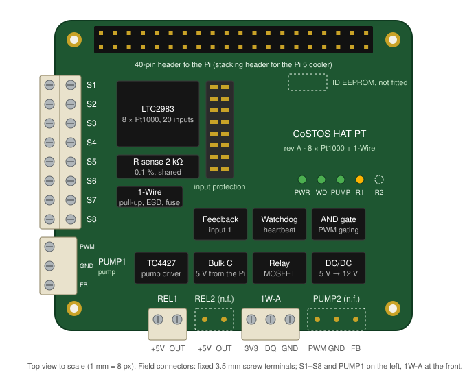

# CoSTOS HAT: PT edition (8 × Pt1000)

For installations that keep their Pt1000 sensors: a controller such as
the RESOL BX Plus measures every sensor as a 2-wire Pt1000, and those
sensors already sit in their sleeves with their cables in place. One
1-Wire bus stays on the board, so DS18x20 sensors can still be added.

Status: **planned as the second board**, after the 1-Wire edition. The
reference installation plans to use it (see
[installation.md](installation.md#sensors-and-outputs-in-use)).

This page describes only what differs from the 1-Wire edition; everything
else (power, pump output, watchdog, relay, LEDs, terminals for PUMP1 and
REL1, manufacturing) is the same and described in
[HAT-1wire.md](HAT-1wire.md). Which HAT to choose: [HAT.md](HAT.md). Why
the LTC2983 and the other decisions:
[HAT-development.md](HAT-development.md).



## 1. What differs from the 1-Wire edition

| | 1-Wire edition | PT edition |
|---|---|---|
| Pt1000 inputs | 1 (PT1, MAX31865), PT2 footprint not fitted | **8 (S1–S8) on one LTC2983**, each wired independently |
| 1-Wire | 2 buses (GPIO4, GPIO17) | **1 bus (1W-A, GPIO4)**: same circuit (4.7 kΩ pull-up, 100 Ω series resistor, ESD diode, polyfuse) |
| Sensor terminals | PT1 2-way, 1W-A and 1W-B 3-way, all on the left edge | **one two-level block, 8 positions** (upper and lower level of position *n* are the two wires of sensor S*n*) on the left edge, plus 1W-A 3-way at the front |
| SPI | CE0 (CE1 for PT2) | CE0 for the LTC2983 |
| Extra GPIOs | | LTC2983 /RESET on GPIO22 (pin 15), INTERRUPT (conversion done) on GPIO27 (pin 13) |
| Everything else | 12 V, PUMP1/2 (transistor chain), REL1/2, watchdog, feedback, readback, header, EEPROM footprint | **identical** |

## 2. Pt1000 inputs (LTC2983)

- **One LTC2983** (LQFP-48, 7 × 7 mm) on 3.3 V, so its SPI levels match
  the Pi. Decoupling and reference capacitors as in the datasheet.
- **Shared sense resistor:** one 2 kΩ 0.1 %, low-drift resistor on CH1/CH2
  serves all eight sensors; the measurement is ratiometric against it.
- **Each sensor independent:** in the datasheet's standard 2-wire
  configuration every RTD uses two inputs, so S1–S8 use 16 of the
  remaining 18 inputs (2 spare). A broken cable or sensor only loses that
  sensor. The "18 RTDs in a series stack" trick from Analog Devices'
  design note is deliberately **not** used: there a single broken cable
  stops the current for every sensor.
- **Excitation current** chosen for Pt1000 per the datasheet (around
  100 µA), so the voltages stay well inside the input range up to the
  collector's 208 °C stagnation temperature.
- **Protection:** the inputs are buffered (high impedance), so each
  terminal wire gets a series resistor and an ESD diode without
  distorting the reading.
- **Built in:** Pt1000 linearisation, result in °C, and fault reporting per
  sensor (open, short, out of range).

## 3. Raspberry Pi configuration

As in [HAT-1wire.md 6](HAT-1wire.md#6-raspberry-pi-configuration), with these differences:

```ini
dtparam=spi=on
dtoverlay=w1-gpio,gpiopin=4
# no second w1-gpio line (GPIO17 is unused on the PT edition)
gpio=24,25,5=op,dl
# PWM output readback: inputs with pull-down
gpio=6,26=ip,pd
gpio=22=op,dh   # LTC2983 /RESET released
gpio=27=ip,pu   # LTC2983 INTERRUPT (conversion done)
```

## 4. Software

- The board edition is chosen in the setup wizard (Settings → Hardware);
  sensor S*n* is LTC2983 channel pair *n*, the 1-Wire probes are assigned
  by their ROM ID as on the 1-Wire edition.
- At start CoSTOS writes the channel assignment words (sensor type
  PT-1000, 2-wire, shared sense resistor, excitation current) and the
  sense resistor value; nothing needs to be stored on the chip, so the
  LTC2984's EEPROM brings no benefit.
- Once per second: start a multi-channel conversion, wait for INTERRUPT,
  read the eight results in °C with their fault bits. Faults map onto
  the same sensor-fault handling and glitch counters as every other
  sensor (ARCHITECTURE section 5.1).

## 5. Space and cost

- **Space:** one 7 × 7 mm chip, the sense resistor, 16 protection
  resistors and ESD diodes fit comfortably where the 1-Wire edition has
  PT1, PT2, the DS2482 footprint and the second 1-Wire bus (see the
  mockup).
- **Cost** (estimates, comparison in [HAT-development.md 4](HAT-development.md#4-pt-edition-choice-of-measuring-chip-d13), assembly model in [HAT-1wire.md 8.2](HAT-1wire.md#82-fully-assembled-rough-estimate)):
  **≈ €149 for one** (smallest assembled order, 2 boards), about €58 per
  board in a batch of 5, about **€63.60 in single-quantity parts** (without
  the power input, D18, with the transistor driver chain, D22):

| Part | Qty | ≈ € |
|---|---|---|
| LTC2983 (8 × Pt1000; DigiKey $39.06 for one) | 1 | 39.00 |
| PCB, ⅓ of an AISLER set of 3 (≈ €19) | — | 6.50 |
| 3.5 mm fixed screw terminals: two-level 8-position block, REL1, PUMP1, 1W-A | 4 | 4.00 |
| Resistors and capacitors, about 45 (incl. the 2 kΩ 0.1 % sense resistor and 16 protection resistors) | — | 3.80 |
| B0512S-1WR3 DC/DC | 1 | 3.00 |
| 40-pin stacking header and 4 spacers | 1 | 3.00 |
| PESD5V0 ESD diodes (16 Pt1000 wires, 1-Wire, FB1) | 18 | 1.80 |
| TPS22918 | 1 | 0.60 |
| LEDs (PWR, WD, PUMP1, R1) | 4 | 0.65 |
| 74LVC1G123 | 1 | 0.40 |
| SMBJ13A | 1 | 0.20 |
| Pump driver transistors: MMBT3904 × 3, MMBT3906 × 1 (D22) | 4 | 0.08 |
| 100 mA polyfuse | 1 | 0.20 |
| AO3400A, 1N4148W | 2 | 0.20 |
| **Total** | | **≈ 63.60** |

  The LTC2983 is more than half of it; everything apart from the
  converter chip costs about €5 more than on the 1-Wire edition
  ([HAT-1wire.md 8.1](HAT-1wire.md#81-cost-estimate-rev-a-as-fitted-per-board)), for the bigger terminal block and the protection of the
  16 sensor wires.
- **Sourcing:** LCSC rarely has the LTC2983 in stock. For JLCPCB assembly
  the chips are bought at DigiKey (≈ €39) and consigned to JLCPCB, or
  AISLER assembles with EU-sourced parts.

