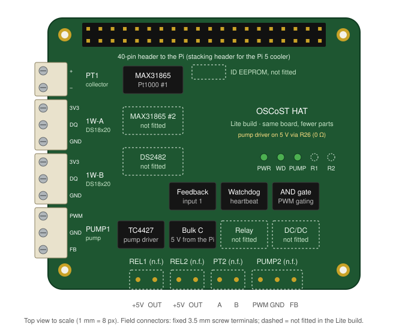

# OSCoST HAT: specification

Status: **specification agreed, rev A not yet designed**. This page
defines what the HAT has to do before anything is drawn in KiCad. The
decisions behind it are listed at the end.

The HAT combines the circuits from [Hardware needed](HARDWARE.md) on one
board that plugs onto the 40-pin header. No stripboard version is built
for the reference installation, so HAT rev A is the first hardware on the
real system: the bring-up plan (section 9) tests every block on its own,
and the pump only gets connected once its output and the watchdog have
been checked on the bench.

The HAT comes in **two editions** that share everything except the
sensor inputs, plus a cheaper **Lite build** of the first
([section 12](#12-lite-build-decided-d19)):

- **1-Wire edition** (sections 1–10): 1 Pt1000 input (collector) plus two
  1-Wire buses for DS18x20 sensors. For new installations and anyone
  replacing their sensors.
- **PT edition** ([section 11](#11-pt-edition-8--pt1000)): 8 Pt1000
  inputs on one LTC2983 plus one 1-Wire bus, for installations that keep
  their existing Pt1000 sensors, as most commercial controllers use them,
  and still want to add DS18x20 sensors.

---

## 1. Scope

**On the HAT** (low voltage only, 3.3 V / 5 V / 12 V):

- PWM pump outputs with feedback inputs
- Pt1000 temperature inputs
- 1-Wire bus for DS18x20 sensors
- Control outputs for external relays / SSRs
- **No power input** (D18): the Pi is powered by its own USB-C supply and
  the HAT takes its few hundred mA from header pins 2/4, like any HAT
- Hardware watchdog that switches all relay outputs off when the software
  stops
- Protection on every connection that leaves the board, status LEDs

**Not on the HAT, deliberately:**

- **Anything with 230 V.** The pump's mains supply and an optional relay
  or SSR stay off the board (ARCHITECTURE 5.6). The HAT only sends a relay
  a low-voltage control signal.

## 2. Target boards and form factor

| | |
|---|---|
| Boards | Raspberry Pi 4, Raspberry Pi 5 |
| Size | Raspberry Pi HAT: 65 × 56.5 mm, 4 × M2.5 mounting holes matching the Pi |
| Header | 40-pin female stacking header with tall spacers (≈ 16–17 mm) for every board (D16): clears the Pi 5 active cooler and most passive heatsinks, and works on a Pi 4 too |
| Connectors | Field connections on the left and bottom edges, fixed 3.5 mm screw terminals (see 7) |
| Component height | Low enough for a standard enclosure; the DC/DC module is the tallest part |
| ID EEPROM | Footprint for the Raspberry Pi HAT ID EEPROM on pins 27/28, not fitted in rev A (D6) |

### Mockup

Top view to scale. The placement shows that everything fits; the real
layout is done in KiCad.


On a Pi 5, top and side view: the HAT covers the left 65 mm, Ethernet and
USB stay free, sensors leave to the left and the pump cable to the front.
Heights are approximate and get fixed in KiCad.


### 2.1 Considered: Waveshare ESP32-P4-WIFI6-DEV-KIT

The Waveshare ESP32-P4-WIFI6-DEV-KIT has the Pi form factor and a
40-pin header, so a microcontroller version could in principle use the
same HAT. The pin maps were checked against each other (header
silkscreen and the board schematic, November 2026):

- 5 V, 3.3 V and GND are on the same pins as on the Pi.
- The board's 3.3 V buck (MP1658, 3 A) has plenty of headroom; the HAT
  needs under 50 mA.
- The USB inputs appear to be ORed through a P-MOSFET and a Schottky
  diode. Same rule as on the Pi: one supply at a time.
- I²C (pins 3/5, GPIO7/8) is shared with the on-board audio codec. It
  only matters if the DS2482 is ever fitted.

Three HAT signals land on pins the P4 board uses itself:

| HAT signal | Pi header pin | P4 GPIO there | Used on the P4 board for | Free P4 pin instead |
|---|---|---|---|---|
| SCLK | 23 | GPIO0 | 32.768 kHz crystal (via R29, 0 Ω) | 37 (GPIO47) |
| REL1 | 22 | GPIO1 | 32.768 kHz crystal (via R33, 0 Ω) | 31 (GPIO26) |
| PWM2 (unfitted) | 35 | GPIO53 | audio amplifier enable (via R73, 0 Ω) | 33 (GPIO48) |

There are two ways to fit the HAT to the P4:

- **Move the three signals.** The HAT then no longer works on a Pi,
  because the Pi's SPI clock is fixed to pin 23.
- **Remove R29/R33 on every P4 board.** This costs the board's RTC
  crystal, and PWM2 still has to move.

**Decision D14: OSCoST stays on the Raspberry Pi.** More people already
own one, and Linux gives more flexibility for the web interface,
VictoriaMetrics buffering, updates and add-ons. The P4 stays a possible
later port. If it is ever done, the "move the three signals" variant
above is the starting point. The full cost and capability comparison of the Pi
against the ESP32-S3, RP2350 and ESP32-P4, and the P4 boards considered,
are in [ARCHITECTURE 13](ARCHITECTURE.md#13-platform-comparison-pi-or-microcontroller).

## 3. Block diagram

```
                40-pin header
 ┌──────────────────┼──────────────────────────────────────────────────────┐
 │                  │                                                      │
 │  5 V from the Pi (pins 2/4) ─► bulk capacitor, power LED ─► HAT         │
 │  5 V ──► DC/DC 5→12 V ──► 12 V ─┐                                       │
 │                                 ▼                                       │
 │  PWM1 ─► AND ─► TC4427 ch A ─► R ─► TVS ─────────────────────► Pump 1   │ PWM / GND / FB
 │  PWM2 ─► AND ─► TC4427 ch B ─► R ─► TVS ─────────────────────► Pump 2   │ PWM / GND / FB
 │          ▲                                                              │
 │  FB1, FB2 ◄── R/C filter ◄── pull-up 3.3 V ◄─────────────────── Pumps   │
 │          │                                                              │
 │  HEARTBEAT ─► watchdog (retriggerable monostable) ─► WD_OK ─┐           │
 │                                                            ▼           │
 │  REL1..2 ─────────────────────────────► low-side MOSFETs ◄─ relay supply ├──► external SSR / relay
 │                                                                         │
 │  SPI ─► MAX31865 #1, #2 (Pt1000) ◄──────────────────────────── sensors  │
 │  GPIO 4, 17 ─► pull-ups ─► 1-Wire bus A, B ◄────────────────── DS18x20  │
 │                                                                         │
 │  LEDs: power, watchdog OK, pump 1, relay 1, relay 2                     │
 └─────────────────────────────────────────────────────────────────────────┘
```

### Circuit diagrams (rev A)

Drawn from this specification as a reference for the KiCad project; the
KiCad schematic will be the reference for the board itself. Faded parts
are footprints that are not fitted in rev A. Regenerate with
`python3 tools/hw/hat_schematic.py docs/img`.


Part choices the drawings add to the text below (all to be confirmed
when the BOM is made): relay supply switch TPS22918; AND gates 74LVC1G08; relay
MOSFETs AO3400A with 1N4148W flyback diodes; ESD diodes PESD5V0 on the
sensor inputs; 100 mA polyfuse for the 1-Wire sensor supply; a 1.5 kΩ
minimum load on the 12 V output, which keeps the unregulated DC/DC below
the 13 V TVS standoff at light load.

## 4. Functions

### 4.1 PWM pump outputs

- **Two output positions**, one per TC4427 channel. **Rev A fits only
  PUMP1** (solar pump). PUMP2 (its series resistor, TVS, AND gate,
  feedback parts and terminal) stays unfitted, as a spare for a later
  store-loading or heating pump (D2).
- **Fitted in any case:** the 100 kΩ pull-down on the TC4427's channel B
  input, so the unused input is held low and never floats.
- Same circuit as the [12 V driver board](HARDWARE.md#option-1-driver-board-12-v):
  TC4427 from a 5 V → 12 V DC/DC, 470 Ω series resistor, P6KE15A-class
  TVS (SMD equivalent with the same breakdown voltage, e.g. SMBJ13A; not
  lower, since the unregulated 12 V can reach 13.5 V), 100 kΩ pull-down at
  the input (D1).
- **Watchdog gating:** each PWM signal passes an AND gate with `WD_OK`, so
  a stopped watchdog also forces the PWM to 0 %. With a solar (PWM2)
  pump that means "stop", in addition to the relay cutting its mains.
  (For heating-profile pumps 0 % means full speed; there the relay is
  what stops them. The documentation for the outputs must say so.)
- Per output a 3-way terminal: **PWM, GND, FB**, in the cable's order
  (brown, blue, black).

### 4.2 Pump feedback inputs

- One per PWM output (FB2 unfitted in rev A, with PUMP2). Same circuit as on the stripboard: 4.7 kΩ
  pull-up to 3.3 V at the terminal, 10 kΩ series resistor, 1 nF to GND at
  the GPIO.
- Optional per output in software; an unconnected input reads as
  constant high and is ignored.

### 4.3 Pt1000 inputs

- **Two MAX31865 positions** (SSOP-20, hand-solderable), each with its own
  4.3 kΩ 0.1 % reference resistor, the input filter from the datasheet and
  ESD protection on the terminal. **Rev A fits only #1 (PT1, collector).**
  #2 and its PT2 terminal stay unfitted: a second collector sensor, the
  hot flow line or precise heat metering can be added later without a new
  board.
- **The collector needs a Pt1000:** the cable to the roof usually has only
  two wires, which is exactly what a Pt1000 needs. A DS18x20 would need
  three (normal powered mode) and only goes up to 125 °C. The cable's
  resistance shows up as a small fixed offset (about 0.25 K for 20 m of
  0.75 mm²), corrected by the per-sensor calibration value.
- 2-wire connection by default; solder jumpers for 3-wire sensors.
- On SPI0, with the two hardware chip selects: CE0 (pin 24) for #1, CE1
  (pin 26) for #2.
- The `DRDY` outputs are not connected; OSCoST polls once per second.

### 4.4 1-Wire bus

- **Two independent 1-Wire buses**, driven by the kernel's `w1-gpio`
  driver: bus A on GPIO 4 (pin 7), bus B on GPIO 17 (pin 11). Up to about
  5 sensors per bus. A fault on one bus (damaged cable, short) only takes
  out the sensors on that bus.
- Per bus: 4.7 kΩ pull-up to 3.3 V, ESD protection on DQ, and a 3-way
  terminal (3V3, DQ, GND).
- **Sensors run in normal powered mode** (3 wires: 3V3, DQ, GND), never in
  parasite mode, which is unreliable at high temperatures and with several
  sensors converting at once.
- 3.3 V sensor supply with a polyfuse, shared by both buses.
- **Fallback: DS2482-100 footprint, not fitted.** An I²C-to-1-Wire bridge
  on I2C1 (pins 3/5) with active pull-up, for the case that long cables or
  the Pi 5's GPIO cause trouble. Fitting it (and moving the buses to it)
  needs no new board.

### 4.5 Relay / SSR control outputs

- **Two output positions, rev A fits only REL1** (solar pump mains).
  REL2 (MOSFET, flyback diode, LED, terminal) stays unfitted; its gate
  pull-down is fitted so the GPIO line is defined.
- Each is a low-side N-MOSFET switching the negative side
  of an external SSR input or relay coil; the positive side comes from
  the HAT's **relay supply** (5 V).
- The relay supply is switched by the watchdog (4.6): without a heartbeat,
  every relay output is off, whatever the GPIOs do.
- Flyback diode per output (for relay coils), gate pull-down so outputs
  are off while the Pi boots, LED per output.
- Intended load: a DIN-rail SSR with a 3–32 V DC control input
  (typically under 20 mA), or a 5 V relay coil up to about 100 mA.
- 2-way terminal per output: **+5 V (switched)** and **OUT**.

### 4.6 Hardware watchdog

- OSCoST toggles a **heartbeat GPIO** once per successful control cycle
  (sensors read, decision made, outputs written).
- A **retriggerable monostable** (e.g. 74LVC1G123) keeps `WD_OK` high as
  long as edges keep arriving; about 2–3 s without an edge and `WD_OK`
  drops. A GPIO stuck high or stuck low counts as "no heartbeat", because
  only edges retrigger it. The 74LVC1G123 retriggers on rising edges
  only: with one toggle per 1 s control cycle a rising edge arrives every
  2 s, so the timeout is set to about 3 s.
- `WD_OK` switches the relay supply (high-side load switch) and gates the
  PWM signals (4.1).
- After power-up `WD_OK` is low until the software starts sending
  heartbeats, so nothing runs while the Pi boots.
- LED "watchdog OK". A test point and a jumper to disable the gating for
  bench tests (clearly marked, open by default).
- **Why it is worth the ~€3:** the Pi's own hardware watchdog and systemd
  catch a hung kernel or a crashed OSCoST, but not a fault in the
  switching hardware. Where a cut-off relay or SSR is used (option C), an
  SSR that fails short-circuited would leave the pump powered; the
  watchdog-gated PWM is then a second, independent way to stop it (0 % =
  stop with a PWM2 pump), and the feedback input shows that it happened
  (D8).
- **With a permanently powered pump (D15, option A) the gated PWM is the
  only stop path**, which makes this circuit the main hardware safety
  layer rather than a backup.
- This is the "external heartbeat" layer from
  [Safety](ARCHITECTURE.md#41-hardware-layer-independent-of-software); the
  SoC watchdog and the systemd watchdog remain in addition.

### 4.7 Power: from the Pi (D18)

The HAT has **no power input**. The Pi runs from its own USB-C supply
(D15), and the HAT takes its 5 V from header pins 2/4 and its 3.3 V from
pins 1/17, like any HAT. Its 5 V therefore sits behind the Pi's own input
protection, so the HAT needs no fuse, TVS or ideal diode of its own; it
only has a bulk capacitor and a power LED on its 5 V rail.

- **Supply:** the official Raspberry Pi USB-C supply (27 W for the Pi 5,
  15 W for the Pi 4) or an equivalent. The Pi 5 negotiates 5 A over USB
  power delivery, so no `PSU_MAX_CURRENT` setting is needed.
- **DIN-rail builds** (ARCHITECTURE 5.6 options B/C): a 5 V DIN-rail
  supply feeds the Pi through a short USB-C lead (5.1 V, 3 A for a Pi 4,
  5 A for a Pi 5; a Pi 5 on a plain USB-C lead without power delivery
  needs `PSU_MAX_CURRENT=5000` in its bootloader configuration).
- **Earlier design** (rev A drafts before D18): a PWR terminal with fuse,
  TVS and an LM74700 ideal diode powered the Pi through the header. It was
  dropped because option A never uses it; it saved about €4 and nine parts.

### 4.8 Status LEDs

The LEDs are OSCoST's only local display (no screen, general rule). All
of them are driven by hardware and show the real state even if the
software is wrong; none needs an overlay or any software.

| LED | Colour | Driven by | Shows |
|---|---|---|---|
| PWR | green | 5 V rail | the HAT has power |
| WD | green | watchdog output WD_OK | heartbeat seen, outputs enabled (4.6) |
| **PUMP1** | green | TC4427 output via 4.7 kΩ | what really reaches the pump: off = stop, brighter = faster |
| R1 | yellow | relay output 1 | relay or SSR switched on |
| PUMP2, R2 | | | only with the unfitted second channels |

Alarms are shown on the web page, as metrics and (optionally) over MQTT,
not on an LED. The LEDs face up; a closed enclosure needs a window or
light pipes above them.

### 4.9 Power budget

| Rail | Source | Users | Estimated current |
|---|---|---|---|
| 5 V | Pi header pins 2/4 (from the Pi's USB-C supply) | DC/DC, relay supply, LEDs | HAT < 200 mA with a relay coil, < 100 mA with an SSR (per extra fitted relay output up to +100 mA) |
| 12 V | DC/DC on the HAT (1 W) | TC4427, PWM outputs | < 30 mA |
| 3.3 V | Pi header pins 1/17 | MAX31865 × 2, DS18x20 sensors, pull-ups | < 30 mA |

## 5. Pin assignment

The same on the Raspberry Pi 4 and Pi 5. Only the PWM chip and channel
numbers behind GPIO 18/19 differ, which is software configuration.

| Function | Header pin | Pi 4 | Pi 5 |
|---|---|---|---|
| 1-Wire bus A | 7 | GPIO 4 | GPIO 4 |
| 1-Wire bus B | 11 | GPIO 17 | GPIO 17 |
| I²C SDA / SCL (DS2482, only if fitted) | 3 / 5 | I2C1 | I2C1 |
| SPI MOSI / MISO / SCLK | 19 / 21 / 23 | SPI0 | SPI0 |
| SPI CE0 (MAX31865 #1) | 24 | GPIO 8 | GPIO 8 |
| SPI CE1 (MAX31865 #2, only if fitted) | 26 | GPIO 7 | GPIO 7 |
| PWM 1 | 12 | GPIO 18, PWM0 channel 0 | GPIO 18, RP1 PWM0 channel 2 |
| PWM 2 (only if fitted) | 35 | GPIO 19, PWM0 channel 1 | GPIO 19, RP1 PWM0 channel 3 |
| Feedback 1 | 16 | GPIO 23 | GPIO 23 |
| Feedback 2 (only if fitted) | 36 | GPIO 16 | GPIO 16 |
| Heartbeat | 18 | GPIO 24 | GPIO 24 |
| Relay 1 | 22 | GPIO 25 | GPIO 25 |
| Relay 2 (only if fitted) | 29 | GPIO 5 | GPIO 5 |
| ID EEPROM | 27 / 28 | ID_SD / ID_SC | ID_SD / ID_SC |
| 5 V (Pi → HAT) | 2, 4 | | |
| 3.3 V | 1, 17 | | |
| GND | 6, 9, 14, 20, 25, 30, 34, 39 | | |

The config below enables both PWM channels and all relay pins, so a later
fitted PUMP2 or REL2 needs no configuration change. Both PWM channels need a two-channel PWM overlay. Which one works on the
Pi 5 (`pwm-2chan` or two `pwm` entries) is checked during bring-up; see
also [Testing the output](HARDWARE.md#testing-the-output).

## 6. Raspberry Pi configuration

What has to be enabled on the Pi for the HAT. The OSCoST installer will
set this up; listed here so it can be checked by hand.

**`/boot/firmware/config.txt`**

```ini
# SPI0 for the two MAX31865 (CE0, CE1)
dtparam=spi=on
# Two 1-Wire buses for the DS18x20 sensors (external pull-ups on the HAT;
# no "pullup" parameter, which would mean parasite power)
dtoverlay=w1-gpio,gpiopin=4
dtoverlay=w1-gpio,gpiopin=17

# Relay outputs and heartbeat: outputs, driven low as early as possible
gpio=24,25,5=op,dl

[pi4]
# Two hardware PWM channels on GPIO 18 / 19
dtoverlay=pwm-2chan,pin=18,func=2,pin2=19,func2=2
# The Pi 4's analog audio uses the same PWM hardware
dtparam=audio=off

[pi5]
# RP1 PWM0 channels 2 / 3 on GPIO 18 / 19 (verify during bring-up)
dtoverlay=pwm-2chan

[all]
```

**Not needed:**

- No I²C, unless the optional DS2482 is fitted (then `dtparam=i2c_arm=on`
  instead of the two `w1-gpio` lines).
- No overlays for the feedback inputs: they are read as GPIO edge events
  through the GPIO character device.
- With the ID EEPROM fitted later (D6), the overlays above could be
  loaded automatically.

**Also on the system side:**

- The OSCoST service user needs access to `/dev/gpiochip*`, `/dev/spidev0.*`,
  `/sys/bus/w1` and `/sys/class/pwm` (groups `gpio` and `spi` on Raspberry
  Pi OS).
- The SoC hardware watchdog is armed through systemd
  (`RuntimeWatchdogSec=` in `/etc/systemd/system.conf`), in addition to the
  HAT's own watchdog.

## 7. Field connectors

22 terminal positions don't fit along one 65 mm edge: at 5.08 mm pitch
they would need about 112 mm. So the connectors use **fixed 3.5 mm screw
terminals** on **two edges**, as in the [mockup](#mockup):

- **Left edge** (everything that is normally wired, D17): PT1, 1W-A,
  1W-B, PUMP1. The PT edition: the S1–S8 block and PUMP1.
- **Front (bottom) edge** (rarely used or not fitted): REL1, REL2, PT2,
  PUMP2 (REL2, PT2 and PUMP2 not fitted in rev A). The PT edition: REL1,
  REL2, 1W-A, PUMP2. There is no power terminal (D18).
- The top edge holds the 40-pin header. The right edge stays free: on the
  Pi, the USB and Ethernet sockets sit right next to it.

**Where the field terminals go (decided: B, D17).** With the Pi powered
over USB-C (D15) the USB-C cable leaves at the front edge. Moving PUMP1 to
the left edge puts all wiring that is normally used on one side and
leaves the front to the USB-C plug and to REL1, which option A doesn't
use. (The drawing still shows the PWR terminal, dropped later by D18.) The three arrangements compared (1-Wire edition):


Fixed means one block per connector, soldered to the board, with the
cable screwed straight into it. Pluggable terminals (a soldered socket and
a removable screw plug) would let the HAT come off without undoing any
wire, but cost about €4 more per board; for a controller that stays in its
cabinet that isn't worth it (D10). To swap the Pi or the HAT, label the
wires and unscrew them.


All labelled on the silkscreen:

| Connector | Pins | Function |
|---|---|---|
| PUMP1 | PWM, GND, FB | pump 1 signal cable (brown, blue, black) |
| PUMP2 | PWM, GND, FB | pump 2 signal cable (not fitted in rev A) |
| PT1 | +, − | Pt1000 sensor 1 (collector) |
| PT2 | +, − | Pt1000 sensor 2 (not fitted in rev A) |
| 1W-A, 1W-B | 3V3, DQ, GND | DS18x20 sensors |
| REL1 | +5V, OUT | relay / SSR 1, optional: cut-off relay (option C), heating-profile pump, valve |
| REL2 | +5V, OUT | SSR / relay 2 (not fitted in rev A) |

## 8. Manufacturing

- **Design tool:** KiCad. Project in `hardware/hat/` in this repository,
  with schematic, layout, and Gerber/BOM exports for each released
  revision.
- **Manufacturer:** AISLER (Germany). 2-layer, 1.6 mm, HASL, Budget
  service. Their price is a job fee plus a price per cm² and board; for a
  65 × 56.5 mm board (about 37 cm²) a set of 3 bare boards is about
  €19 net at the time of writing (check their current pricing).
- **Design rules:** AISLER's KiCad design rules, imported before routing.
- **Assembly: delivered fully soldered (D7).** All SMD parts on the top
  side only (one-sided assembly is the cheap option at every assembler),
  through-hole only for the terminals, the 40-pin header and the DC/DC.
  Parts are chosen from what the assembler stocks: for JLCPCB that means
  LCSC part numbers in the BOM, "basic" parts where possible, since every
  other part type adds a feeder fee. Packages stay hand-solderable (0805,
  SOIC, SSOP), so a board can still be repaired or built by hand.
- **Assembler:** decided on real quotes once the KiCad BOM exists: AISLER
  (boards and assembly from Germany) against JLCPCB (cheapest for small
  runs, ships from China).
- **Checks before ordering:** KiCad ERC and DRC clean, every net compared
  against the stripboard circuits, footprints of the MAX31865, DS2482 and
  DC/DC checked against their datasheets, a 1:1 paper print to check
  connector and mounting-hole positions on the real Pi.

### 8.1 Cost estimate (rev A as fitted, per board)

Single-quantity distributor prices without VAT, at the time of writing.
Only the MAX31865 price is checked (DigiKey, €8.76 for one); the rest are
estimates until the BOM exists. Unfitted positions are not counted, nor
are the Pi, its USB-C supply, an optional relay and the sensors.

| Part | Qty | ≈ € |
|---|---|---|
| MAX31865AAP+ (Pt1000 converter) | 1 | 8.80 |
| PCB, ⅓ of an AISLER set of 3 (≈ €19) | — | 6.50 |
| B0512S-1WR3 DC/DC | 1 | 3.00 |
| 40-pin stacking header and 4 spacers | 1 | 3.00 |
| 3.5 mm fixed screw terminals (PT1, 1W-A, 1W-B, PUMP1, REL1) | 5 | 2.50 |
| Resistors and capacitors, about 25 (the 0.1 % 4.3 kΩ is about €0.80 of it) | — | 2.50 |
| TC4427 | 1 | 1.30 |
| TPS22918 | 1 | 0.60 |
| LEDs (PWR, WD, PUMP1, R1) | 4 | 0.65 |
| 74LVC1G123 | 1 | 0.40 |
| SMBJ13A | 1 | 0.20 |
| PESD5V0 ESD diodes | 4 | 0.40 |
| 74LVC1G08 | 1 | 0.20 |
| 100 mA polyfuse | 1 | 0.20 |
| AO3400A, 1N4148W | 2 | 0.20 |
| **Total** | | **≈ 30** |

Without the power input (D18); with it the list came to ≈ €34. The watchdog with AND gate and relay supply switch is about €1.50–2 of
this (D8). Pluggable terminals would add about €4 (D10). The PT edition's
list is in [11.5](#115-space-and-cost).

### 8.2 Fully assembled: rough estimate

Factory assembly has fixed costs per order, so the price depends mostly
on how many boards are ordered. **Most people want one controller**, but
JLCPCB's smallest economic assembly order is 2 boards, so "price for one"
below means the total of that smallest order; the second board is a spare
(or for a friend).

Rough JLCPCB estimates, incl. shipping and 19 % import VAT, built from
their published fees (setup fee, per-joint fees for SMD and through-hole,
a feeder fee of about €2.80 per non-basic part type, a hand-soldering fee
per order) plus the parts at LCSC prices. Model: a **fixed part per
order** (≈ €60 for the normal build, ≈ €54 for the Lite build with two
non-basic part types fewer) plus a **variable part per board** (≈ €15
normal, ≈ €9.50 Lite, ≈ €49 PT edition with the consigned LTC2983).
Without the power input (D18), which also removed two non-basic part types.

**What one controller costs**, by how you get the board (estimates, all
incl. 19 % VAT; 🟢 cheapest way, 🟡 middle, 🔴 most expensive):

| How you get it | What you pay for | **1-Wire edition** | **1-Wire, Lite build** | **Lite saves** | **PT edition** |
|---|---|---|---|---|---|
| **Order it ready-made, just for you** | JLCPCB's smallest order: 2 assembled boards (the second is a spare), shipping included | 🔴 **≈ €90** | 🔴 **≈ €73** | ≈ €17 | 🔴 **≈ €158** |
| **Order it ready-made with others** | a group order of 5 assembled boards, your share | 🟢 **≈ €27** | 🟢 **≈ €20** | ≈ €7 | 🟢 **≈ €61** |
| **Build it yourself** | parts for one board plus a set of 3 bare PCBs (AISLER, ≈ €19); needs SMD soldering (fine-pitch MAX31865 / LTC2983); parts shipping not included | 🟡 **≈ €51** | 🟡 **≈ €45** | ≈ €5.50 | 🟡 **≈ €92** |

The parts lists (8.1, 11.5, 12.2) show **≈ €30 / €25.40 / €65**: that is
the parts for one board excluding VAT, with one third of the PCB set, so
it fits a group build, not someone building a single board.

Before D18 the normal build came to ≈ €105 for 2 and ≈ €165 for 5. For
one controller, the fixed costs dominate: that is why the Lite build,
with two non-basic part types fewer, saves more per order (≈ €17) than
its parts suggest (≈ €4.60). AISLER's assembly price is not estimated
here; it gets quoted with the BOM.

### 8.3 Assembly services compared

The estimates in 8.2 use JLCPCB. Other services, as published in
November 2026 (fees and promotions change often; real quotes with the
BOM decide, D7). 🟢 good for one OSCoST board, 🟡 possible, 🔴 weak.

| Service | Smallest assembled order | Fixed costs for a small order | Where | Fit for one OSCoST board |
|---|---|---|---|---|
| **JLCPCB** (Economic PCBA) | 🟡 2 boards | setup $8.18, **$3.07 per extended part type** (basic and "preferred extended" parts: none) | China | 🟢 cheapest per board today (8.2); one-sided only, which suits the HAT; LTC2983 usually consigned |
| **PCBWay** | 🟢 1 board | assembly from about $29 plus parts; passives bought with overage (min. 50 pieces) | China | 🟡 true single board; the overage on cheap passives costs little |
| **NextPCB** | 🟢 1 board | promotions for 1–10 boards: up to $200 off the SMT cost, minimum SMT cost $50 | China | 🟡 could be the cheapest single board while the promotion runs |
| **Seeed Fusion** | 🟢 1 board assembled (5 bare boards made) | setup from $25; parts from its Open Parts Library | China | 🔴 limited parts library; the MAX31865 / LTC2983 may not be in it |
| **AISLER** | 🟡 boards in sets of 3 | boards + stencil + parts + assembly fee, priced per project | Germany / EU | 🟡 no import VAT and customs handling, EU-sourced LTC2983; quote with the BOM |
| **Eurocircuits** | 🟢 1–5 boards (PCB proto) | per project; stencil included | Germany, Hungary | 🔴 usually the most expensive; best for fast EU turnaround |

**JLCPCB part categories.** The category of a part decides whether an
order pays a loading fee for it, per part *type* (not per piece):

| Category | What it is | Fee per part type (Economic PCBA) |
|---|---|---|
| **Basic** | a couple of thousand common parts, permanently loaded on the pick-and-place machines | 🟢 none |
| **Preferred extended** | popular parts that are not permanently loaded but treated like basic ones (many were basic before) | 🟢 none |
| **Extended** | everything else; a feeder is loaded just for this order | 🔴 ≈ $3 ($3.07) |

The fee is why a $0.015 capacitor that is "extended" effectively costs
$3.015 on a small order. Two catches: it applies to **Economic** PCBA only
(Standard PCBA charges about $1.53 for every part type, basic or not),
and parts move between categories, so the BOM is checked against the
current lists just before ordering.

**Design rule (D20):** in KiCad, every ordinary part (resistors,
capacitors, AO3400A, 1N4148W, LEDs, TVS and ESD diodes, terminals) is
chosen from JLCPCB's basic or preferred extended parts. Only the special
chips without such an equivalent pay the fee: MAX31865, TC4427,
74LVC1G123, 74LVC1G08, B0512S and TPS22918 (the LTC2983 of the PT edition
is consigned). That is about six fees per order instead of fifteen or
more, roughly €25–30 less per order, which matters most for a single
controller (8.2). The same rule helps at other services: fewer special
part types means less setup everywhere.

Once the BOM exists, quotes from JLCPCB, PCBWay, NextPCB and AISLER go
into 8.2.

## 9. Bring-up plan (rev A)

1. Visual check, then resistance checks between all rails before power.
2. HAT on the Pi, Pi on its USB-C supply with a USB power meter: current
   rises by well under 200 mA, power LED on.
3. 12 V and 3.3 V present on the HAT.
4. Watchdog: `WD_OK` low after boot, high while a test script toggles the
   heartbeat, low again 2–3 s after it stops.
5. Relay output REL1 with an LED/resistor as dummy load, with and without
   heartbeat.
6. PWM output PUMP1 into a 1 kΩ dummy load, then the real pump (as in
   [Connecting the pump](HARDWARE.md#connecting-the-pump)).
7. Pt1000 input with fixed resistors (1000 Ω = 0 °C, 1385 Ω ≈ 100 °C),
   then the real collector sensor on its 2-wire cable.
8. 1-Wire bus scan on both buses, with one, then five DS18x20 each. On
   the Pi 5, check that `w1-gpio` works reliably through the RP1 chip;
   otherwise fit the DS2482.
9. Repeat steps 3–8 on the other board (Pi 4 ↔ Pi 5).

## 10. Decisions

| # | Question | Decision |
|---|---|---|
| D1 | 12 V (DC/DC) or 5 V driver supply? | **12 V**: the HAT is meant to run for years; the margin is worth one DC/DC module |
| D2 | One or two PWM outputs and relay outputs? | **Two positions each, one fitted**: PUMP1 and REL1 for the solar pump; PUMP2 and REL2 stay unfitted until a second pump is added |
| D3 | How many Pt1000 inputs? | **Two on the board, one fitted**: PT1 for the collector; PT2 (MAX31865 #2, its parts and terminal) stays unfitted until needed |
| D4 | DS2482 or plain `w1-gpio`? | **`w1-gpio` on two buses** (GPIO 4 and 17), sensors in powered mode, DS2482 footprint as unfitted fallback. Keeps I²C out of normal use |
| D5 | Power the Pi from the HAT? | ~~Yes~~, replaced by D18: **no**, the Pi uses its own USB-C supply |
| D6 | Fit the HAT ID EEPROM? | **Footprint only**; fit later if automatic configuration is wanted |
| D7 | Hand assembly or factory assembly? | **Factory-assembled, delivered fully soldered**; AISLER or JLCPCB decided on quotes once the BOM exists (8.2) |
| D8 | Keep the external watchdog and PWM gating? | **Yes**: about €3 in parts. Since D15 (pump permanently powered) it is the main hardware stop path; with an optional cut-off relay it is the second, independent one, e.g. when an SSR fails short-circuited |
| D9 | Keep the MAX31865 or measure the Pt1000 more cheaply? | **Keep the MAX31865**: timing a capacitor charge with a GPIO is too inaccurate under Linux, and a small SPI ADC saves only about €6 but loses the ±45 V input protection on the roof cable and the sensor fault detection |
| D10 | Pluggable or fixed screw terminals? | **Fixed**: about €4 per board cheaper; the HAT rarely comes off, and then the wires are unscrewed |
| D11 | VBus receiver on the HAT? | **No**: VBus is only needed while the BX Plus is still connected (shadow mode, switchable phase). The existing loose adapter plugs onto pins 1, 6 and 10 on top of the stacking header until then; after the switch-over it goes away and the UART is free |
| D12 | Offer a Pt1000-only HAT? | **Yes, as a second edition** of the same board (section 11): same outline and shared KiCad sheets for power, pump, relay and watchdog; only the sensor sheet differs. Measuring chip: see D13 |
| D13 | Measuring chip for the PT edition? | **One LTC2983**: 8 independent 2-wire Pt1000 inputs (18 of its 20 inputs), excitation, fault detection and linearisation built in, result in °C, buffered inputs for simple protection. Costs a little more than 2 × ADS124S08 but needs far less analog design and software, and it frees GPIO4 for a 1-Wire bus. Comparison in 11.6 |
| D14 | Raspberry Pi or ESP32-P4 (Waveshare ESP32-P4-WIFI6-DEV-KIT, same form factor)? | **Raspberry Pi**: more people already own one, and Linux gives more flexibility. The P4 board is a possible later port; its pin check is in 2.1. On the P4, SCLK, REL1 and PWM2 would hit the RTC crystal and the audio amplifier |
| D15 | How do the Pi, the HAT and the pump get their power? | **Option A** ([ARCHITECTURE 5.6](ARCHITECTURE.md#56-230-v-side)): the Pi's own USB-C supply in a socket (most people already have one), the pump permanently on 230 V and stopped over PWM only. Cheapest, no mains wiring, no switching wear, and the pump feedback works at all times. Accepted: one stop path instead of two. REL1 stays on the board for an optional cut-off relay (option C), which heating-profile pumps always need |
| D16 | Spacer height: per board, or one for all? | **One tall height for all** (≈ 16–17 mm with a stacking header): fits the Pi 5 with active cooler or a passive heatsink, and a Pi 4; one BOM. Check that a passive heatsink stays below about 14 mm |
| D17 | Where do the field terminals go? | **Option B** (section 7): sensors and PUMP1 on the left edge, the rarely used PWR/REL1 and the unfitted positions at the front. All normally used wiring leaves on one side and the USB-C plug (D15) has the front edge to itself. Costs nothing; the left edge is then full. PT edition: S1–S8 and PUMP1 left, 1W-A at the front |
| D18 | Does the HAT need its own power input? | **No**: with option A (D15) the Pi runs from its own USB-C supply, so the PWR terminal, fuse, TVS and ideal diode were never used. Removed: about €4 and nine parts; the HAT's 5 V now sits behind the Pi's own input protection. DIN-rail builds feed the Pi through a USB-C lead (4.7). Replaces D5 |
| D19 | A separate low-cost board? | **No: a Lite build of the 1-Wire edition** (section 12): same board, without the 12 V DC/DC and the relay output; the pump driver runs on 5 V through R26 (0 Ω). Both 1-Wire buses and the PWR LED stay. Saves ≈ €4.60, as much as a dedicated Lite board would with the same parts, without a second layout, and can be upgraded. Solar-profile pumps only |
| D20 | Which parts to pick for the BOM? | **JLCPCB basic or preferred extended parts for everything ordinary** (8.3), so only the special chips pay a loading fee: about six fees per order instead of fifteen or more, ≈ €25–30 less for a small order. Checked against the current lists before ordering |

---

## 11. PT edition (8 × Pt1000)

For installations that keep their Pt1000 sensors: a controller such as
the RESOL BX Plus measures every sensor as a 2-wire Pt1000, and those
sensors already sit in their sleeves with their cables in place. One
1-Wire bus stays on the board, so DS18x20 sensors can still be added.

Status: **planned as the second board**, after the 1-Wire edition. The
reference installation plans to use it (see
[installation.md](installation.md#sensors-and-outputs-in-use)).


### 11.1 What differs from the 1-Wire edition

| | 1-Wire edition | PT edition |
|---|---|---|
| Pt1000 inputs | 1 (PT1, MAX31865), PT2 footprint not fitted | **8 (S1–S8) on one LTC2983**, each wired independently |
| 1-Wire | 2 buses (GPIO4, GPIO17) | **1 bus (1W-A, GPIO4)**: same circuit (4.7 kΩ pull-up, ESD diode, polyfuse) |
| Sensor terminals | PT1 2-way, 1W-A and 1W-B 3-way, all on the left edge | **one two-level block, 8 positions** (upper and lower level of position *n* are the two wires of sensor S*n*) on the left edge, plus 1W-A 3-way at the front |
| SPI | CE0 (CE1 for PT2) | CE0 for the LTC2983 |
| Extra GPIOs | | LTC2983 /RESET on GPIO22 (pin 15), INTERRUPT (conversion done) on GPIO27 (pin 13) |
| Everything else | 12 V, PUMP1/2, REL1/2, watchdog, AND gates, feedback, header, EEPROM footprint | **identical** |

### 11.2 Pt1000 inputs (LTC2983)

- **One LTC2983** (LQFP-48, 7 × 7 mm) on 3.3 V, so its SPI levels match
  the Pi. Decoupling and reference capacitors as in the datasheet.
- **Shared sense resistor:** one 2 kΩ 0.1 %, low-drift resistor on CH1/CH2
  serves all eight sensors; the measurement is ratiometric against it.
- **Each sensor independent:** in the datasheet's standard 2-wire
  configuration every RTD uses two inputs, so S1–S8 use 16 of the
  remaining 18 inputs (2 spare). A broken cable or sensor only loses that
  sensor. The "18 RTDs in a series stack" trick from Analog Devices'
  design note is deliberately **not** used: there a single broken cable
  stops the current for every sensor.
- **Excitation current** chosen for Pt1000 per the datasheet (around
  100 µA), so the voltages stay well inside the input range up to the
  collector's 208 °C stagnation temperature.
- **Protection:** the inputs are buffered (high impedance), so each
  terminal wire gets a series resistor and an ESD diode without
  distorting the reading.
- **Built in:** Pt1000 linearisation, result in °C, and fault reporting per
  sensor (open, short, out of range).

### 11.3 Raspberry Pi configuration

As in section 6, with these differences:

```ini
dtparam=spi=on
dtoverlay=w1-gpio,gpiopin=4
# no second w1-gpio line (GPIO17 is unused on the PT edition)
gpio=24,25,5=op,dl
gpio=22=op,dh   # LTC2983 /RESET released
gpio=27=ip,pu   # LTC2983 INTERRUPT (conversion done)
```

### 11.4 Software

- The board edition is chosen in the setup wizard (Settings → Hardware);
  sensor S*n* is LTC2983 channel pair *n*, the 1-Wire probes are assigned
  by their ROM ID as on the 1-Wire edition.
- At start OSCoST writes the channel assignment words (sensor type
  PT-1000, 2-wire, shared sense resistor, excitation current) and the
  sense resistor value; nothing needs to be stored on the chip, so the
  LTC2984's EEPROM brings no benefit.
- Once per second: start a multi-channel conversion, wait for INTERRUPT,
  read the eight results in °C with their fault bits. Faults map onto
  the same sensor-fault handling and glitch counters as every other
  sensor (ARCHITECTURE section 5.1).

### 11.5 Space and cost

- **Space:** one 7 × 7 mm chip, the sense resistor, 16 protection
  resistors and ESD diodes fit comfortably where the 1-Wire edition has
  PT1, PT2, the DS2482 footprint and the second 1-Wire bus (see the
  mockup).
- **Cost** (estimates, comparison in 11.6, assembly model in 8.2):
  **≈ €158 for one** (smallest assembled order, 2 boards), about €61 per
  board in a batch of 5, about **€65 in single-quantity parts** (without
  the power input, D18):

| Part | Qty | ≈ € |
|---|---|---|
| LTC2983 (8 × Pt1000; DigiKey $39.06 for one) | 1 | 39.00 |
| PCB, ⅓ of an AISLER set of 3 (≈ €19) | — | 6.50 |
| 3.5 mm fixed screw terminals: two-level 8-position block, REL1, PUMP1, 1W-A | 4 | 4.00 |
| Resistors and capacitors, about 45 (incl. the 2 kΩ 0.1 % sense resistor and 16 protection resistors) | — | 3.80 |
| B0512S-1WR3 DC/DC | 1 | 3.00 |
| 40-pin stacking header and 4 spacers | 1 | 3.00 |
| PESD5V0 ESD diodes (16 Pt1000 wires, 1-Wire) | 17 | 1.70 |
| TC4427 | 1 | 1.30 |
| TPS22918 | 1 | 0.60 |
| LEDs (PWR, WD, PUMP1, R1) | 4 | 0.65 |
| 74LVC1G123 | 1 | 0.40 |
| SMBJ13A | 1 | 0.20 |
| 74LVC1G08 | 1 | 0.20 |
| 100 mA polyfuse | 1 | 0.20 |
| AO3400A, 1N4148W | 2 | 0.20 |
| **Total** | | **≈ 65** |

  The LTC2983 is more than half of it; everything apart from the
  converter chip costs about €5 more than on the 1-Wire edition
  (section 8.1), for the bigger terminal block and the protection of the
  16 sensor wires.
- **Sourcing:** LCSC rarely has the LTC2983 in stock. For JLCPCB assembly
  the chips are bought at DigiKey (≈ €39) and consigned to JLCPCB, or
  AISLER assembles with EU-sourced parts.

### 11.6 Choice of measuring chip

Chips that measure several Pt1000s, compared for 8 two-wire sensors; the
last column is the 1-Wire edition with new DS18B20 probes, for comparison
with keeping the existing Pt1000 sensors. **Decided: LTC2983 (D13).** The
other options stay documented as alternatives.

Prices are single quantity at the time of writing; totals are estimates
until a real BOM exists, and LCSC stock changes daily. The totals were
made with the power input, since dropped (D18): subtract about €4 from
every column for parts, about €5 per board at 5 boards and about €15 for
the smallest order of 2 (8.2). 🟢 good,
🟡 medium, 🔴 weak.

| | **8 × MAX31865** | **2 × ADS124S08** | **2 × AD7124-8** | **1 × LTC2986** | **1 × LTC2983** (chosen) | **1-Wire edition:** 1 × MAX31865 + 7 × DS18B20 |
|---|---|---|---|---|---|---|
| ***Channels*** | | | | | | |
| Independent 2-wire Pt1000s per chip | 1 | 5 (force + sense pin each) | 7 (16 analog pins) | 🔴 4 (10 inputs, 2 per sensor + sense resistor) | 🟢 9 (20 inputs) | collector: 1; DS18B20: one chip per probe |
| Spare channels with 8 sensors | 🔴 0 | 🟡 2 | 🟢 6 | 🔴 none: 8 only as a series stack | 🟡 1 more sensor | 🟢 PT2 footprint; the buses take more probes |
| 1-Wire bus on the same board | 🔴 no: GPIO4/17 drive the chip-select decoder | 🟢 possible | 🟢 possible | 🟢 possible | 🟢 **yes, 1W-A** | 🟢 2 buses |
| ***Cost*** | | | | | | |
| Chips, LCSC | 🟡 8 × $4.27 = $34 | 🟢 2 × $6.46 = $13 | 🟢 2 × $10.47 = $21 | 🔴 $53 | 🟡 $39 | 🟢 $4.27 |
| Chips, DigiKey / Farnell EU | 🔴 8 × €8.76 = €70 | 🟢 2 × €9.94 = €20 | 🟢 ≈ €20–25 | 🟡 €34–42 | 🟡 ≈ €37–42 | 🟢 €8.76 |
| Extra parts on the board | 8 reference resistors 0.1 %, 16 ESD, decoder ≈ €8 | 2 reference resistors, 16 R + clamps + ESD ≈ €3 | like ADS ≈ €3 | 1 sense resistor, protection R ≈ €2 | 1 sense resistor, 16 protection R + ESD, 1-Wire parts ≈ €3 | pull-ups, ESD, polyfuse ≈ €1 |
| Sensor section, assembled | 🟡 ≈ €40 | 🟢 ≈ €15 | 🟢 ≈ €22 | 🔴 ≈ €50 | 🟡 ≈ €39 | 🟢 ≈ €6 |
| Rest of the board, assembled | ≈ €28 | ≈ €28 | ≈ €28 | ≈ €28 | ≈ €28 | ≈ €27 |
| New sensors and cable | 🟢 none | 🟢 none | 🟢 none | 🟢 none | 🟢 none | 🔴 7 DS18B20 probes + 2 cables ≈ €60–80 |
| **Total, assembled (5 boards, JLCPCB, incl. VAT and shipping)** | 🟡 **≈ €68** | 🟢 **≈ €43** | 🟢 **≈ €50** | 🔴 **≈ €78** | 🟡 **≈ €67** | 🟡 **≈ €33 + €60–80 = €93–113** |
| **Price for one: smallest assembled order (2 boards, JLCPCB)** | 🟡 **≈ €175** | 🟢 **≈ €125** | 🟢 **≈ €139** | 🔴 **≈ €195** | 🟡 **≈ €173** | 🟡 **≈ €105 + €60–80 = €165–185** |
| **Total, single-quantity parts (DigiKey, excl. VAT)** | 🔴 **≈ €103** | 🟢 **≈ €48** | 🟢 **≈ €50** | 🟡 **≈ €61–69** | 🟡 **≈ €69** | 🟡 **≈ €35 + €60–80 = €95–115** |
| Stock for assembly | 🟡 varies | 🟢 good (≈ 1,700 at LCSC) | 🔴 thin, one variant out | 🔴 thin | 🟡 thin at LCSC; buy at DigiKey and consign | 🟡 MAX varies; probes bought separately (fakes are common) |
| ***Function*** | | | | | | |
| Input protection | 🟢 ±45 V built in | 🟡 external parts, needs care | 🟡 external parts, needs care | 🟢 external, easy (buffered inputs) | 🟢 external, easy (buffered inputs) | 🟢 MAX ±45 V; 1-Wire ESD + polyfuse |
| Open / short detection | 🟢 fault register | 🟡 burnout current + software | 🟢 burnout + diagnostics built in | 🟢 built in, per sensor type | 🟢 built in, per sensor type | 🟡 CRC, missing probe; a short takes down its whole bus |
| Output | ratio, converted to °C in software | raw ADC codes, software does all | raw ADC codes, software does all | 🟢 °C directly, linearised | 🟢 °C directly, linearised | 🟢 DS18B20 gives °C directly |
| Range, accuracy | 🟢 Pt1000 beyond 200 °C, class B ±0.6 K at 60 °C | 🟢 same sensors | 🟢 same sensors | 🟢 same sensors | 🟢 same sensors | 🟡 ±0.5 K, max 125 °C (S4 can exceed it: fit PT2) |
| Resolution | 15-bit, ≈ 0.03 K | 24-bit | 24-bit | 24-bit, 0.1 °C accuracy | 24-bit, 0.1 °C accuracy | DS18B20 12-bit, 0.0625 K |
| Package, space | 🔴 8 × SSOP-20, tight | 🟢 2 × TQFP-32 5×5 | 🟢 2 × QFN-32 5×5 (no hand soldering) | 🟢 1 × LQFP-48 7×7 | 🟢 1 × LQFP-48 7×7 | 🟢 roomy |
| ***Effort and risk*** | | | | | | |
| Circuit design | 🟢 low: PT1 circuit × 8 | 🔴 high: analog force/sense layout | 🔴 high: like ADS | 🟢 low–medium: datasheet circuits | 🟢 low–medium: datasheet circuits | 🟢 done: schematic drawn |
| Software | 🟢 simple, driver shared with the 1-Wire edition | 🔴 most: input and current switching, settling, linearising | 🟡 medium: the sequencer helps | 🟢 simple: write channel setup, read °C | 🟢 simple: write channel setup, read °C | 🟢 simple: kernel 1-Wire + MAX driver |
| Work at the installation | 🟢 move the existing wires | 🟢 move the existing wires | 🟢 move the existing wires | 🟢 move the existing wires | 🟢 move the existing wires | 🔴 fit 7 probes, run 2 cables, set calibration offsets |
| Charts vs. history | 🟢 seamless | 🟢 seamless | 🟢 seamless | 🟢 seamless | 🟢 seamless | 🟡 small step, fixed with offsets |
| ***Verdict*** | | | | | | |
| Best for | fallback with a proven circuit, no 1-Wire | cheapest; cost-down option | spare analog inputs (other sensors) | only up to 4 independent sensors | 🟢 **PT edition: chosen** | 🟢 new installations, or when sensors get replaced anyway |

Variant not shown as a column: the 1-Wire edition with PT2 fitted, so S4
stays Pt1000 (2 Pt1000 + 6 DS18B20): about €5 more assembled, one probe
less. The LTC2984 is the LTC2983 with an EEPROM for the channel setup; it
costs more (≈ $71 at LCSC) and OSCoST doesn't need it.

**Also considered: a DiSoCon2-style divider front-end** (each Pt1000 in a
divider with a 0.1 % resistor, op-amp buffer, ADS1115; see
[ARCHITECTURE 12](ARCHITECTURE.md#12-related-projects)). For 8 sensors:
2 × ADS1115 ≈ €5–7, 8 precision resistors ≈ €1–2, 2 quad op-amps
≈ €1–3, reference ≈ €1, protection ≈ €2, so ≈ €10–15 instead of ≈ €42
for the LTC2983 section: **about €30 less per PT board** (≈ €40–45
instead of ≈ €69). On the 1-Wire edition it would save only about €5 on
the single Pt1000 (D9). Not taken, because it gives up:

- open/short **fault detection** (a broken sensor just reads extreme),
- **input protection** for the roof cable,
- **drift-free accuracy**: the ADS1115 measures against its internal
  reference, so supply and reference drift go into the reading unless a
  spare channel measures the excitation and the code works ratiometrically,
- **simple software**: divider maths, calibration and Callendar–Van Dusen
  in our code instead of °C over SPI.

Solar control would cope with ±0.5–1 K, but for a controller meant to run
10+ years the €30 is worth it.

---

## 12. Lite build (decided, D19)

The cheapest way to an OSCoST controller: **the same 1-Wire edition
board with fewer parts fitted**, not a separate board. It saves about
**€4.60 per board**, can be upgraded to the full build by soldering the
missing parts on, and needs no second layout. A dedicated Lite board was
drawn first and dropped: it saved no more money (unfitted footprints cost
nothing, and it would have had the same outline), but it needed its own
layout, parts list, tests and documentation, and had no upgrade path.



**Why no dedicated Lite board:** the comparison that decided D19, both
Lite variants against the normal build (single-quantity parts; 🟢 good,
🟡 medium, 🔴 weak):

| | **Normal HAT** (1-Wire edition) | **HAT Lite** (own board) | **Lite as build option** | **Saved: Lite (own board)** | **Saved: Lite build option** |
|---|---|---|---|---|---|
| ***What's left out*** | | | | | |
| 12 V converter + its load resistor | 🟢 12 V pump signal, large margin | 🟡 5 V, small margin (≈ 4.7 V against 4 V) | 🟡 5 V via a 0 Ω link; converter can be fitted later | **€3.05** | **€3.05** |
| Relay output REL1 (switch chip, MOSFET, diode, terminal, R1 LED) | 🟢 cut-off relay (option C), heating-profile pumps, on/off loads | 🔴 none: solar-profile pumps only | 🟡 not fitted, spot stays | **€1.55** | **€1.55** |
| Second 1-Wire bus (terminal, ESD, pull-up) | 🟢 2 buses | 🟡 1 bus | 🟡 1 fitted, 1W-B can be fitted later | **€0.65** | **€0.65** |
| PWR LED | 🟢 | 🟡 none (WD shows power too) | 🟡 not fitted | **€0.15** | **€0.15** |
| 0 Ω link for 5 V | — | — | one extra part | — | **−€0.01** |
| ***Kept on all three*** | | | | | |
| MAX31865 for the collector, watchdog + PWM gating, all field-line protection, PUMP1 with feedback, WD and PUMP1 LEDs, tall header, full outline | 🟢 | 🟢 | 🟢 | — | — |
| PT2, PUMP2, REL2, DS2482 spots for later | 🟢 | 🔴 none | 🟢 | — | — |
| ***Totals*** | | | | | |
| Parts, single quantity | ≈ €30 | ≈ €24.60 | ≈ €24.60 | **≈ €5.40** | **≈ €5.39** |
| **Price for one** (smallest assembled order: 2 boards, 8.2) | ≈ €90 | ≈ €71 | ≈ €71 | **≈ €19** | **≈ €19** |
| Assembled, per board in a batch of 5 | ≈ €27 | ≈ €19.50 | ≈ €19.50 | **≈ €7.50** | **≈ €7.50** |
| Extra design work | — | 🔴 second board, layout, parts list, tests, docs | 🟢 one extra part and a second parts list | — | — |
| Upgrade later to the full HAT | — | 🔴 buy a new board | 🟢 solder the missing parts on | — | — |

Both savings columns come out the same: the saving comes only from parts
that are not fitted, empty footprints cost nothing, and a dedicated board
would have the same outline. The dedicated board would only add a second
design to maintain and remove the upgrade path. After this comparison the
second 1-Wire bus and the PWR LED were put back into the Lite build (12.2),
so it now saves about €4.60.

### 12.1 Rule: it may fail, but it may not break anything

The Lite build may stop working; it must never leave the pump running or
damage the Pi:

1. **Every fault ends in "pump stopped".** The PWM line keeps its
   pull-down and the watchdog-gated AND gate (4.6), and the Lite build only
   supports **solar-profile pumps** (Wilo PWM2, Grundfos profile C), where
   no signal or a low signal means stop. The setup wizard refuses a
   heating profile on a Lite build.
2. **Field wiring can't reach the Pi.** The MAX31865 with its ±45 V input
   protection stays on the collector input, and every terminal keeps its
   series resistors, ESD diodes, TVS diode and polyfuse. A short or a
   swapped wire damages nothing. (230 V on a low-voltage terminal is beyond
   any HAT.)
3. **No power path of its own** (D18): powered by the Pi.
4. **The weakest part fails safe.** The pump driver runs on 5 V instead of
   12 V, so the pump sees about 4.7 V against its ~4 V threshold
   ([HARDWARE.md](HARDWARE.md#12-v-or-5-v)). If that isn't enough (long
   cable, a pump with a higher threshold), the pump simply doesn't start,
   and the feedback input reports it.

### 12.2 Normal build against Lite build

Single-quantity parts; "saved" is what the Lite build saves on that row.
🟢 good, 🟡 medium, 🔴 weak.

| | **Normal build** | **Lite build** | **Saved** |
|---|---|---|---|
| ***Left out in the Lite build*** | | | |
| 12 V DC/DC U2 with C4 and minimum load R2; R25 | 🟢 pump signal ≈ 10.6 V, large margin | 🟡 R26 (0 Ω) fitted instead: driver on 5 V, ≈ 4.7 V at the pump | **€3.05** |
| Relay output REL1: TPS22918, AO3400A, 1N4148W, terminal, R1 LED | 🟢 cut-off relay (ARCHITECTURE 5.6 option C), heating-profile pumps, on/off loads | 🔴 none: solar-profile pumps only | **€1.55** |
| R26 (0 Ω) | not fitted | fitted | **−€0.01** |
| ***The same in both*** | | | |
| MAX31865 (collector), both 1-Wire buses, watchdog + PWM gating, field-line protection, PUMP1 with feedback, PWR, WD and PUMP1 LEDs, tall header, outline | 🟢 | 🟢 | — |
| Unfitted spots for PT2, PUMP2, REL2, DS2482 | 🟢 | 🟢 | — |
| ***Totals*** | | | |
| Parts, single quantity | ≈ €30 | ≈ €25.40 | **≈ €4.60** |
| **Price for one** (smallest assembled order: 2 boards, 8.2) | ≈ €90 | ≈ €73 | **≈ €17** |
| Assembled, per board in a batch of 5 | ≈ €27 | ≈ €20 | **≈ €7** |
| Upgrade | — | 🟢 solder on U2, C4, R2, R25 (remove R26) and the REL1 parts | — |

The two 0 Ω positions R25 and R26 must **never be fitted together**: that
would short the 12 V and 5 V rails. The silkscreen marks them "12 V" and
"5 V (Lite)".

