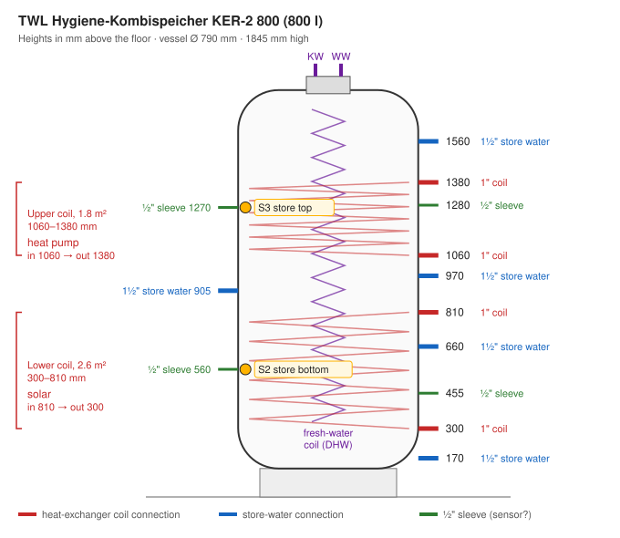

# Reference installation

This is the system OSCoST is built to control first. It is the **acceptance
spec**: OSCoST is ready to replace the existing controller when it
reproduces its behaviour for this installation (see
[Migration](ARCHITECTURE.md#9-migration-from-the-deltasol-bx-plus)).

Status: **incomplete**. Open points are listed at the end.

## Controller being replaced

- RESOL DeltaSol BX Plus, read over VBus by
  [vbus2influx](https://github.com/isarrider/vbus2influx).

## Sensors and outputs in use

From the existing Grafana dashboard on the vbus2influx data. The input
numbers are the vbus2influx field numbers (`temperature_01` …), assumed to
be BX Plus inputs S1–S8.

| Input | Name in the dashboard | Position | Role |
|---|---|---|---|
| S1 | Temp_1_Kollektor | Collector | **Control**: pump start/stop (ΔT), collector protection |
| S2 | Temp_2_Boiler_u | Store, bottom | **Control**: ΔT reference, store maximum |
| S3 | Temp_3_Boiler_o | Store, top | Display |
| S4 | Temp_4_Vorlauf | Solar flow (collector → store), at the store | Display; heat quantity once a flow value exists |
| S5 | Temp_5_Rücklauf | Solar return (store → collector), at the store | Display; heat quantity once a flow value exists |
| S6 | nach Heizung / vor Boiler | Heating circuit: after the heat generator, before the store | Measurement only |
| S7 | nach Boiler / vor Haus | Heating circuit: after the store, before the house | Measurement only |
| S8 | nach Haus / vor Heizung | Heating circuit: after the house, back to the heat generator | Measurement only |

- The heat generator ("Heizung") is a **heat pump** today; it was a gas
  boiler when the system was installed. S6–S8 are only measured, nothing
  acts on them.

| Output | vbus2influx field | Use |
|---|---|---|
| Relay 1 | `relay_01` | Solar pump, mains |
| PWM A | `PWM_0_10V_A` | Solar pump, speed (PWM2) |

No other relays or outputs are in use, which matches the HAT rev A
(REL1 + PUMP1).

## Solar pump

| | |
|---|---|
| Pump | **Wilo Yonos PARA ST 15/7-50/iPWM2** (from the type plate) |
| Control | External PWM, profile **PWM2 (solar)** |
| Signal cable | 3 cores: **1 brown = PWM input**, **2 blue or grey = signal ground**, **3 black = PWM output (feedback from the pump)** |
| Input signal | 100–5000 Hz (1000 Hz nominal), high level from about 4 V; max. 15 V for Yonos PARA (24 V on the newer Para series). 12 V fits both. |
| Feedback output | open collector, 75 Hz, duty cycle = pump status (see below) |
| Cable break | Pump stops (active stop mode) |

Earlier versions of this page listed a Yonos PARA ST 15/7.0-PWM2. The type
plate says **iPWM2**: the same solar profile, plus a feedback output on a
third wire.

### PWM2 input characteristic

| PWM input | Pump |
|---|---|
| < 7 % | active stop mode (also on cable break) |
| 7–15 % | minimum speed while running |
| 12–15 % | starting band: the pump starts from standby only above this |
| 15–95 % | speed rises linearly from minimum to maximum |
| > 95 % | maximum speed |

### Feedback output (black wire)

Open collector on the pump side (470 Ω in series), high level 3–25 V
supplied by the controller's pull-up, low ≤ 1 V, at most 1 mA in normal
operation. 75 Hz, duty cycle accurate to ±1 %. The duty cycle is the share
of time the line is high (an unpowered pump leaves it high: 100 %).

| Feedback duty | Meaning |
|---|---|
| 0 % | feedback interface damaged |
| 2 % | active stop mode, ready to start |
| 5–75 % | running; value is flow or power information |
| 80 % | running, but not at optimal performance (warning: motor overload, module over temperature) |
| 85 % | stopped by a temporary error (motor overload, over/under voltage, module over temperature); restarts by itself |
| 90 % | stopped by a temporary error (over current, over speed, turbine mode); restarts by itself |
| 95 % | stopped by a permanent failure (blocked rotor, driver fault, motor windings) |
| 100 % | pump has no power, or feedback interface damaged |

Source: Wilo, *Wilo-Para iPWM Communication Protocol*, technical guide V1.01.
Dry running and the deblocking routine show up as 5 % while running. Wilo
documents this table for its Para series; the Yonos PARA iPWM uses the same
VDMA 24224 interface, but **verify the values on the real pump** (2 % when
stopped, 5–75 % when running) before OSCoST relies on them.

### Consequences for OSCoST

- OSCoST preset **"Wilo PWM2"**: stop = 0 %, start at ≥ 20 %, regulate
  between 15 % (minimum) and 100 % (maximum). The 7–15 % band, where
  start/stop depends on the previous state, is never used.
- Output stage: the driver board or optocoupler module from
  [Hardware needed](HARDWARE.md#pwm-pump-output). 12 V is inside the input
  range (max. 15 V).
- Frequency: 500 Hz (the RESOL controller uses 512 Hz).
- **The feedback output gives OSCoST real pump monitoring**: confirmation
  that a stop really stopped the pump (2 %), that it runs when commanded
  (5–75 %), warnings (80 %), and errors (85–95 %), plus "no power" (100 %),
  which also detects a failed mains relay. The driver board has the input
  for it (J2 FB, see [Hardware needed](HARDWARE.md#checking-the-feedback-signal)).
- **To do on the real pump**: confirm the table with the multimeter check
  in the hardware guide (standby about 0.4 V, running in between, no
  power about 3.3 V).

## Store

One combination store (Kombispeicher) with a fresh-water coil for domestic
hot water in the centre and two heat-exchanger coils. Drawn from the
manufacturer's dimension drawing; the web interface will draw the store on
its overview page from the same data (see
[ARCHITECTURE 7.1](ARCHITECTURE.md#71-pages)), generated here by
`python3 tools/docs/store_svg.py > docs/img/store-reference.svg`.

| | |
|---|---|
| Vessel | Ø 640 mm, 1845 mm high incl. the top flange, on a 125 mm stand ring |
| Volume | probably about 500 l (to be confirmed from the type plate) |
| Fresh-water coil | centre, cold (KW) and hot water (WW) ¾" at the top |
| Coil 1 (upper) | 1" connections at 1380 and 1060 mm |
| Coil 2 (lower) | 1" connections at 810 and 300 mm |
| Store-water connections | 1½" at 1560, 970, 660, 170 mm (right) and 905 mm (left) |
| ½" sleeves | 1280, 455 mm (right); 1270, 560 mm (left) |

Still open: which coil the solar circuit uses (normally the lower one),
what feeds the other coil, which store-water connections the heating
circuit (S6–S8) uses, and which sleeves hold S2 (store bottom) and S3
(store top).

## Open points

- Sensor types (Pt1000 on every input?).
- Store: volume, coil and sleeve assignment (see [Store](#store)).
- Collector: flat-plate or evacuated tube, area.
- Heat transfer fluid: glycol or water, glycol percentage.
- Flowmeter (V40 or similar) present?
- Independent store overtemperature cut-out present?
